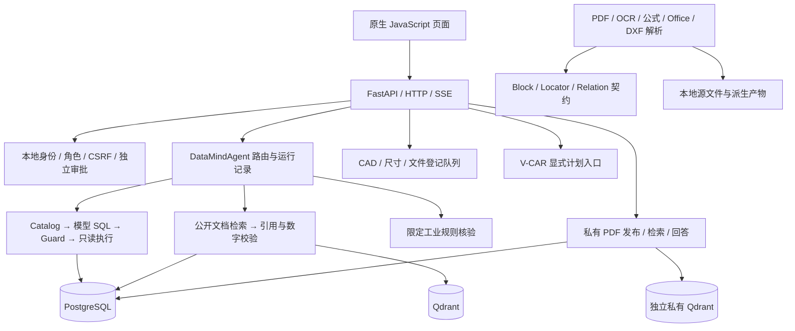

# DataMind Agent 全项目审查报告

审查日期：2026-10-08（Asia/Shanghai）  
固定代码基线：`2d9ab18d06e17f79f0ed29e3a3cf07ceb11d2842`，API `0.30.0`  
审查性质：架构与实现审查、隔离回归、针对性缺陷复现；本轮不修改业务代码。

## 1. 总体判断

**项目已形成有较强证据治理能力的本地技术原型，具备继续做受控演示和研发验证的基础；目前尚不足以作为通用、多人使用的生产问数系统。下一阶段最有价值的工作是修复权限与正确性缺口、把已有模块连成可靠链路，再扩展文件类型和模型能力。**

项目的突出优势是对“结果从哪里来、哪个版本生效、谁复核或批准、失败是否保留”投入较多：私有 PDF 发布、CAD 资产、独立审批、来源权威及证据回放都已有实质实现。相比之下，SQL 语义验证、通用解析内容保真、前端异步状态和部署默认值还存在明显薄弱点。

本轮在独立源码快照和临时元数据库副本上运行完整回归，**643/643 通过，0 失败、0 错误，耗时 160.248 秒，进程退出码 0**。但针对性复现仍确认了敏感列绕过、错误公式被接受、任务截止时间失效等问题。通过率说明已有用例稳定，不能证明所有安全边界、业务口径或真实材料泛化已经成立。

建议优先处理的四项 P1：

1. SQL Guard 的别名/CTE 作用域漏洞会绕过敏感列限制。
2. 销售额公式只检查字段是否出现，错误运算也会被赋予高置信结果。
3. PostgreSQL 与未认证公共 Qdrant 默认监听全部网卡。
4. 子进程 stdin 写入阶段不受挂钟截止时间和取消控制。

## 2. 范围、方法与证据边界

基线共跟踪 **1,513 个文件**，其中 **992 个位于第三方 `gateway/source/`**。审查遍历项目目录，重点检查第一方代码、迁移、部署、测试、样本与评测组织；第三方网关仅检查接入和部署边界，未逐文件审计其全部 Go/前端源码或依赖漏洞。

第一方 Python 解析检查覆盖 `datamind/`、`ingestion/`、`scripts/`、`db/`、`tests/` 的 **132 个文件**，均通过 AST 解析；基线有 **42 个测试文件、643 个测试方法、87 个 HTTP 路由**。另外检查了两份前端 JavaScript 和两个启动/重置 shell 的语法。

为了避免正在进行的开发影响结果，完整回归使用 `git archive 2d9ab18` 导出的快照，调用仓库的 `scripts/test_isolated.py` 创建并清理临时数据库。未启动或升级原 HTTP 服务，未执行破坏性重置，未调用外部付费模型。专项 SQL 复现只使用只读事务；其他专项主要使用合成配置、内存桩和自动清理的临时文件。没有进行生产压力测试、真实材料盲测或完整浏览器视觉验收。

本轮产物：

- [完整回归日志](</Users/caicai/DataMind Agent/reports/project_audit_20261008_2d9ab18_regression.log>)。
- [专项复现与统计结果](</Users/caicai/DataMind Agent/reports/project_audit_20261008_2d9ab18_checks.json>)。

审查期间原工作区继续变化：除最初的契约存储迁移、模块和 CLI 外，又出现契约存储测试，以及 API、契约文档和报告更新。**这些进行中内容未计入 643 项基线验收；本报告的代码行号以固定基线为准，后续编辑可能使行号移动。**

## 3. 架构与能力地图



图中不表示所有格式已进入同一上传、发布和问答链路；这是当前需要补齐的集成工作。

| 模块 | 已具备的能力 | 当前边界与评价 |
|---|---|---|
| SQL 问数 | Catalog、别名召回、审核 Join、参数绑定、只读事务、超时、有限修复 | 主链路清楚，但权限和指标语义有本轮实证缺陷；复杂 SQL 泛化未验收 |
| 公开 RAG | 词法/向量融合、显式多文件选择、版本校验、引用定位、生成后重验 | 连续原文与数字出现校验不等同于语义蕴含；摄取一致性弱于私有链路 |
| 私有 PDF | 固定源、准备产物、认证登记、冻结向量计划、outbox、租约/CAS、修复/回收、受控回答 | 是工程边界相对完整的模块；仍需统一上传/UI/任务编排和真实模型评测 |
| 工业核验与审批 | 限定温度规则、事实复核、独立批准、来源权威、冲突证据 | 合成材料与固定规则的机制验证充分；不能据此推断真实工厂泛化 |
| CAD 与尺寸 | 受控 DXF、固定历史、实体关联复核、显式测量绑定、独立审批、单条尺寸比较 | DWG、通用图纸 PDF 和真实制造授权未闭环；不代表整批质量结论 |
| 通用解析契约 | 媒体探测、Adapter 路由、七类定位、Block/Relation 校验、定位存储 | Office/DXF 已有适配；内容完整性与检索消费仍待补齐；关系持久化在工作区推进 |
| 文件任务与资源治理 | DXF/测量 JSON 队列、逐项重试、并发槽、取消、进程组终止、CPU 原语、租约原语 | PDF/OCR/Office 未统一进入队列；跨主机租约尚未全面接入实际执行路径 |
| V-CAR | 显式 DAG、独立节点并发、局部修复、共享预算、恢复接口、白名单 HTTP 执行 | 仍主要是编排基础能力；聊天中的通用跨源路由仍明确拒绝，恢复态缺少版本绑定 |
| 前端与运行回放 | 模型配置、问答、引用、运行记录、复核、CAD、尺寸、多文件管理 | 功能广度可观；共享状态多，聊天与回放存在竞态，私有 PDF 等新能力仍偏 API/CLI |

值得保留的设计有：不可变源与版本摘要、失败关闭、独立审批、冻结计划、局部修复、历史失败与评测分母保留。应将这些设计推广到较早实现的公开摄取、SQL 校验和前端状态管理。

## 4. 优先缺陷及修复建议

优先级口径：**P1** 为影响核心安全、正确性或执行边界、应优先修复的问题；**P2** 为有明确触发条件的功能或可靠性问题。以下区分“已复现”与“静态确认”，不把未实现能力直接当作缺陷。

### F01 · P1 · SQL 列权限可被作用域和整行引用绕过（已复现）

证据：[sql_guard.py:84](</Users/caicai/DataMind Agent/datamind/sql_guard.py:84>)、[sql_guard.py:105](</Users/caicai/DataMind Agent/datamind/sql_guard.py:105>)；数据库表级授权见 [03_demo_retail.sql:81](</Users/caicai/DataMind Agent/deploy/init/03_demo_retail.sql:81>)。

Guard 全局收集 CTE/表别名，并全局豁免 SELECT 投影别名，没有按查询作用域解析字段。普通 `SELECT phone FROM customers` 会被拒绝，但以下两种查询被放行，并在当前只读演示库成功返回一行：

```sql
SELECT c AS c FROM customers c LIMIT 1;

SELECT c.phone FROM customers c
WHERE EXISTS (
  WITH c AS (SELECT customer_id FROM customers)
  SELECT customer_id FROM c
) LIMIT 1;
```

第一种返回包括受限字段的整行复合值；第二种利用内层 CTE 别名干扰外层字段检查。只读事务不能限制已授予 SELECT 的敏感列。复现未输出客户字段值。

**建议：** 按 AST scope 解析字段来源；限制投影别名只在合法位置引用；拒绝未经授权的整行值；通过脱敏视图或列级授权增加数据库侧保护。验收需覆盖 CTE 遮蔽、子查询同名别名、整行引用及正常 ORDER/GROUP 别名。

### F02 · P1 · 错误指标公式被当作有效业务结果（已复现）

证据：[sql_engine.py:254](</Users/caicai/DataMind Agent/datamind/sql_engine.py:254>)、[agent.py:302](</Users/caicai/DataMind Agent/datamind/agent.py:302>)。

销售额检查只要求 SUM 子树出现 `quantity`、`unit_price`、`discount`，没有验证运算含义。同样的 2024 年和有效订单状态过滤下，注入候选 SQL 并只读执行得到：

| 表达式 | 结果 | 当前校验 |
|---|---:|---|
| `SUM(quantity + unit_price + discount)` | 2,281,866.320 | completed，无 findings |
| `SUM(quantity * unit_price * (1-discount))` | 2,123,352.60950 | completed，无 findings |

错误结果高约 **7.46%**。Agent 随后以“非空结果”判定 verified，并对零售 SQL 输出 high 置信度。时间和状态过滤也应从表达式含义验证，不能仅凭字段或参数出现判定。

**建议：** 将已登记指标编译成受控表达式，或比较规范化 AST；区分“安全执行成功”“业务口径通过”和“答案证据充分”。为每个指标增加错误运算符、错误过滤范围、重复 Join 导致重复计数等反例。

### F03 · P1 · 本地存储服务实际暴露全部网卡（配置及运行状态确认）

证据：[compose.yaml:15](</Users/caicai/DataMind Agent/deploy/compose.yaml:15>)、[compose.yaml:31](</Users/caicai/DataMind Agent/deploy/compose.yaml:31>)、[01_roles.sql:12](</Users/caicai/DataMind Agent/deploy/init/01_roles.sql:12>)。

本轮 `docker ps` 显示 PostgreSQL 为 `0.0.0.0:5432` 与 IPv6，公共 Qdrant 为 `0.0.0.0:6333–6334` 与 IPv6。公共 Qdrant 未启用 API key，数据库有代码中固定的开发默认密码。API 绑定本机不能保护这些直接暴露的存储端口；实际跨设备可达性仍取决于主机网络和防火墙，本轮未从外部探测。

**建议：** 默认全部绑定 `127.0.0.1`；开启向量库认证；统一可配置凭据并移除部署用的固定密码；远程部署作为显式配置。已有卷的角色密码需要迁移，单改 `.env` 不足以更新历史初始化的角色。

### F04 · P1 · stdin 写入绕过子进程 deadline（已复现）

证据：[task_budget.py:368](</Users/caicai/DataMind Agent/datamind/task_budget.py:368>)。

父进程先同步写 stdin，完成后才执行带 timeout 的等待。对不读 stdin、休眠 1.6 秒的子进程发送 1 MiB 输入，设置 `deadline_s=0.5`，本轮仍得到 **`status=ok`、耗时 1622.2 ms**。如果子进程持续不读取且不退出，写入可能持续阻塞，取消检查同样无法及时执行。

**建议：** 从启动时计算绝对截止时间，把 stdin 写入、输出读取与进程监控并行处理；写入、等待和清理共用剩余预算。补充大输入背压、写入期间取消、子进程提前退出等测试。

### F05 · P2 · “无密钥导出”保留其他认证材料（合成配置复现）

证据：[api.py](</Users/caicai/DataMind Agent/datamind/api.py>) 的 `export_profiles`（基线 729–741 行）、[settings_store.py:210](</Users/caicai/DataMind Agent/datamind/settings_store.py:210>)。

`include_keys=False` 只移除 `api_key`，仍保留 `Authorization` 等自定义头及带用户名/密码的代理 URL。用户按页面“不含密钥”的提示分享导出文件时，可能泄露其他认证材料。本轮仅使用合成字符串验证，没有读取真实密钥。

**建议：** 对认证头、代理 URL userinfo 和 API key 统一建模与脱敏，默认导出不携带认证材料；公开配置响应复用同一策略。覆盖头名称大小写及不同代理 URL 形式。

### F06 · P2 · 模型探活和实际问答使用不同配置（已复现）

证据：[sql_engine.py:44](</Users/caicai/DataMind Agent/datamind/sql_engine.py:44>)、[sql_engine.py:63](</Users/caicai/DataMind Agent/datamind/sql_engine.py:63>)。

页面探活保留显式 proxy，`settings()` 和 `model_profile()` 却没有传递它。合成已保存配置有 proxy，转换后的真实调用 profile 中为 `None`，可造成“测试连接成功、问答失败”或走错网络出口。

**建议：** 探活、模型列表、SQL、公开 RAG、私有回答统一使用一个 profile 解析器；请求开始时冻结配置快照，贯通测试全部字段。

### F07 · P2 · V-CAR 恢复状态不绑定原计划（已复现）

证据：[vcar.py:170](</Users/caicai/DataMind Agent/datamind/vcar.py:170>)、[vcar.py:301](</Users/caicai/DataMind Agent/datamind/vcar.py:301>)。

保持 node_id 不变，将 input 的来源版本从 1 改为 2，再传入旧 succeeded state，执行结果仍为 completed，`used_steps=0`，返回版本 1 的旧结果。当前 HTTP 请求未暴露 state；影响首先在内部恢复接口及后续持久化接入。

**建议：** 恢复记录绑定 plan SHA、节点输入、来源版本、依赖结果摘要及执行器版本；变化节点及后继失效重跑，并恢复累计预算。

### F08 · P2 · 新问答与历史回放会串屏（纯内存 JS 复现）

证据：[app.js:818](</Users/caicai/DataMind Agent/web/app.js:818>)、[app.js:856](</Users/caicai/DataMind Agent/web/app.js:856>)。

启动新 SSE 问答、期间回放旧运行，再让新 SSE 返回，最终可以出现“旧问题 + 新答案”，Trace 同时包含两个 run。发送按钮禁用没有约束回放和诊断操作。

**建议：** 对共享结果面板使用统一请求代次与 AbortController，异步回调必须确认仍属于当前运行。将现有尺寸/多文件页面的竞态防护提炼复用，增加可重复执行的前端交错测试。

### F09 · P2 · Office 内容保真仍有三类边界缺陷（临时文件复现）

证据：[office.py:36](</Users/caicai/DataMind Agent/ingestion/office.py:36>)、[office.py:84](</Users/caicai/DataMind Agent/ingestion/office.py:84>)、[office.py:149](</Users/caicai/DataMind Agent/ingestion/office.py:149>)。

| 场景 | 实际行为 | 影响与修复方向 |
|---|---|---|
| DOCX 段落 → 表格 → 段落 | 输出段落 → 段落 → 表格 | 标题与表格上下文可能错配；按 OOXML body 实际顺序遍历 |
| XLSX 含无缓存的 `=B1*2` | 公式单元格被当作空值，仍 `parsed` 且无缺口 | 保留公式与缓存状态；缺缓存应明确 partial/quality finding，不能静默宣称完整 |
| 64 字符 document_id、多块文档 | block_id 截断掉序号，报 duplicate_block_id | 为序号保留空间，或使用稳定摘要生成 ID |

不支持公式求值符合当前范围；问题在于没有显式报告遗漏。PPTX 图片、图表、合并单元格等尚未解释也应通过能力/质量标记对下游可见。

### F10 · P2 · 公开摄取跨存储更新缺少恢复协议（静态控制流确认）

证据：[ingest.py:553](</Users/caicai/DataMind Agent/ingestion/ingest.py:553>)、[ingest.py:579](</Users/caicai/DataMind Agent/ingestion/ingest.py:579>)；跳过逻辑位于 489 行附近。

刷新先删除/写入 Qdrant，再提交 PostgreSQL。中间失败会留下缺失或新向量与旧 indexed 元数据；普通重跑可能因状态和解析版本未变而跳过。未做真实向量库破坏或故障注入。

**建议：** 复用私有 PDF 的 outbox、冻结计划、完整核对后发布模式；至少持久保存刷新状态，并在重试时核对实际向量。增加“删点后失败”“向量写成后 DB 回滚”“进程退出后恢复”的隔离故障注入。

### F11 · P2 · 验证和重置入口存在失真及副作用（静态确认）

证据：[verify.py:58](</Users/caicai/DataMind Agent/scripts/verify.py:58>)、[verify.py:79](</Users/caicai/DataMind Agent/scripts/verify.py:79>)、[start_local.sh:71](</Users/caicai/DataMind Agent/scripts/start_local.sh:71>)、[reset_demo.sh:10](</Users/caicai/DataMind Agent/scripts/reset_demo.sh:10>)。

- `verify.py` 固定要求 2 个数据源，但标准启动会登记第三个工业源；固定 26 个已索引文档也不适合当前可扩展库。应按必需集合或 manifest 校验。
- 权限验证在 autocommit 下对真实订单执行 DELETE、创建表。如果权限恰好错误地开放，验证自身会修改数据库。应在隔离库，或始终 rollback 的事务中验证。
- `reset_demo.sh` 先 `down -v` 删除卷，随后才使用当前 macOS 未提供的 `py -3.13`，可能清掉数据后重建中止。应统一解释器，在破坏性步骤之前完成依赖与输入预检；最后的 `bash scripts/verify.py` 提示也需改为 Python 调用。

本轮没有执行以上破坏性路径。

## 5. 工程质量与尚未闭环的能力

**模块之间的衔接比新增模块更值得优先投入。** `agent.py:253` 对通用数据库与文档联合推理仍返回 `ROUTE_UNSUPPORTED`；V-CAR HTTP 执行器需要服务端配置白名单。应先选一条真实业务链路，将用户问题、类型化计划、工具参数、证据、局部修复、预算与回放串起来，再扩大工具种类。不要将“有 DAG 引擎”直接记作“通用跨源问答已完成”。

**解析契约应贯穿存储和引用消费。** Office/DXF Adapter、PDF 快照、公开 PDF 摄取与 CAD 专用资产当前仍有不同的持久化和读取路径。工作区里的契约存储实现方向正确，验收应覆盖“导入 → 关系/定位存储 → 检索 → 原对象引用”，以及旧契约迁移、权限、哈希完整性、幂等和失败恢复。只验证 JSON 结构合法不足以验证内容完整或可引用。

**工程可复现性还没有收敛为单一入口。** 第一方未发现 CI 配置或完整依赖锁；`requirements.txt` 与可选 requirements 的版本范围不一致，文档提到 Python 3.13/3.14，当前实测解释器为 3.14.5。建议基础约束文件配合 SQL/OCR/Office/CAD 分组，锁定验收组合，并建立全新数据库和已有数据库升级两条流水线。隔离回归还依赖已经初始化的本地数据，不能替代从零启动验收。

**当前实现适合本地演示的身份边界。** 匿名公开问答/运行记录与默认本机管理员是文档声明的产品范围，本报告不将其误标为未声明漏洞。多人使用前，需要明确用户与资源归属、运行记录访问控制、下载授权、代理部署方式和配额；独立审批必须使用真正独立的身份。

**资源预算需要端到端执行。** CPU/内存/租约原语、资源槽和受控 runner 已存在，但不等同于所有 SQL/RAG/SSE/解析路径都具有相同约束。SSE 当前每请求独立线程及无界队列，仍需断连取消、并发与背压。跨主机租约的 fence 应在所有提交位置生效；预算中的 rows/tokens 当前主要在派发边界检查，不能宣传成模型调用前的硬额度。

**维护复杂度在快速上升。** 基线 `api.py` 1,116 行、`web/app.js` 1,315 行；权限中间件依赖 URL 前后缀判断，各业务域共享较多状态。优先抽取模型配置、请求身份、错误响应、异步生命周期等共同规则，再按业务域拆路由和前端模块。没有必要为拆分而引入微服务。

**当前状态文档存在交叉矛盾。** `PROGRESS.md` 一处写当前 549/549，契约报告已到 643；README 部分能力表仍说没有私有向量修复/回收，其他段落已写完成；部分报告的边界说明仍说 Office/CAD 未实现。建议保留历史报告原件，用单一 `capabilities/status` 清单生成“当前能力表”，记录 commit、命令、环境、样本类型、分母及边界。历史模型成绩、本轮组件回归、合成机制消融应始终分栏。

## 6. 后续改进顺序与验收标准

| 阶段 | 建议任务 | 完成标准 |
|---|---|---|
| A：先稳住核心承诺 | F01–F04；同时修 F05 脱敏及 F11 验证副作用 | 敏感列和错误公式反例全部拒绝；默认存储仅本机可达；stdin 背压下按截止时间取消；无密钥导出无认证材料；检查脚本不改原库 |
| B：修复日常使用可靠性 | F06–F10、模型配置统一、前端请求代次、Office 保真、恢复态绑定 | 探活与问答使用同一配置；交错操作不串屏；内容遗漏可见；换输入不能复用旧结果；跨存储故障可恢复 |
| C：打通一条完整业务链路 | 完成进行中的契约存储，接检索/引用；再接文件队列与 V-CAR | 给定明确样本集，实现上传/登记 → 解析 → 发布 → 显式检索 → 回答/核验 → 原页/原对象回放；每一步可重试、取消和审计 |
| D：证明泛化并固化交付 | 独立材料盲测、真实模型与视觉消融、依赖锁、CI、干净环境复现 | 授权样本标签先冻结；分别报告 SQL/RAG/OCR/表格/CAD 的正确率、拒答、误修复、定位、时延与成本；新机器按单一入口复现 |

A、B 阶段可以并行拆为 SQL、资源执行、前端/配置三条工作线；C 应选择一个明确业务目标，避免同时展开所有格式。D 的环境固化可以提前做，真实材料验收则取决于授权输入。赛题 ZIP、PPT 和最终包装可继续按已有项目约定放在前置技术任务之后。

建议新增测试优先覆盖本报告反例，而不是继续累加与实现同构的正向断言。回归分层为：无服务单元测试、隔离 PostgreSQL 集成、认证 Qdrant 一致性、可执行前端竞态、带真实模型的独立评测。每层分别记录运行命令和成本，不将其合并成一个“准确率”。

## 7. 本轮验收记录

| 检查 | 本轮结果 | 能证明什么 |
|---|---|---|
| 固定基线完整隔离回归 | 643/643，160.248 秒，exit 0 | 已有组件与集成用例通过 |
| 第一方 Python AST | 132 文件通过 | 源码可解析 |
| JS / shell 语法 | 两份 JS、两份 shell 通过 | 入口脚本无已检测到的语法错误 |
| SQL 权限与错误公式 | 绕过及错误公式接受已复现 | 现有测试存在关键语义/安全盲区 |
| 任务预算 / 恢复 / Office / 配置 | 专项结果见 JSON | 具体边界缺陷可复现 |
| 前端新请求与回放交错 | 纯内存 JS 复现串屏 | 共享页面状态缺乏请求归属保护 |
| 运行容器端口 | PostgreSQL、公共 Qdrant 监听全部网卡 | 默认本地部署边界未限制到 loopback |

本轮没有修改业务源码或替用户提交正在进行的开发；新增文件仅为本报告及对应验证产物。以上建议以当前代码证据为依据，后续修复需在新的 commit 上重新验收相关反例和完整回归。
