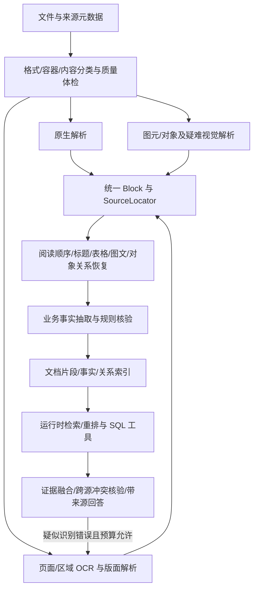

# DataMind Agent 技术设计说明书

## 面向赛题八：多模态数据驱动的可解释精准问数/问答智能体

版本：V1.2（依据复杂文件分类与解析参考文档优化；状态截至 2026 年 10 月 2 日）
初版日期：2026 年 9 月 28 日；修订日期：2026 年 10 月 2 日\
用途：竞赛方案设计、系统研发、测试验收与答辩演示

> **方案摘要**：面向结构化与非结构化混合数据，建设可解释的精准问数/问答智能体。保留已实现的零售/Chinook SQL 基线，新增工业复杂数据主场景：工艺文件、质检报告和二维 CAD 图纸。研发重点是复杂多表关联聚合、文件分类与原生/OCR 适配、非标准结构及对象关系恢复、业务事实提取、跨格式证据定位、实体/版本对齐及冲突检测与消解。高级创新聚焦 **V-CAR（可验证跨源智能体推理）** 中的“可追溯事实提取与冲突驱动局部重识别”，以工具执行、规则计算和原始证据构成可审计闭环。

## 文档使用说明

本次修订以用户于 2026 年 10 月 1 日提供的赛题方向为需求依据：基础任务为单表查询与单文档检索 Demo；中级任务从官方指定的九个难题中，初赛至少攻克一项，决赛攻克三项以上；高级任务提交突破与创新性自述。必须采用国产模型，允许使用公开或自建数据，鼓励 CAD 图纸、工艺文件等复杂数据。初赛交付设计报告、技术实验说明书、可运行软件压缩包；决赛现场演示可运行智能体，同等效果下模型参数越小、处理数据越复杂越有优势。

本版删除旧稿中未经当前赛题依据确认的具体分值、满分线和中级任务编号。§1.2 的专项代号是项目内部追踪项，不等同于官方九项编号；正式提交前须对照官方最新完整清单逐项确认，不能把自设功能直接计为已完成的中级任务。文中准确率、样本量和性能数字除 §18 中有报告依据的记录外，均是研发目标，不代表赛题硬性门槛或已经取得的成绩。

**阅读顺序**：§18.1 是当前能力状态总表，§18.11 是参考文档整合记录，§18.16 是最新工业模型问数实施记录，§18.15 是工业规则实施记录，§18.14 是扫描表格字段实施记录，§18.13 是 OCR/公式阶段记录，§18.3 是下一步完成条件；§18.2、§18.4–§18.9 保留为历史核查记录，其中旧故障和待办应按后续记录理解。§1–§17 为目标设计，接口、对象、部署和里程碑不能据此推定全部已实现。10 月 1 日修订为设计整合；10 月 2 日的真实 OCR/公式接入及问答实测见 §18.13，扫描表头/字段进度见 §18.14，限定工业温度跨源核验见 §18.15，CAD 与通用跨源能力仍待实现。正文版本为 V1.2，文件名同步更新为 `DataMind_Agent_技术设计说明书_V1.2.md`，README 和参考文档链接已更新。


**本版参考输入**：[复杂非结构化文件分类与解析技术文档](<复杂非结构化文件分类与解析技术文档.md>)。该文档提供普通办公文件与工程数据的分类、结构恢复目标和解析架构；本说明书将其转化为有范围、有契约、有验收的项目设计。参考文档中的技术清单是候选，不表示本项目已接入所有格式或模型。CAD/IFC、日志、GIS 和点云可以包含原生结构，按结构化、半结构化与视觉内容混合处理，不统一退化为 OCR 文本。

## 目录

1. 项目定位与赛题映射
2. 目标、范围与设计原则
3. 总体架构与运行主链路
4. 模块一：结构化数据与精准问数引擎
5. 模块二：RAG 与多模态知识库
6. 模块三：多 Agent 编排与跨源推理
7. 模块四：全链路可解释与可视化
8. Metadata / Knowledge Infrastructure
9. Evaluation System
10. 接口契约与关键数据结构
11. Demo 设计与验收脚本
12. 技术选型与国产模型要求
13. 前后端与部署方案
14. 现有仓库的增量实现位置
15. 研发路线图与赛题交付顺序
16. 风险、治理与答辩证据
17. 参考资料
18. 实施进度与下一步验收（2026 年 10 月 2 日）

# 1. 项目定位与赛题映射

## 1.1 项目定义

**项目名称：DataMind Agent**\
**项目定位：多模态数据驱动的可解释精准问数/问答智能体。**

系统目标是统一连接结构化业务库与非结构化知识库，识别问题中的指标、实体、时间、版本和约束；通过 SQL 查询、文档检索、业务字段提取和规则核验，形成带出处的答案。工业主场景以零件编号、工序号、生产批次和适用版本串联图纸、工艺与质检证据。当前 SQL 单源、文档单源和限定工业温度的原文/SQL 规则核验可运行，工业通用路径与 CAD 待扩展，详见 §18。

### 关键能力

- 用业务术语、字段别名和表关系图完成 Schema Linking，生成可执行且只读的 SQL。
- 对 PDF、扫描件、工艺卡、质检报告和二维 CAD 实行按页/区域解析，恢复表格、技术要求、尺寸标注及来源定位。
- 将非结构化内容提取为带原文证据、单位、适用条件和版本的业务事实；用国产小模型处理疑难区域。
- 对单源、跨源和多跳问题形成显式任务 DAG，受限调用 SQL、RAG、公式计算等工具。
- 对关键数值、文档引用、跨源实体映射和逻辑一致性执行规则化验证。
- 在失败时按错误类别重规划、修复并重试；超过预算则澄清或说明无法验证。
- 展示真实工具调用、SQL、检索证据、校验结果、耗时与重试记录；不展示模型私有逐字思维链。

## 1.2 基础任务、中级任务、高级创新

| 级别/内部专项 | 竞赛目标或项目重点 | 目标实现范围 | 验收证据 |
|---|---|---|---|
| 基础任务 | 单表查询与单文档检索 Demo | 国产模型；只读 SQL；单文档检索问答；答案与 SQL 行/文档块绑定；可启动软件 | 单表与单文档成功/无答案用例；启动说明；原文出处 |
| 专项 T1：复杂多表问数 | 复杂业务关联与聚合 | Schema Linking、审核 Join Graph、连接基数/粒度、分组聚合、子查询、语义校验和有界修复 | 固定 gold 结果、连接/聚合困难子集、错误分类；已有 SQL 基线见 §18 |
| 专项 T2：非标准文档识别 | 工艺文件、质检报告、二维 CAD | 真实 OCR、阅读顺序、跨页表格、工艺字段、标题栏/尺寸标注及对象关联、证据定位 | 字段级标签、表格结构、尺寸关联、引用位置及复杂度分层结果 |
| 专项 T3：混合数据冲突 | 结构化与非结构化数据冲突检测与消解 | 实体/批次/工序对齐、单位标准化、适用版本、权威规则、未消解冲突展示 | 冲突精确率/召回率、正确消解率、未消解原因、双方证据与规则 ID |
| 配套能力：质量路由与澄清 | 支持上述专项稳定运行 | 低清/倾斜检测、局部重识别、实体与指标消歧、缺失证据拒答 | 质量风险召回、重识别增益、误修复率、澄清/拒答正确率 |
| 高级创新：V-CAR | 可追溯事实提取与冲突驱动局部重识别 | Plan → Execute → Verify → Repair；按冲突根因重识别、重新对齐或规则消解；国产小模型级联 | 消融对照、证据覆盖、修复前后差异、耗时/参数量/资源与失败样例 |

初赛先完成基础任务，再从 T1/T2/T3 中选择与官方九项清单对应且有充分证据的一项作为专项突破；已有 T1 积累可复用。决赛围绕 T1/T2/T3 形成三个专项的完整演示和评测，再核对官方认定口径。质量路由、澄清、公式识别属于支撑能力，未核对前不额外计算官方专项数量。

## 1.3 评分约束到工程证据的映射

| 评分关注点 | 工程设计对应项 | 可提交证据 |
|---|---|---|
| NL2SQL 准确率 | Schema Linking、Join Graph、SQL AST 校验、执行反馈修复 | 固定测试集、SQL/结果对照、错误分类和版本差异 |
| RAG 忠实度与多模态能力 | 结构解析、Hybrid Search、重排、引用校验 | 原文页图、解析 JSON、Recall@K、引用支持率、困难样例 |
| 跨源融合与多跳 | Planner DAG、实体映射、子任务依赖和 Evidence Graph | SQL 结果到文档检索的实体传递轨迹；反向路径测试 |
| 鲁棒性与效率 | 降级、缓存、索引、并发、超时预算 | 固定工业复杂度/硬件/模型的 p50/p95、资源、级联/缓存与失败率对照 |
| 可解释与产品完成度 | Trace API、流式事件、前端执行图和证据详情 | 现场可重放案例、导出 trace、来源定位及可读错误 |
| 国产模型与参数效率 | 国产来源登记、小模型区域级联、版本锁定 | 模型卡/权重来源、全参数与激活参数、量化配置、级联调用比例、同集效果与资源对比 |
| 复杂工业数据 | 工艺/质检/二维 CAD 与生产库关联 | 自建数据契约、模板/版本/质量分层、真实识别输出和原始证据 |
| 高级创新 | V-CAR 冲突驱动重识别与规则消解 | 消融对照、冲突根因、重试前后差异、失败终止说明 |

## 1.4 参考 MD 到项目设计的映射

| 参考文档内容 | 本项目吸收方式 | 对应章节 |
|---|---|---|
| §2–§4：普通复杂文件分类 | 格式/载体/业务三层分类，A/B/C 范围 | §5.1.1 |
| §5、§9：统一解析/子模块 | Router/Adapter → Block/Locator → 关系 → 事实/索引 | §5.1.2、§14 |
| §7：问数/问答/多模态融合 | 摄取/查询分离，重排先于融合，SQL/规则确定性 | §5.3、§6 |
| §8：完整性与可追溯 | 分层门禁、结构切片、按类型定位 | §5.2、§5.4–§5.5、§9 |
| §10：工程数据/关系 | 二维机械 CAD 核心；拓扑扩展；模型/空间/音视频后置 | §5.1.1、§5.7、§12 |

参考分类不是官方任务编号或成绩依据；B/C 类有数据、Adapter、定位和评测后才能进入实际支持清单。

# 2. 目标、范围与设计原则

## 2.1 MVP 与比赛增强范围

**基础 Demo**：可重置的演示数据库；国产模型驱动的单表查询；原生 PDF 与真实扫描件解析；单文档检索问答；SQL/文档证据定位；运行记录与最小评测。当前 SQL 单源、文档单源、演示扫描 OCR 与公式图识别可运行；完整结构与工业字段仍待扩展，见 §18.13。

**初赛专项闭环**：在基础 Demo 上复用复杂多表 SQL 积累；新增“工艺文件字段 → 生产批次查询 → 规则核验 → 原文证据”的工业路径。先保证工艺卡和质检报告的真实解析，再扩展二维 CAD；自建样例清晰标注模拟来源。

**决赛增强**：二维图纸专项识别、跨页表格、跨源冲突检测/消解、冲突驱动局部重识别、国产小模型级联与消融对照。通用公式问答、大规模压测、多协议扩展与前端框架迁移降为后续项，不抢占主路径。

**首版边界**：二维机械图纸先覆盖标题栏、技术要求和选定尺寸/公差；不承诺任意 CAD 格式或完整三维几何理解。业务核验输出可复核辅助结论，不直接执行生产控制。模型训练、知识自动写回和多 Agent 微服务化不列入核心交付。

## 2.2 设计原则

1. **可验证优先**：每个事实断言至少映射到 SQL 行/聚合结果、文档片段、计算过程之一；证据不足就降低置信或拒答。
2. **确定性工具优先**：关系连接、数值计算、时间边界、权限和格式校验写成可测规则；LLM 做语义解释与候选生成。
3. **能力解耦、流程统一**：SQL 与 RAG 是工具能力；Orchestrator 管任务生命周期；Evidence/Trace 是统一产物。
4. **所有恢复都有上限**：修复最多 2 次；整个运行有时间、token、SQL 行数和检索上下文预算。
5. **只读与最小权限**：问数连接只授予只读账号；上传文档按租户隔离；日志中脱敏敏感内容。
6. **可重复评估**：模型、提示词、元数据、索引、语料版本和测试集版本共同写入 run manifest。

# 3. 总体架构与运行主链路

## 3.1 逻辑架构

| 交互层 | 核心能力层 | 基础设施层 | 运行支撑 |
|---|---|---|---|
| 复用现有 web 问数/模型配置/回放，新增识别/原页高亮/冲突面板 | ① 多表问数；② 文档/工艺/CAD 事实；③ 跨源核验/冲突消解；④ 证据与受控重识别 | Catalog/审核关系、事实/版本索引、文件卷、PostgreSQL、Qdrant；worker 按需 | 固定工业评测、应用 Trace、模型 manifest、配置/密钥；监控服务后续 |

## 3.2 主链路

```text
用户问题
  → Query Understanding（实体、指标、时间、范围、歧义）
  → Planner 产出受 JSON Schema 约束的 Task DAG
  → Router 选择 SQL / 文档检索 / 工业事实提取→SQL核对 / 冲突局部重识别
  → SQL Agent 和/或 RAG Agent 执行有界工具调用
  → Fusion Agent 合并结果并建立 Evidence Graph
  → Verifier 检查数值、引用、映射、逻辑和权限
  → PASS：生成带来源的答案；FAIL：修复/重规划，最多 2 次
  → Trace 事件实时推送，运行和证据持久化
```

## 3.3 工业混合数据示例路径（待实现）

问题：“2026 年 9 月 A102 零件哪些批次的保温温度不符合适用工艺要求？生产记录和质检报告是否一致？”

1. 抽取 `part_id=A102`、问题期间、`operation_no` 和核验指标；缺工序且存在多项要求时先澄清。
2. 检索工艺文件，提取温度区间、单位、适用零件/工序、审批状态及生效/失效时间，保存原文证据；按每个批次发生时间选择适用版本。
3. SQL 查询生产批次、工序实测记录和质量记录，保持指标粒度与连接基数，避免重复聚合；检索并对齐同批次质检报告。
4. 确定性代码换算单位、比较实测值与工艺区间，再比较数据库与报告中同口径的实测值和结论。
5. 将“实测超出规范”与“两个来源对同一事实记载矛盾”分别报告。发现疑似 OCR 数字错误时重识别局部区域，重新执行依赖核验；真实冲突按显式权威规则裁决，缺依据则标记未消解。
6. 展示批次列表、适用工艺版本、SQL 行、报告/工艺原页位置、规则计算与冲突处理记录。该路径属于新设计，不计入既有零售 SQL 成绩。

# 4. 模块一：结构化数据与精准问数引擎

## 4.1 子组件与数据流

| 子组件 | 输入 | 处理 | 输出 |
|---|---|---|---|
| Connector / Introspector | 只读连接配置、数据库 | 读取表、列、类型、主外键、注释、样例值；按 allowlist 限定 schema | `SchemaSnapshot` |
| Semantic Metadata Service | `SchemaSnapshot`、业务词表 | 维护中文名、别名、单位、口径、枚举映射、敏感级别、有效时间 | `SemanticCatalog` |
| Schema Retriever | 问题解析结果、元数据 | 词法召回 + 向量召回 + 业务约束重排 | Top-k 表/列/关系候选及分数 |
| Schema Graph / Join Planner | 候选表、主外键图 | 受限最短路径/代价路径；排除禁用关系和多义连接 | `JoinPlan` |
| SQL Planner / Generator | 问题语义帧、候选 Schema、JoinPlan、数据库方言 | 先生成结构化查询计划，再生成 SQL；关键字段绑定元数据 ID | `SQLDraft` |
| SQL Guard / Validator | SQL AST、allowlist、执行策略 | 只允许 SELECT/CTE；检查表列权限、笛卡尔积、limit、聚合和时间范围 | 校验通过/阻断及原因码 |
| Read-only Executor | 通过验证 SQL、参数、预算 | 只读事务、statement timeout、行数限制、取消信号 | 列定义、结果行、耗时、行数 |
| Result Validator / Repair | SQL 错误或结果摘要 | 错误分类；基于 Schema 与数据库反馈局部修复；最多 2 次 | 有证据的结果或可解释失败 |

## 4.2 元数据设计与 Schema Linking

单个字段记录：`source_id`、`schema_name`、`table_name`、`column_name`、`data_type`、`comment`、`business_name`、`aliases[]`、`sample_values[]`、`unit`、`semantic_role`、`sensitivity`、`is_nullable`、`primary_key`、`foreign_keys[]`、`freshness`、`catalog_version`。

候选分数建议：

`Score = 0.30·lexical + 0.25·dense + 0.20·alias + 0.15·value_match + 0.10·graph_compatibility`

该权重仅为可调初值；以验证集的 Top-k 命中和误链接率网格搜索，不把相似度直接解释成概率。字段召回后必须结合表关系、指标口径和查询语境做二次排序。对“销售额”同时命中下单金额、退款金额、含税金额的场景，必须依据指标定义或向用户澄清。

Join Graph 节点是表，边是经过审核的外键/业务关系，边属性包括连接字段、基数、方向、有效状态、语义说明、更新时间。路径代价可定义为：`cost(edge)=1 + ambiguity_penalty + fanout_penalty + privacy_penalty`。仅允许 Catalog 中已批准的路径，不允许模型凭字段名自行拼接未经登记的 JOIN。

## 4.3 NL2SQL 算法步骤

1. 解析问题：意图、时间、指标、维度、实体、排序/排名、比较、输出粒度、限定条件。
2. 时间标准化：结合显式时区与赛事数据日期解析“去年/本季度”；未提供时间时不自行假设。
3. Schema 召回：表、列、枚举值与指标定义分别召回并显示候选理由。
4. 语义消歧：候选口径存在实质差异时提问；否则按业务 Catalog 中唯一活跃口径处理。
5. 查询计划：`select[] / metrics[] / filters[] / group_by[] / joins[] / order_by[] / limit / expected_grain`。
6. 生成 SQL：指定方言；常量采用参数绑定；标注每个 projection/filter 对应的业务语义 ID。
7. AST 与执行前检查：用 SQLGlot 解析 AST，拒绝 DDL/DML、系统目录、未授权 schema、无上限大结果、危险函数和无关系 JOIN；用 `EXPLAIN`/超时保护作为资源门禁。
8. 只读执行与结果校验：检查空值比例、重复粒度、单位、数值范围和预期聚合列；生成数据时间/查询参数摘要。
9. 失败修复：按错误码重取 schema、修复列名/方言/聚合歧义；任何修复都重新经过 Guard，禁止“直接改字符串后重跑”。
10. 输出数字证据：结果摘要、SQL 哈希、脱敏 SQL、执行时间、行数、数据源版本、可复现参数。

## 4.4 关键结构

```json
{
  "intent": "rank_entities",
  "metrics": [{"metric_id":"sales_amount","aggregation":"sum","unit":"CNY"}],
  "dimensions": [{"field_id":"product.name"}],
  "time_filter": {"field_id":"orders.created_at","from":"2025-01-01","to":"2026-01-01","timezone":"Asia/Shanghai"},
  "filters": [],
  "sort": [{"field":"sales_amount","direction":"desc"}],
  "limit": 1,
  "ambiguities": [],
  "needs_clarification": false
}
```

`SQLExecutionResult` 至少含 `run_id`、`query_id`、`sql_hash`、`redacted_sql`、`bound_params_redacted`、`columns[]`、`rows[]`、`row_count`、`elapsed_ms`、`source_snapshot_id`、`validator_findings[]`、`status`。

## 4.5 失败处理

- 元数据缺失：不给 SQL 生成器虚构列；返回“需要补充指标/字段口径”，并在 Catalog 中创建待维护项。
- 多义指标：展示候选口径、单位和计算定义，优先发起单轮澄清；未获回复时不输出单一确定数字。
- SQL AST 不通过：阻断并记录规则命中；提示安全原因，不尝试绕过 Guard。
- 查询超时/资源超限：取消语句，尝试增加过滤、限制结果或改用摘要查询；仍失败时解释范围与预算限制。
- 空结果/异常值：标为数据为空或结果异常，不把零值当作真实值；可建议缩小时间范围或确认筛选条件。
- 修复耗尽：保留错误类别、尝试次数、候选修复差异，终止并转人工确认。

## 4.6 模块验收指标

研发目标：表/列 Schema Linking Recall@5 ≥ 0.90；Join Path 正确率 ≥ 0.90；初赛测试集 NL2SQL Execution Accuracy ≥ 0.80 并逐周提升；决赛复杂多表子集目标 ≥ 0.90；只读策略违规执行数 = 0；SQL 修复成功率按错误类别统计而非混成单一总分。所有目标须由版本化测试集实测确认。

# 5. 模块二：RAG 与多模态知识库

## 5.1 文件分类、路由与质量感知解析

### 5.1.1 分类维度与交付范围

采用三层分类：**物理格式**（PDF/DOCX/DXF 等）、**内容载体**（原生文本、扫描、混合页面、图元、单元格等）、**业务语义**（工艺规范、质检实测、图纸技术要求等）。PDF 后缀不能区分扫描工艺卡与矢量机械图纸，文件分类须深入页/区域；一个文件可同时命中多条解析路径。

下表是范围与规划，不是当前格式支持清单。A 为近期核心，B 为核心闭环后扩展，C 为远期研究。当前实现依据统一见 §18.1。

| 数据类别 | 代表输入 | 应恢复的内容 | 范围/状态 |
|---|---|---|---|
| 工程文档 | 原生/扫描/混合 PDF 工艺卡、质检报告、技术规范 | 文字、标题、阅读顺序、表头/单元格、图注、版本与业务字段 | A；原生 PDF/演示扫描 OCR/单文档问答已有，工业字段与完整结构待实现 |
| 工程图纸 | 二维 DXF、图纸 PDF/扫描图；DWG 单独转换 | 图层/图元、图号/版次、材料、选定尺寸/公差及对象关联 | A；限定二维机械范围，全部待实现 |
| 现场图片与老旧档案 | 表单、设备截图、蓝图、污损/盖章扫描 | 文本/符号、区域、图文关系、不可辨内容与证据 | A；先覆盖核心工艺/质检/图纸，不承诺缺陷诊断 |
| Word | DOCX 标题、表格、图片、文本框、批注/修订 | 章节、图表/正文、批注/脚注与原生对象位置 | B；待实现；DOC 转换单独登记 |
| PPT | PPTX 文本框、连接线、图表、备注 | 幻灯片/对象、空间关系、流程方向与备注 | B；待实现；PPT 转换单独登记 |
| 复杂报表 | XLSX 多区域/合并/多级表头、公式/图表 | 表区、表头路径、单元格、公式/缓存值/跨表引用 | B；待实现；CSV 不携带上述版面语义 |
| 关系图 | 工艺流程图、P&ID、电气图 | 节点、连线、端口、设备编号、方向与关系类型 | B；待实现，另建符号/拓扑标签，不等同机械尺寸识别 |
| 网络与通信内容 | HTML、邮件及附件 | 正文/引用、线程、附件关系与来源快照 | C；待实现，不接入外部账号或自动采集 |
| 模型与空间数据 | BIM/IFC、三维 CAD、GIS、点云 | 构件/装配/坐标/几何/空间关系 | C；专业适配与几何处理未实现，不列首版验收 |
| 时间与运行数据 | 音视频、日志、报警、仿真结果 | 时间轴、说话人/帧、事件、条件/单位/数值 | C；待实现；有原生数值结构时保留结构 |

优先“工艺/质检 PDF＋二维 CAD＋生产库”的完整链路；Word/PPT/Excel 的原生结构适配按样本需求推进。参考文档的通用六类文件建议作为长期兼容路线，不能扩大本次赛题核心交付边界。

### 5.1.2 类型识别与 Parser Adapter 契约（待实现）

`FileClassification` 至少记录 `declared_extension`、`detected_media_type`、`container_type`、`content_profiles[]`、`semantic_candidates[]`、`classification_evidence[]`、`selected_adapter`、`routing_reason`、`status`。类型根据文件签名、容器结构及抽样页/对象判断；扩展名和 MIME 不一致时先验证，不以改后缀解决格式错误。未知格式、密码保护、损坏文件、转换失败单列，不返回空解析成功。

Adapter 登记可读格式/内容画像、是否需转换、输出定位能力、模型依赖/国产来源、能力限制和版本。原生解析优先，扫描或疑难区域再走 OCR/视觉；Office 不默认截图 OCR，CAD 不默认丢弃图元和单位。格式声明、读取器兼容性和样本验收须同时成立才列为支持。

摄取与查询分开：摄取先形成版本化资产和索引；查询消费已就绪版本，只有质量/冲突检查触发时才受控重解析。



统一 `ParseResult` 包含资产/源版本、分类/路由记录、`blocks[]`、`relations[]`、原始/转换产物引用、质量发现、能力缺口、逐页/逐对象状态、解析器/模型版本与 `parse_status`。文档规范的业务版次和文件 hash 对应的源版本、解析重试版本分开记录；同一文件重识别不等于工艺规范升级。

状态建议为 `parsed`、`partial`、`needs_review`、`failed`、`unsupported`。`parsed` 仅表示声明范围解析完成，不等于所有事实已验证；已解析/失败范围和缺口必须可查。只发布通过结构校验且满足定位要求的块/事实，保留失败部分，不静默丢弃整页或对象。

### 5.1.3 页/区域策略

| 输入画像 | 解析策略 | 必须保留的证据 |
|---|---|---|
| 可用文本层 | PyMuPDF 文本/坐标；检查乱码、缺字、覆盖 | 原始字串、阅读顺序与页位置 |
| 扫描/照片 | 方向校正、纠偏/必要去噪，PaddleOCR/PP-StructureV3 | 原图/处理图、文字候选、区域与质量发现 |
| 多栏/图文混排 | 布局分区、栏内顺序、图注/脚注关联 | 块位置、关系与不确定候选 |
| 表格/跨页续表 | 表区、单元格/合并、表头/单位/脚注恢复 | 二维结构、单元格出处与续表合并依据 |
| 图纸/疑难局部 | 原生图元或重叠裁剪＋国产视觉 | 图层/句柄或原页区域、对象/标注关联 |

PP-StructureV3 提供版面、表格、公式和阅读顺序等能力；工业符号/关联效果仍需自建验证。[官方文档](https://github.com/PaddlePaddle/PaddleOCR/blob/main/docs/version3.x/pipeline_usage/PP-StructureV3.md)

解析图和预览图分开设置。当前预览页图不能直接证明细小标注可识别；按样本比较 OCR 分辨率/裁剪尺度，记录裁剪、缩放、旋转变换并还原原页坐标。扫描增强图只作解析输入，引用仍可访问原始图像。

### 5.1.4 质量与修复边界

诊断清晰度、倾斜、字符覆盖、阅读顺序、表格完整性与关键字段合法性。缺页只在页码连续性/目录/清单有依据时判断；模型未输出可解释分数时保存 `null`/未校准，不填固定概率。综合质量分按文档类型在人工验证集校准，规则通过不等于识别必然正确。

失败恢复定位到页/区域/对象，在统一修复预算内调整解析策略；仍不通过保留候选并标为待核验。当前 `ocr_proxy`、OHR-Bench `gt_text` 只用于演示/评测对照，禁止进入真实 OCR 测试输入。不可辨文字、连接关系或单位不由模型补造。

## 5.2 统一结构、关系与来源定位契约（待扩展）

### 5.2.1 Block、Relation 与 Chunk

| 对象 | 主要字段 | 契约要求 |
|---|---|---|
| `DocumentBlock` | block/document/source_version、类型、原文、原生属性、reading_order、质量发现、parser/model_version、`source_locator` | PDF 当前已有基础字段；Office/CAD 原生对象与统一定位待扩展 |
| `BlockRelation` | relation_id、src/dst_ref、relation_type、scope、evidence_refs、method、verification_status | 结构恢复产物，不以正文摘要替代关系；未知关系留候选 |
| `Chunk` | chunk/document/source_version、section_path、block/related_refs、embedding_text、exact_text、table/image/formula_ref、ACL、content_hash | 原文和生成摘要分开；多块仍保持逐块出处，禁止跨源版次/访问域拼接 |
| `DocumentFact`/`DrawingFeature` | 业务实体、值/单位/条件、规范版次、结构/关系引用、原文定位 | 字段提取须回原始块/图元；详见 §5.6–§5.7 |

常用关系为 `precedes`（顺序）、`contains`（层级）、`caption_of`（图注）、`continuation_of`（续页）、`header_of`（表头）、`annotates`（标注对象）、`connected_to`（连接）、`flows_to`（有证据方向的流程）、`references`（原生引用）。跨文件对象对齐另存实体映射，与页内结构关系分开。图纸连接和流程方向需有明确来源，不靠实体名称或距离猜测。

现有 `page_no/bbox/table_cells/heading_level` 可通过 Adapter 归一到目标契约；当前数据库没有上述统一关系/定位对象，需增量迁移。正文切片当前按字符预算，目标可比较字符/token/结构粒度；同一报告必须说明实际采用的度量。

### 5.2.2 SourceLocator 类型

所有 locator 带 `document_id` 与不可变 `source_version`，再按类型保留原生位置；业务 `document_version`、`parse_version` 单独记录。适配器必须能解析 locator 并显示证据，禁止用生成摘要替代定位。

| locator_kind | 原生定位字段 | 使用边界 |
|---|---|---|
| `pdf_region` / `image_region` | 实际页序号/图 ID、bbox、坐标系/页面大小、变换链 | 印刷页码与 PDF 页序号分开 |
| `office_object` | part/object_id、paragraph/table/cell 或 slide/shape、render_ref? | DOCX 默认以原生对象为锚；渲染页码依赖环境，不能补造固定页码 |
| `sheet_range` | sheet_name、cell/range、表区、公式/缓存值来源 | 保留单元格与合并关系，后续报表适配 |
| `cad_entity` | layout/view、entity_handle、layer、模型坐标系/单位、render_ref | 句柄须绑定源版本；实体坐标不与像素混用 |
| `temporal_segment` | start/end 时间、speaker/frame_ref | 音视频后续适配；目前不支持 |
| `model_spatial_object` | 原生对象 ID、模型/坐标参考、视图或几何产物 | BIM/空间后续设计，当前不支持 |

拟议的 PDF 来源例（只示范定位契约）：

```json
{
  "locator_kind": "pdf_region",
  "document_id": "doc-demo",
  "source_version": "sha256-demo",
  "page_no": 3,
  "bbox": [40, 80, 300, 150],
  "coordinate_system": "pdf_points",
  "page_size": [595, 842],
  "printed_page_label": "2",
  "render_ref": "source-page-003"
}
```

### 5.2.3 结构感知切片

段落与标题路径配对；跨页段落仅在顺序/版次明确时合并。表格按表区或行组切分，携带完整表头路径、单位、脚注和单元格定位；跨页续表保留每页片段与合并关系。图片与图注联合召回；公式与符号定义/适用条件成组；流程节点携带已验证关系片段，不把节点名单当流程。原生 CAD 属性/关系进入事实或关系索引，生成文本仅用于召回。

## 5.3 混合检索、重排与证据融合

运行时先识别问题需要的是文字事实、精确数值、对象属性或关系路径，再选择工具：文档文字走词法＋向量；工艺/质检字段按实体/工序/批次/版本过滤；数量/范围/合规走 SQL/确定性工具；对象连接路径仅在相关关系已核验后查询。

文档召回链路：权限/源版次/适用时间过滤 → 词法与 Dense 召回 → RRF → 文档证据候选重排 → 邻接结构补全/去重 → 上下文裁剪。可用 Top-30/Top-20/Top-5～8 作为初值，以验证集调参；当前运行时链路待实现。重排位于文档证据融合前，不能用相关性分数改写 SQL 数值、决定来源权威或替代冲突裁决。

统一答案证据链：文档/事实/关系证据＋SQL 执行结果 → 实体与版本对齐 → 规则/冲突核验 → Claim 绑定 → 回答。每条事实引用稳定证据 ID，保留原文、SourceLocator、源/业务/解析版本和质量发现。未核验的视觉描述明确标为候选；不作为已验证关系写入正式索引。

关系首版用 PostgreSQL 关系表/JSONB 与内存遍历，和 Qdrant 文本索引并行；工程关系图与回答支持证据图分别建模。不因参考文档提到 Knowledge Graph 就新增独立图数据库。

## 5.4 非标准结构恢复规则与适配边界

| 结构 | 恢复动作 | 防止的错误 |
|---|---|---|
| 多栏、标题、页眉/脚注 | 布局分区、层级/顺序、重复区域标记 | y/x 排序串栏；把脚注例外/版本号当噪声删除 |
| 跨页段落/表格 | 顺序/表头/列语义/单位/脚注核验，保存续接边 | 跨版本、跨不同表区误合并 |
| 图片/图注/公式 | 原生引用或位置候选＋上下文校验 | 最近段落不必为图注；公式不可缺符号/条件 |
| Word 结构（B） | 标题/表格/文本框/图片、批注/脚注/修订分别保存 | 将批注/删除文本当生效正文；假页码 |
| PPT 流程（B） | slide/shape、连接线端点/方向、图表数据和备注 | 文本框顺序不等于流程；备注不等于页面正文 |
| Excel 表区（B） | 多区域分割、合并/表头路径、公式/值/依赖及隐藏标记 | 盲目填充合并格；混用公式与过期缓存值；把隐藏内容静默删除 |
| 工程拓扑（B） | 符号/设备 ID、端口、连线/方向及专业类型 | 线相交不自动代表连通；物料流与控制关系不混用 |

Office/P&ID 等规则为后续 Adapter 设计，不代表当前能解析这些输入。工程符号的含义须有规范/图例或经审核词典；多候选关系保留 `candidate/needs_review`。通用公式问答后置，仅为工业参数核验所需的确定表达式优先补足，计算输入/单位/舍入与原文有证据。

## 5.5 质量门禁、失败处理与验收

采用五类检查：格式/转换可读；内容覆盖与字符候选；结构/关系/表格完整；字段/单位/版本合法；引用可解析。每个失败记录影响范围、规则 ID、可恢复动作和预算；阶段指标分开，不能以高 OCR 字符正确率替代字段/关系/问答正确率。

| 验收层 | 指标/用例 | 统计边界 |
|---|---|---|
| 分类/转换 | 路由正确率、误路由、失败/不支持状态 | 混合 PDF、假后缀、损坏/加密、转换缺失/警告均纳入 |
| 原文/结构 | CER、标题/顺序、单元格/表头、图注/续接关系 Precision/Recall | 按载体/模板/质量分层；不可辨样本单列 |
| 业务/工程 | 字段值/单位/范围、适用版次、尺寸—对象关联/拓扑边 | 工艺规范、实测和报告结论分别评测 |
| 来源定位 | Locator 成功解析率、原页/对象命中率 | bbox/页码、原生对象 ID、单元格或句柄按类型评测 |
| 检索/回答 | Recall@5、MRR、忠实度、引用支持、拒答 | 与解析组件指标分开；关系/精确数值不能只评词相似 |

沿用项目研发目标：Recall@5 ≥ 0.85、MRR@10 ≥ 0.80、回答忠实度 ≥ 0.90、PDF 正确页码率 ≥ 0.95、质量风险召回 ≥ 0.90、多文档/多模态正确率 ≥ 0.90。它们不是官方满分线，也不是实测成绩。其他结构/关系指标先建人工 gold 与基线，再确定阶段门槛；新增格式必须增加定位和失败用例才可标“已验证”。

格式不支持返回 `unsupported`，关键结构/字段不明返回待核验；检索空结果可在同权限范围改写一次，证据不足拒答。保留部分成功与失败范围，整体结论必须声明证据缺口；统一重识别预算见 §5.8 和 §6.7。

## 5.6 工艺文件与质检报告的业务事实提取（新增，待实现）

工艺文件提取零件/工艺编号、工序号、设备、材料、温度/压力/时间、允许范围、前置工序、例外条件、适用范围和版本有效期；质检报告提取批次、检测项目、实测值、单位、检测时间、报告结论和来源位置。工艺要求与实测值分别存储，禁止把规范值当成生产实测值。

每条 `DocumentFact` 保存原始表达与标准化值，字段至少为 `fact_id`、`entity_type`、`entity_id`、`operation_no`、`batch_id?`、`metric`、`fact_kind`（requirement/measurement/conclusion）、`raw_value`、`normalized_value/range`、`raw_unit/normalized_unit`、`conditions`、`source_version`、`document_version`、`parse_version`、`valid_from/to`、`approval_status`、`evidence_refs[]`、`extraction_method`、`verification_status`。版本/条件不明时保持缺失状态，不能从文件名或上传时间补造。

示例仅为拟议契约，不表示当前已有该文档或表：

```json
{
  "fact_id": "fact-demo-001",
  "entity_id": "A102",
  "operation_no": "30",
  "metric": "holding_temperature",
  "fact_kind": "requirement",
  "raw_value": "850±10℃",
  "normalized_range": {"min": 840, "max": 860, "min_inclusive": true, "max_inclusive": true},
  "normalized_unit": "℃",
  "conditions": {"duration_minutes": 120},
  "source_version": "sha256-demo",
  "document_version": "V2",
  "parse_version": "parse-demo-001",
  "valid_from": "2026-09-01",
  "valid_to": null,
  "approval_status": "approved",
  "evidence_refs": [{"block_id": "block-demo", "source_locator": {"locator_kind": "pdf_region", "document_id": "doc-demo", "source_version": "sha256-demo", "page_no": 3, "bbox": [40, 80, 300, 150], "coordinate_system": "pdf_points", "page_size": [595, 842]}}],
  "verification_status": "candidate"
}
```

模型负责字段候选和语义关联；确定性代码负责 JSON 契约、编号/枚举、单位、范围和时间检查。单位换算须处理偏移型单位，公差须区分对称/非对称和未指明公差；未知单位/符号保留原文并标记待核验。结构合法、规则通过、人工核验是不同状态，保留抽取版本和修订历史。

检索采用“原文切片＋事实索引”：Qdrant 召回相关内容，PostgreSQL 按零件/工序/批次/版本筛选事实，并支持与生产记录的受控核对。语义检索相似度不能代替唯一编号匹配；关系计算走确定性工具，不把整批数值交给模型心算。

## 5.7 二维 CAD 专项识别（新增，待实现）

首版范围为二维机械图纸的标题栏、技术要求和选定尺寸/公差；图号、零件号、材料、版本优先，其后扩展粗糙度等特征。不承诺完整三维模型、任意工程符号或任意 DWG 兼容性。

- **DXF 原生路径**：通过 `ezdxf` 读取文字、块属性、图层、尺寸实体及句柄，保留标注文本、数值候选、单位配置、视图/局部上下文与原始实体引用；尺寸覆盖文本与实体测量值不一致时登记差异，不能静默选择。
- **PDF/扫描图路径**：识别标题栏、技术要求和尺寸密集区域，采用重叠裁剪/放大后 OCR 或国产视觉模型；去重并映射至原始页面，保留引线、端点及视图关联候选。
- **DWG 路径**：建立单独的、经测试的 DWG→DXF/图纸 PDF 转换步骤；记录工具版本、布局、字体与转换警告。`ezdxf` 不是 DWG 转换器，相关限制见[官方说明](https://ezdxf.readthedocs.io/en/stable/introduction.html)。转换失败或不支持时明确返回边界，不能当空文件成功摄取。

`DrawingFeature` 保存 `drawing_id/revision`、`part_id`、`feature_type`、`annotation_raw`、`nominal_value`、`tolerance_upper/lower`、`unit`、`entity_handle?`、`layer?`、`view_id?`、`target_refs[]`、`source_locator` 和 `association_status`。识别到尺寸文字不等于确定尺寸对应哪个对象；多个可能视图/对象时保留候选或转复核。PDF 图纸优先采用明确标注值，不根据页面像素长度或打印比例推定制造尺寸。

分别评测文字/符号、字段值、公差区间和标注—对象关联，不能只用 OCR 字符准确率声称图纸理解完成。DXF 证据需提供实体句柄与对应渲染视图；扫描图证据使用页码/bbox。

## 5.8 国产小模型级联与局部重识别（新增，待实现）

常规页走原生解析或轻量 OCR，复杂表格/图纸局部才调用国产视觉模型。先评测 Qwen3-VL-2B/4B 候选，失败后在同一总预算内切换裁剪尺度或批准的较大国产模型；不以扩大模型自动替代证据不足。Qwen 官方提供文档解析、OCR 与定位示例，但没有据此承诺本项目工业图纸准确率。[官方仓库](https://github.com/QwenLM/Qwen3-VL)

记录每次路由原因、裁剪区域、模型版本、参数量、视觉输入预算、耗时、显存与级联比例；使用内容 hash、区域和解析版本做缓存。必须先按质量/规则/冲突诊断选择动作，禁止对真实冲突反复重识别直到出现想要的数值。API 当前只有文本对话载荷，视觉图片输入与视觉配置选择需在 `datamind/providers.py` 和配置契约中新增实现，现有协议适配不等于具备多模态能力。

参数效率以同一独立测试集、相同数据复杂度和硬件条件比较“轻量 OCR＋2B”“轻量 OCR＋4B”“全页视觉模型”等方案，报告效果与资源差异。OCR/Embedding/Reranker 与语言/视觉模型的参数分别登记；MoE 全参数和激活参数分别报告，量化位宽不等于参数量减少。只能验证 API 别名时声明具体规模未核验，不能宣称最小模型优势。

# 6. 模块三：多 Agent 编排与跨源推理

## 6.1 Agent 角色与职责边界

| Agent / 服务 | 允许职责 | 不允许职责 | 典型输入/输出 |
|---|---|---|---|
| Query Understanding | 意图、实体、时间、歧义抽取；提出澄清 | 直接执行 SQL 或自行编造答案 | `UserQuery → QueryFrame` |
| Planner / Orchestrator | 建立任务 DAG、预算和数据源路由 | 越过工具权限直接访问数据库 | `QueryFrame → TaskPlan` |
| SQL Agent | Schema Linking、SQL 计划生成、只读执行请求、修复建议 | 绕过 Validator；执行写操作 | `SQLTask → SQLExecutionResult` |
| RAG Agent | 检索、重排、证据抽取、引用定位 | 将无证据内容当成已验证事实 | `RAGTask → EvidenceBundle` |
| Fusion Agent | 基于 ID/规范实体合并跨源结果，组织答案主张 | 隐去来源冲突或凭空推断因果 | `Subresults → ClaimSet` |
| Verification Agent | 数值、引用、实体、时间、逻辑、安全检查 | 用不可复现的“自信分”覆盖明确错误 | `ClaimSet + Evidence → VerificationReport` |

建议首版用 Python 显式状态机/有类型 DAG 实现，降低不可见控制流；若后续采用 LangGraph 等编排库，仍须保持任务状态、节点输入输出和工具边界可导出。Agent 是具有受限职责的流程节点，不以 Agent 数量作为创新指标。

## 6.2 TaskPlan 与执行状态

```json
{
  "plan_id":"p-...",
  "goal":"核验 A102 批次温度与适用工艺，并检查质检报告一致性",
  "budget":{"max_steps":12,"max_repair":2,"deadline_ms":30000,"max_rows":100},
  "tasks":[
    {"task_id":"t1","kind":"document.facts","depends_on":[],"input_refs":["query_frame"],"status":"pending"},
    {"task_id":"t2","kind":"sql.measurements","depends_on":["t1"],"input_refs":["t1.part_id","t1.operation_no"],"status":"pending"},
    {"task_id":"t3","kind":"report.facts","depends_on":["t2"],"status":"pending"},
    {"task_id":"t4","kind":"fusion.verify","depends_on":["t1","t2","t3"],"status":"pending"}
  ]
}
```

状态枚举：`pending → ready → running → succeeded | failed | blocked | skipped`。每次变更写 `TraceEvent`；进程重启后从持久化状态恢复。依赖失败时只重跑受影响子图，且必须保留原失败事件。

## 6.3 V-CAR：Plan → Execute → Verify → Repair

**Plan**：把用户目标改写为可测试的 `ClaimSet` 和任务 DAG；每个子任务指定输入引用、工具、预期结果、超时与权限。\
**Execute**：按拓扑序执行；独立 SQL/RAG 任务允许并发，带依赖的任务等待前序结构化结果。所有工具调用有 idempotency key、run_id、超时和限额。\
**Verify**：校验 SQL 数值是否来自执行结果；文档事实是否由引用支持；实体 ID 与名称是否一致；时间、单位、币种和粒度是否匹配；不同来源是否冲突；查询/检索是否越权。\
**Repair**：按失败原因选择局部动作：重新取 Schema、替换错误字段、调整检索查询、扩展证据范围、重新匹配实体、重算公式或发起澄清。修复后重新执行受影响节点并重做全部依赖的验证。\
**Stop**：通过验证则回答；修复预算耗尽、权限被拒、来源冲突无法裁决或证据覆盖不足则终止并明确说明缺口。

状态转换：`PLANNED → EXECUTING → VERIFYING → COMPLETED`；验证失败时 `VERIFYING → REPAIRING → EXECUTING`；不可恢复时进入 `NEEDS_CLARIFICATION` 或 `FAILED_WITH_EVIDENCE`。每轮修复保存 `failure_code`、`root_cause`、`repair_action`、输入差异、节点版本和结果差异，便于做修复成功率消融。

## 6.4 跨源实体对齐与证据图

实体映射优先级：主键/外部编码精确匹配 > 经审核别名表 > 规范化名称 + 上下文候选 > 模型建议后人工确认。不得仅凭名称相似度自动把两个实体合并。每条映射存 `source_entity`、`canonical_entity`、`match_method`、`score`、`approved_by`、`valid_from/to`。

工程对象/连接关系表示文件中的业务结构，回答 Evidence Graph 表示结论的支持/反驳依据；二者通过对象/事实/来源 ID 关联。视觉候选关系不能直接视为已验证支持证据。

Evidence Graph 节点类型：`Question`、`PlanTask`、`SQLQuery`、`SQLRow/Aggregate`、`Document`、`Chunk`、`TableCell`、`Formula`、`DocumentFact`、`DrawingFeature`、`BlockRelation`、`ConflictRecord`、`Claim`、`VerificationCheck`。工业扩展节点待实现，不能由已有 SQL 证据节点推定其已接入。边类型：`derived_from`、`retrieved_from`、`maps_to`、`supports`、`contradicts`、`verified_by`、`repaired_from`。每个最终 Claim 至少有一个 `supports` 边或明确的 `insufficient_evidence` 状态。

## 6.5 校验规则与置信度

规则化门禁必须先于模型评审：

- 数值 Grounding：答案数值可在 SQL 结果或公式计算记录中定位；允许范围只用于格式舍入，不可容忍量级错位。
- 引用 Grounding：关键文本 claim 至少映射到一个证据块；使用句级支持/矛盾判断，模型审校作为二级信号并抽样人工复核。
- Entity Grounding：产品/客户/地区等规范 ID 与 SQL 行、文档实体映射同一。
- Temporal Grounding：问题期间、数据时间戳、文档版本有效期一致。
- Cross-source Consistency：冲突显式标出；无裁决依据时不自动选择。
- Safety Grounding：执行身份、允许工具、SQL AST 和检索 ACL 均通过。

展示置信等级而非未经校准的小数概率：`high / medium / low / insufficient`。如比赛需要数值分数，则用标注集做 isotonic/logistic calibration，另报 ECE/Brier Score；分数解释为已验证证据覆盖信号，不声称是事实绝对概率。

## 6.6 失败恢复

模型输出不符合 JSON Schema：一次结构化重试；仍失败转安全模板答复。工具超时：熔断该子任务、最多一次幂等重试；依赖关系允许时继续执行独立子图。RAG 无证据：不得用模型内知识补缺；询问是否扩大文档范围。SQL 与文档值冲突：先执行 §6.7 的实体/单位/版本与规则核验；缺少裁决依据时分列展示并转复核。Repair 超限：返回已验证的局部结论，并清楚列出未完成部分。

## 6.7 结构化与非结构化数据的冲突检测与消解（新增，待实现）

比较前先确定规范实体、工序、批次、指标定义、测量时点/方法、单位及适用版本。工艺规范与实测值不同可能表示不合规，并不是两个来源对同一事实的矛盾；只有同一事实、相同口径的记录不一致才进入跨源冲突判定。

| 分类 | 核验动作 | 消解依据/状态 |
|---|---|---|
| 单位/口径差异 | 可靠换算，核对测量定义/精度/时点 | 口径对齐后等价则 `resolved_equivalent`；不同口径不强行比较 |
| 实体/批次误对齐 | 检查编号、审核别名及工序键 | 撤销错误映射；无唯一候选则 `needs_review` |
| 文档版本差异 | 按批次发生时间匹配已批准且生效的版本 | 有唯一适用版本则 `resolved_by_rule`；有效期重叠/缺失转复核 |
| 疑似识别错误 | 原文局部重识别，对比候选并检查证据 | 保留旧值/新值/原因；不能仅因新值与数据库一致就认定正确 |
| 同口径真实矛盾 | 展示双方原始记录、修订/审批链 | 只按已登记权威规则裁决；无依据则 `unresolved` |
| 实测超出规范 | 确定性区间/条件计算 | 输出业务不合规结论及规则证据，单独统计 |

处理顺序：对齐 → 标准化 → 查适用版本 → 分类 → 受控重识别或规则裁决 → 重新计算全部依赖结论。默认不存在“数据库永远正确”或“上传更晚的文件优先”规则；来源权威策略必须说明适用范围、审批人、规则版本与有效期。

`ConflictRecord` 字段为 `conflict_id`、`entity_key`、`metric`、`conflict_type`、`left/right_fact_refs`、`comparison_context`、`normalized_values`、`rule_id/version`、`resolution_status`、`selected_fact_ref?`、`reason`、`repair_attempt_refs[]`。来源原值不可覆盖。消解成功只代表差异按证据/规则得到解释，不自动获得写回生产库的权限。

示例：工艺要求 840–860℃，数据库实测 870℃，同批次报告实测 850℃。系统应分别报告“数据库记录超限”和“实测值跨源冲突”。即使报告写“合格”，也不能在温度事实未消解前生成单一确定的批次合格结论。

## 6.8 高级创新自述与消融设计（新增，待验证）

拟议自述主题：**面向工业混合数据的可追溯事实提取与冲突驱动局部重识别**。创新假设是：把业务事实绑定到原始区域，利用单位/版本/实体规则诊断跨源冲突，只对疑似识别错误的区域调用国产小视觉模型，能够在维持效果时减少全页模型调用并提高错误定位能力。该假设尚未实测，不能写成已证明突破。

同一冻结测试集依次比较：①普通 OCR＋文本检索；②结构化事实＋实体/单位/版本核验；③再增加局部重识别；④完整规则消解和证据闭环。固定模型与其他配置做机制消融，再单独比较 2B/4B 的规模影响。统计字段准确率、冲突精确率/召回率、正确消解率、局部修复成功率、正确字段被改错比例、答案正确率、拒答率及额外耗时；分别保留成功、真实未消解和修复预算耗尽案例。

# 7. 模块四：全链路可解释与可视化

## 7.1 Trace 设计

每个 run 事件统一含：`event_id`、`run_id`、`parent_event_id`、`task_id`、`agent_name`、`event_type`、`status`、`started_at`、`ended_at`、`duration_ms`、`input_summary`、`output_summary`、`tool_name`、`artifact_refs[]`、`retry_index`、`error_code`、`model_id`、`prompt_version`、`token_usage`、`visibility`。原始文档全文、凭证和隐私字段不得放到可视化事件中；SQL 参数按敏感级别脱敏。

Trace 事件类型：`query.parsed`、`plan.created`、`tool.started`、`sql.validated`、`sql.executed`、`retrieval.completed`、`evidence.attached`、`verification.failed/passed`、`repair.started/completed`、`answer.completed`。新增工业事件（待实现）：`document.parsed`、`fact.extracted`、`version.selected`、`conflict.detected`、`region.reparsed`、`conflict.resolved/unresolved`；按事件区分规则消解与重识别。

## 7.2 前端交互

- **问答区**：流式显示回答草稿状态、澄清请求和最终答案；未验证时显示“正在核验”，不把中间生成当成最终结论。
- **执行图**：Vue Flow / Cytoscape 展示 DAG 节点、依赖边、耗时、状态、失败/重试标识；可折叠低层细节。
- **SQL 面板**：展示脱敏 SQL、数据库方言、Validator 检查清单、执行时间、行数、表格结果和导出按钮。
- **证据面板**：展示来源、源/业务/解析版本、原文与质量发现，按 SourceLocator 打开原页/对象/单元格；PDF 显示实际页序号与印刷页码，CAD 显示实体/视图。后续 Office 不伪造页码，未支持定位类型明确提示。
- **文档识别与核验视图（待实现）**：左侧原页/图纸区域，右侧工艺或质检字段、单位、版本和核验状态；点击字段高亮原文或 CAD 实体渲染位置；下方展示对应数据库值、差异和采用依据。
- **校验面板**：逐条显示 Claim、证据、规则名称、PASS/WARN/FAIL、修复结果；区分业务不合规、已消解冲突、未消解冲突和待人工核验。
- **性能面板**：总耗时、SQL、检索、解析、LLM 各阶段耗时；数据规模、并发数、缓存命中率和当前评测版本。

展示对象是可复核的决策依据、工具调用和证据关系，不提供隐式内部思维链文本。用户应能从最终答案点击到原始 SQL 行、文档页和验证规则。

## 7.3 流式协议

`POST /v1/chat/stream` 使用 SSE；事件载荷统一为 `event: trace` / `data: {TraceEvent}`。断线后通过 `GET /v1/runs/{run_id}/events?after={cursor}` 按序恢复。客户端用 `run_id + event_id` 去重；完成事件是 `answer.completed`，失败事件包括 `run.failed` 和可读原因。大文件与页面图走文件 API 或预签名对象引用，不内嵌在 SSE。

## 7.4 可解释性验收

- 运行步骤完整率 ≥ 0.99（持久化事件数/实际工具调用数）。
- 最终事实 Claim 证据覆盖率 ≥ 0.95；无法溯源的 Claim 必须被阻止或标记。
- 前端展示的 SQL 与实际执行 SQL 哈希一致；修复前后 SQL 可比较。
- 引用页码与原 PDF 页码映射正确率 ≥ 0.95。
- 一条完整 Demo 路径可从运行 ID 重放；PII 和凭证泄漏数 = 0。

# 8. Metadata / Knowledge Infrastructure

## 8.1 统一元数据对象

| 对象 | 主键 | 关键字段 | 主要用途 |
|---|---|---|---|
| DataSource | `source_id` | 类型、连接 secret 引用、schema allowlist、权限组、环境 | 连接与安全边界 |
| SchemaSnapshot | `snapshot_id` | source_id、catalog_version、表列、关系、更新时间 | 可复现 SQL 生成 |
| BusinessMetric | `metric_id` | 定义、表达式、单位、粒度、过滤口径、负责人 | 指标语义口径 |
| EntityAlias | `alias_id` | canonical_id、alias、来源、有效期、审批状态 | Schema 和跨源实体匹配 |
| DocumentAsset | `document_id` | 文件 hash、URI、页数、ACL、质量分、parser 版本 | 文档版本和访问控制 |
| DocumentBlock / Chunk | block_id / chunk_id | 页、坐标、标题路径、文本/表格/公式、内容 hash | 引用追溯与检索 |
| FileClassification / ParseResult（新增，待实现） | document_id / parse_version | 容器/内容画像、路由/能力、范围/缺口、产物/版本 | 文件分类与适配结果 |
| BlockRelation / SourceLocator（新增，待实现） | relation_id / locator_ref | 结构关系、原生位置、源版本/坐标系/变换/状态 | 结构恢复与跨格式定位 |
| DocumentFact（新增，待实现） | `fact_id` | 原始/标准化值、实体/工序/批次、单位、条件、版本、证据、抽取状态 | 工艺规范与质检实测值索引 |
| DrawingFeature（新增，待实现） | `feature_id` | 图号/版次、尺寸/公差、对象关系、CAD 句柄/页坐标、关联状态 | 二维图纸字段与关联核验 |
| ConflictRecord（新增，待实现） | `conflict_id` | 双方事实、比较口径、分类、规则版本、处理状态、重识别历史 | 冲突检测、消解与回放 |
| EvaluationCase | `case_id` | query、标签、gold SQL/answer/evidence、slice、版本 | 离线评测与回归 |
| Run / TraceEvent | run_id / event_id | plan、工具事件、时间、状态、版本 | 审计、演示、诊断 |
| Evidence / Claim | evidence_id / claim_id | 原始出处、支持关系、校验状态 | 端到端可解释性 |

## 8.2 存储建议

- PostgreSQL 保存 Catalog、权限、运行、评测集和结构化证据索引；JSONB 放可变解析属性，关系型列保存必须过滤和约束的字段。
- 对象存储保存源文件、页面渲染图和中间解析产物，按内容 hash 版本化；本地演示可用 MinIO 或文件卷。
- Qdrant 保存 chunk dense/sparse vectors 与过滤 payload；若语料规模小、系统组件需最少，可用 PostgreSQL + pgvector 作为替代。向量索引需与 `document_version`、ACL、parser/embedding model version 同步。
- Redis 可选：短时会话、任务协调、幂等锁和缓存。缓存键必须包含用户权限、查询规范化、数据/文档版本和模型/提示词版本，避免跨权限复用。
- Schema Graph、文档结构、工程对象关系和回答证据图分别存 PostgreSQL 对应表/JSONB，按需内存遍历。版本/权限过滤覆盖邻接补全；不能通过跨域关系绕过原资产权限。有规模/查询成本实测后再考虑专门图数据库。

## 8.3 数据治理与版本

每次评测或 Demo 的 manifest 固定：应用 commit、SQL schema snapshot、业务词典版本、文档集合 hash、分类/Adapter/结构恢复/parser 版本、转换工具/参数、源/业务/解析版本、embedding/reranker 版本、模型 ID/国产来源/权重版本/参数量/量化配置、提示词版本、温度/采样参数、评测集版本、缓存状态、部署规格。更新知识库采用 `ingest → validate → shadow index → atomic switch`，失败可回滚到上一个可用索引。

# 9. Evaluation System

## 9.1 测试集建设

项目自设初赛评测基线为至少 10 道 NL2SQL 与 10 道 RAG 测试题（非用户提供的官方数量要求）；建议扩充为 60–100 条可审计用例，并保持规则调参集与独立测试集隔离。样本按难度和失败类型分层：

- NL2SQL：单表过滤、时间范围、别名、枚举、JOIN 2/3/4 表、聚合、排序 Top-k、同比/环比、嵌套、空值和歧义澄清。
- RAG：原文段落、跨页标题、扫描件 OCR、复杂表格、表格计算、公式变量、跨文档冲突、过期版本、答案不可得。
- Cross-source：工艺要求→批次 SQL→质检报告核对，图纸→零件/工序约束，单位等价、版本过期/重叠、真实矛盾、实体误对齐、证据不足。
- 工业解析：分类/路由、混合扫描页、阅读顺序/标题/图注/脚注、续表/合并表头、工艺/实测/图纸字段、尺寸—对象关联；按载体/模板/质量分层。
- 后续格式：Word 对象/批注、PPT 节点/连接线、Excel 表区/公式值、P&ID 拓扑在 B 类 Adapter 实现后才纳入正式支持集，单列成绩。
- Robustness：错别字、口语简称、时间缺失、超长问题、权限越界、空检索、坏文件和服务超时。

每条 Case 包含：`case_id`、类别/难度、用户问题、期望路由、gold query plan、gold SQL 或允许 SQL 集、结果断言、必需证据 ID/SourceLocator、gold blocks/relations、期望解析状态、gold answer claims、澄清标签、失败类别、数据版本、人工审核者。

## 9.2 指标与计算

| 子系统 | 主要指标 | 说明 |
|---|---|---|
| Schema Linking | Recall@k、MRR、表/列/关系路径准确率 | 分别报告表、列、枚举值，使用人工标注 gold IDs |
| NL2SQL | Exact Match、Execution Accuracy、Clause Accuracy | Execution Accuracy 以只读参考库执行后结果比较；数值允许容差须逐题声明 |
| RAG Retriever | Recall@k、Precision@k、MRR、nDCG@k | 至少报告 k=5、10，按文档类型/质量分层 |
| RAG Answer | Correctness、Faithfulness、Citation Precision/Recall | 规则/标注为主，LLM Judge 只作辅助；随机抽样人工复核 |
| 文件分类/结构 | 路由准确率、覆盖率、标题/顺序/图注/续表/表头与关系 Precision/Recall | 按格式/载体/业务分层；partial/unsupported 计入状态报告 |
| 工业字段/图纸 | 字段 Precision/Recall/F1、值/单位/范围准确率、表格结构与标注—对象关联正确率 | 按文档/字段类别分层；缺失字段与多候选单列 |
| 冲突与消解 | 冲突 Precision/Recall、正确消解率、错误消解率、未消解比例 | 与业务不合规分开；消解分母为触发规则/修复的冲突，不用一致率代替准确率 |
| 局部重识别 | 修复成功率、误修复率、触发比例、额外耗时 | 误修复指原本正确的字段被改错；比较机制消融与规模实验 |
| 模型效率 | 各模型参数、激活参数、量化位宽、显存/内存、视觉输入量、调用比例 | 同数据/硬件/效果下比较；API 别名规模未知须注明 |
| Agent / V-CAR | 路由准确率、计划可执行率、跨源答案准确率、Verify 检出率、Repair Success Rate | 分母分别报告触发校验数/修复数，不能只展示成功案例 |
| 可解释性 | Claim Evidence Coverage、Trace Completeness、Source Locator Accuracy | 输出 Claim 到 SQL/块/页码路径的可验证比例 |
| 性能 | p50/p95 latency、吞吐 QPS、错误率、token/查询、cache hit | 分单源/跨源；固定数据量、并发数和硬件 |
| 鲁棒性 | 澄清正确率、拒答正确率、权限违规数、低质文档风险召回率 | 对抗/异常用例单列；权限违规目标为 0 |

执行结果比较可先用排序无关的行集 canonicalization（列顺序归一、数值类型归一、明确小数容差），对排名/限量问题必须保留排序与 Top-k。不要仅用 SQL 字符串完全相同作为准确率；也不要把“可运行”当成语义正确。

## 9.3 测试流程和门禁

1. Freeze 数据、元数据和评测集版本，记录 manifest。
2. 运行组件级回归：Parser、Schema Retriever、SQL Guard、Retriever、Verifier。
3. 运行端到端基准：按场景、难度、模态、工具路径输出 confusion matrix 和错误簇。
4. 对每次提示词/索引/模型/路由变化做 A/B 与消融；一次只改变有限因素。
5. 对新增成绩人工抽查至少 10% 样本与全部高风险边界样本。
6. 发布门禁：SQL 安全违规为 0；关键路径通过率不下降；错误答案和低证据回答无静默增长；p95 不超预算；演示问题可重复运行。

## 9.4 工业复杂数据、自建基准与效率实验

第一批建议建设约 40 份核心源文档（工艺卡 15、质检报告 15、二维图纸 10），配套可重置生产/质检记录和约 60 条问答/核验用例。这是扩展建设计划；当前已有单份 17 页合成工艺/报告材料及 12 批次示例，见 §18.15，尚未达到此计划规模。文档需覆盖多模板、版本/有效期、合并/跨页表格、图纸视图、小字号/符号；真实授权样本与合成样本分别标注。

同一源文档的原生、旋转、模糊、噪声扫描变体必须归入同一数据划分；按模板家族、零件系列/来源分组划分调参集与独立测试集，避免用近重复扫描页提高成绩。Gold 由人工逐字段标注原文位置、值/单位/条件、适用版本、实体/对象关联及冲突原因；模糊不可辨的字段标注为不可确定。没有真实样本时只报告合成数据边界，不声称适用于任意工业图纸。

预置冲突覆盖单位表观差异、实体误配、有效期重叠、OCR 数字错误、来源真实矛盾与证据不足；同时加入大量无冲突样例检测误报。原生对照文本和 OHR-Bench gold 仅提供给评测端，OCR 推理不得读取 gold。分别统计“错误是否检出”“差异是否正确消解”和“最终业务结论是否正确”。

结构反例必须包括双栏串序、图注邻近但不属于该图、不同单位的相似续表、含例外的脚注、标注有多个对象和混合 PDF 漏扫描页。B 类另增批注/修订、PPT 连线方向、Excel 多表区/隐藏/缓存过期、交叉线不连通。Gold 绑定原始对象/区域/版本，失败或不支持不能从分母静默删除。

首轮效率比较优先固定工业数据复杂度、国产模型及硬件，报告冷/热缓存、解析耗时、问答 p50/p95、显存/内存、调用次数、视觉输入量和失败率；并发从 1 开始。千万行/万文档/20 并发的大规模压测降为可选后续实验，不能替代真实工业文件识别与冲突闭环。

# 10. 接口契约与关键数据结构

## 10.1 外部 API 与实现边界

| 方法与路径 | 用途 | 当前状态 |
|---|---|---|
| `POST /v1/chat`、`POST /v1/chat/stream` | 问数与 SSE | 已实现 SQL 单源；文档/跨源返回 `ROUTE_UNSUPPORTED` |
| `GET /v1/runs`、`GET /v1/runs/{id}` | 运行列表与结果 | 已实现 SQL 单源 |
| `GET /v1/runs/{id}/events`、`GET /v1/runs/{id}/evidence` | 续传与证据回放 | 已实现 SQL；工业事实/冲突待扩展 |
| `/v1/model/profiles` 及既有启用/导入/导出 | 多配置文本接入 | 已实现；国产来源/视觉配置待扩展 |
| `POST /v1/documents`、`GET /v1/documents/{id}` | 上传、摄取状态/质量/版本 | 待实现；摄取脚本不等于上传 API |
| `GET /v1/documents/{id}/facts` | 工艺/质检字段与原始证据 | 新增设计，待实现 |
| `GET /v1/documents/{id}/features` | CAD 尺寸/公差及对象关联 | 新增设计，待实现 |
| `GET /v1/documents/{id}/pages/{page_no}` | 原页预览与坐标基准 | 新增设计，待实现 |
| `GET /v1/runs/{id}/conflicts` | 双方事实、规则与修复历史 | 新增设计，待实现 |
| `POST /v1/documents/{id}/reparse` | 指定受控区域重解析 | 新增设计，待实现；受总修复预算限制 |
| `POST /v1/evaluations/{suite}/run` | 固定评测作业 | 待实现；当前评测由脚本运行 |

当前 HTTP 服务仅面向本机演示，未接身份认证。目标采用 JWT/反向代理身份，`scope` 只收窄权限；文件限制类型、大小、页数与解析时长，返回稳定错误码与运行 ID。新增接口、ACL 和对象须实现并迁移，不能凭本表视作上线。

## 10.2 工业 Chat 请求（目标扩展；当前限定实现见 §18.15）

```json
{
  "conversation_id": "conv-industrial-001",
  "question": "2026年9月A102工序30哪些批次温度超限？生产记录和质检报告是否一致？",
  "scope": {"database_sources": ["demo_industrial"], "knowledge_collections": ["process_and_quality"]},
  "options": {"stream": true, "show_sql": true, "answer_locale": "zh-CN"}
}
```

工业来源/集合未创建或授权前不进入 Agent allowlist；通用 SQL 数据源仍为 `demo_retail` 和 `chinook`，限定工业规则分支另使用 `demo_industrial`/`industrial_demo`。目标格式与当前固定温度工具的差异见 §18.15。

## 10.3 最终答案响应（目标契约）

```json
{
  "run_id": "run-001",
  "status": "completed",
  "answer": "……[E1][E2]",
  "claims": [{"claim_id":"c1","text":"批次 B001 的数据库温度记录超出适用工艺区间","status":"verified","evidence_ids":["e1"]}],
  "confidence_level": "high",
  "conflicts": [{"conflict_id":"conf-demo","status":"unresolved","left_fact_ref":"sql-demo","right_fact_ref":"report-demo","reason":"同批次同口径实测值矛盾，缺少裁决依据"}],
  "trace_cursor": "evt-009",
  "versions": {"schema":"s-14","knowledge":"kb-22","prompt":"p-8","model":"model-config-3"}
}
```

## 10.4 错误契约（含待实现扩展，状态见 §18）

| 错误码 | 含义 | 行为 |
|---|---|---|
| `AMBIGUOUS_METRIC` | 指标口径不唯一 | 返回候选定义并请求澄清 |
| `SCHEMA_NOT_FOUND` | 未找到可信字段或关系 | 不生成 SQL；提示维护元数据 |
| `SQL_POLICY_BLOCKED` | SQL 触犯只读/权限/资源门禁 | 拒绝执行并记录规则 |
| `SQL_TIMEOUT` | 查询超时 | 取消语句，受预算限制重试或缩小范围 |
| `DOCUMENT_LOW_QUALITY` | 文档解析可信度不足 | 进入降级/人工复核，引用中标警告 |
| `EVIDENCE_NOT_FOUND` | 没有足够证据支持答案 | 澄清、扩大授权范围或返回未验证 |
| `CROSS_SOURCE_CONFLICT`（待实现） | 同实体同口径来源矛盾 | 原值/版本/来源分列；有显式规则才消解 |
| `DOCUMENT_FORMAT_UNSUPPORTED`（待实现） | CAD 格式/转换不支持 | 返回边界，不当空解析成功 |
| `FACT_SCHEMA_INVALID`（待实现） | 契约不合法/单位未知 | 保留候选与原文，不参与确定结论 |
| `VERSION_UNRESOLVED`（待实现） | 无唯一适用版本 | 返回版本候选，转待核验 |
| `DRAWING_ASSOCIATION_UNCERTAIN`（待实现） | 标注对象不确定 | 保留关联候选并转复核 |
| `REPAIR_BUDGET_EXHAUSTED` | 修复预算用尽 | 终止并附失败轨迹，不循环调用 |

## 10.5 文件状态与解析结果扩展（待实现）

`ingest_stage` 为 queued/classifying/parsing/validating/indexing/ready/failed；`parse_status` 为 §5.1.2 的 parsed/partial/needs_review/failed/unsupported。摄取就绪、局部解析完成、业务事实已验证分别报告，不共用 success 标记。

拟议响应字段：document_id、source_version、document_version、parse_version、classification、adapter_capabilities、ingest_stage、parse_status、parsed_scope、failed_scope、quality_findings、unsupported_features、artifact_refs、model_manifest_ref。只发布通过验证的解析版本；重识别保留旧版本及依赖，不覆盖原文。

`GET /v1/documents/{id}/relations`（新增设计）返回结构/工程关系与原始证据；`GET /v1/documents/{id}/source?locator_ref=...`（新增设计）由服务端查表解析已登记 locator，返回授权原页/对象预览，不能接受任意路径或把 URL 当访问权限。前端展示缺口、不支持和待核验，不能只显示“已入库”。

# 11. Demo 设计与验收脚本

## 11.1 工业演示数据与现有基线

既有 `demo_retail`、`chinook` 和零售/OHR-Bench 语料保留回归；不将其成绩解释为工业识别能力。计划新增 `demo_industrial`：

| 计划表/对象 | 核心字段 | 数据契约 |
|---|---|---|
| `parts` | 零件 ID、图号、材料、名称 | 唯一编码，审核别名辅助 |
| `process_revisions` | 工艺/版次、零件、审批、有效期 | 时间半开区间，重叠/未知可检出 |
| `operations` | 工艺版本、工序号/名称 | 同版本下工序唯一 |
| `production_batches` | 批次、零件、生产时间、工艺版本 | 按批次时间选择适用版本 |
| `process_measurements` | 批次/工序/指标、实测/单位/时点 | 多次采样明确逐次/汇总口径 |
| `quality_records` | 检测 ID、批次/项目、实测与结论 | 对应报告记录有明确键 |
| 工艺/质检文件、图纸 | 文档/图号、版次、实体、审批/有效期 | 字段证据可回原页/CAD 实体 |

先冻结连接基数、字段与 gold，再编写 seed、Catalog、文档/标注及评测脚本。多采样与多检测 JOIN 不得重复聚合；缺信息保留缺失。材料标明合成/授权来源与版本。当前已建设限定合成温度表与数据，见 §18.15；本节完整业务范围仍为后续规划。

## 11.2 基础与专项现场演示路径

**基础演示（文档部分待实现）**：单表“2024 年有多少笔订单？”展示 SQL；单文档“这份工艺卡工序 30 的温度要求是什么？”展示原文/页码/字段；无答案明确拒答。

**路径 A：复杂多表问数**：既有零售 SQL 基线可运行；工业扩展查询零件/期间的批次、测量、质量记录，展示 JOIN/粒度/聚合与只读证据（待实现）。

**路径 B：工艺＋质检混合核验（待实现）**：问“2026 年 9 月 A102 工序 30 哪些批次温度超限？生产记录和质检报告是否一致？”展示版本选择、字段、SQL、规则比较、冲突分类与原页高亮。

**路径 C：CAD＋冲突局部重识别（待实现）**：读取零件/材料/选定尺寸公差，与工艺/质检核对；展示低清区域的识别风险、修复前后与重新核验。保留真实矛盾、版本不明/对象不确定和预算耗尽案例，不用预置正确值冒充识别。

## 11.3 演示验收与阶段交付

- 国产模型来源/版本、可核验参数量/量化配置与辅助模型可查；API 别名未知规模如实说明。
- 一键启动/恢复版本，结果关联 `run_id`；历史运行标为回放，不能伪装实时演示。
- 基础成功/无答案用例可复现；专项展示 SQL、字段、适用版本、原文、规则和冲突状态。
- 初赛交付设计报告、技术实验说明书、可运行软件压缩包；附启动/重建说明、锁定依赖、数据/模型获取办法、固定标签、逐例报告及边界。大权重不随包时说明合法获取/缓存方式，按赛事规定准备环境。
- 决赛展示可运行工业智能体与国产小模型对照，专项数量对照官方九项，附高级创新自述/消融/失败证据。
- 按实际网络条件演练，未验证本地模型时不承诺离线可运行；不可用则明示失败或回放。
- 指标附版本/分母，不把目标、gold 注入或原生对照当真实识别成绩。

# 12. 技术选型与国产模型要求

## 12.1 模型来源与规模

**竞赛必须采用国产模型**。语言/视觉/OCR/Embedding/Reranker 登记研发来源、权重/模型卡、版本、许可与用途，并核对赛事认定口径；国产云地址或 OpenAI 兼容协议不能证明底层模型来源。

- SQL/文本：保留 DeepSeek 历史基线，新增国产小规模开源文本模型同集对照。`deepseek-flash` 是历史别名，精确权重/参数需核验，不能据此宣称小模型优势。
- 视觉：Qwen3-VL-2B/4B 候选，用于复杂局部；未安装/集成/评测，官方依据见 §5.8。
- OCR/版面：PaddleOCR/PP-StructureV3 候选，先接真实扫描；冻结各子模型，不能当完整 CAD 理解器。
- Embedding：当前 BAAI/bge-small-zh-v1.5；重排优先国产来源可核验模型，同集锁定。

已有 Anthropic Messages 协议保留兼容性历史，不作为比赛模型方案或亮点。竞赛配置锁定已核验国产模型；当前未实现来源强制校验或视觉配置分工，需补 manifest/配置校验。

## 12.2 工程组件与状态

| 层 | 已有/候选 | 近期扩展 |
|---|---|---|
| API/编排 | FastAPI、SQL 状态机已有 | RAG/工业 DAG、文档 API/权限 |
| 数据库/SQL | PostgreSQL、Catalog/审核图、SQLGlot 已有 | 工业 seed/口径/粒度、事实/冲突迁移 |
| 检索 | BGE/Qdrant 摄取已有 | 运行时 Hybrid/重排/事实过滤 |
| 文档 | PyMuPDF 已有；PaddleOCR/PP-StructureV3 待接 | Router/Adapter、结构关系、原生/扫描与工艺事实 |
| Office/拓扑 | B 类待实现 | 原生对象/单元格/连接线优先，视觉补疑难，独立定位/评测 |
| 模型/空间/音视频 | C 类后置 | 专业对象/坐标/时间契约，当前不在核心交付 |
| CAD | ezdxf 候选；DWG 转换单独测试 | DXF 实体/图纸局部视觉、关联不确定处理 |
| 解析替代 | MinerU 候选 | 核验部署模型来源、同集比较后决定 |
| 存储 | 本地文件卷已有 | 裁剪/CAD 渲染/不可变版本；S3 可选 |
| 前端 | HTML/JS/CSS 测试页已有 | 字段/原文高亮/冲突；Vue 迁移可选 |
| 部署/观测 | Compose 数据服务/应用 Trace 已有 | worker 按需；OTel/Redis/大规模监控后续 |

先用工业样本验证效果/资源，再锁依赖与权重。确定性工程库来源与国产模型要求分别登记，不堆叠多套服务。

# 13. 前后端与部署方案

## 13.1 服务拆分

**单体模块化服务起步**：`api`、`orchestrator`、`sql`、`rag`、`verification`、`trace`、`evaluation` 分 package，共用类型和依赖注入；文档摄取/评测作为单独 worker 进程，必要时用 Redis Queue/Celery。不要在首版把每个 Agent 变成微服务。

当前前端为 `web/index.html`、`web/app.js`、`web/style.css`，后端 FastAPI + Pydantic + psycopg2。优先在现有页面增加文件/字段/证据高亮/冲突，页图或 PDF.js 用于定位；Vue/TypeScript 和图形库按需评估，不阻塞主路径。摄取可独立 worker，文件先存本地卷，元数据存 PostgreSQL，向量存 Qdrant。

## 13.2 目标部署拓扑（尚未全部实现）

```text
reverse-proxy (TLS / static frontend)
   ├── frontend (existing web assets / optional Vue)
   └── api (FastAPI, 1-2 replicas)
         ├── worker (OCR / ingestion / evaluation)
         ├── postgres (metadata + app state)
         ├── qdrant (dense/sparse index)
         ├── file volume / optional S3 (source / page / crop)
         └── redis (optional queue/cache)
```

数据库赛题样例作为独立 read-only source 连接，或使用容器化 PostgreSQL 初始化脚本；不要与 Metadata DB 共用高权限账号。当前支持文本 remote API 配置；计划增加已核验国产本地兼容 API，视觉适配/本地部署须单独验收。模型不可用时，明确显示 degraded mode，不返回伪造的正常结果。

## 13.3 安全、权限与资源限制

- SQL: 独立只读角色、schema/table allowlist、AST allowlist、查询超时、结果行数和导出限制。
- 文件: MIME 与魔数双重检测、大小/页数限制、病毒扫描按条件启用、路径隔离、租户 ACL 贯穿索引过滤。
- 模型提示: 文档内容作为不可信数据，禁止其改变系统规则或工具权限；工具参数由 Pydantic/allowlist 校验。
- 运行: 最大任务数、工具并发、token、deadline、重复调用上限；cancel 传播至数据库/worker。
- 机密: `.env` 不入库；生产 secret manager；日志去除 key、原文 PII 和受限 SQL 参数。
- 评测: 生产数据和演示数据分环境；人工检查已授权数据，模型供应商的数据保留条款单独审核。

# 14. 现有仓库的增量实现位置

保留 `datamind/`、`ingestion/`、`web/`、`db/`、`deploy/` 和 `scripts/` 结构，不迁移已运行 SQL。下面新增路径均为规划，当前未创建。

| 位置 | 复用与计划新增 |
|---|---|
| `datamind/agent.py`、`api.py` | 复用 SQL 状态机/HTTP/SSE，扩展文档/工业路由与 API |
| `datamind/providers.py` | 补视觉载荷、国产模型来源与配置分工 |
| `datamind/catalog.py`、`sql_*.py` | 工业 Catalog、审核关系、测量粒度/口径与只读执行 |
| 新增 `datamind/document_facts.py`、`industrial_verify.py`、`rag.py` | 事实契约、核验/消解、运行检索/引用/拒答 |
| `ingestion/ingest.py`；新增 `router.py`、`parsers/`、`quality.py` | 分类/能力登记、PDF/OCR/DXF/视觉 Adapter、质量路由 |
| 新增 `datamind/document_structure.py`、`source_locator.py` | Block/Relation/Locator，结构恢复、权限/版本定位与邻接补全 |
| 新增 `db/seed_demo_industrial.py`、`deploy/init/` 增量迁移 | 工业 seed/Catalog，事实/CAD/冲突对象，兼容已有库 |
| `web/` | 识别/字段/原文高亮、SQL 对应值、冲突面板 |
| 新增 `scripts/eval_documents.py`、`eval_conflicts.py` | 字段/CAD/定位、冲突/消解/修复与消融；保留 SQL/Schema 回归 |
| 新增 `data/industrial/`；扩展 `data/evaluation/`、`object_store/` | 工业源、独立 gold、裁剪/CAD 渲染/版本产物 |
| `reports/`、`技术文档/` | 工业报告、设计/实验说明、模型 manifest 和创新自述 |

已有 Document/Chunk/Evidence/Run 表不代表工业事实/CAD/冲突已实现；新增字段必须迁移并绑定版本/证据，不能靠重置既有库隐式完成。

# 15. 研发路线图与赛题交付顺序

本节保留 M1–M14 代号，原六周/三天节奏仅为估算，不代表比赛日期或已完成进度；状态见 §18.1。当前优先 M6→M7→M8 的真实文档闭环，再做 M10 工业冲突与 M11 创新；M9/M12 复用已有 SQL API/Trace/页面。

## 里程碑 M1（第 1-3 天）：赛题冻结与工程骨架

**目标**：把评分点变成需求、数据契约和可启动骨架。\
**任务**：整理基础/中级/高级任务矩阵；冻结首批演示问题；复用 Git、配置、FastAPI、现有 web、PostgreSQL、Compose 骨架；定义 QueryFrame、TaskPlan、TraceEvent。\
**交付物**：需求追踪表、仓库骨架、OpenAPI 初稿、端到端空流程。\
**验收**：一键启动；`/health` 与前端连通；最小基准不少于 10 条，覆盖 NL2SQL 与 RAG 且有 gold label。
**风险**：赛题评分理解偏差；处理：逐项回看原表，保留评分条款到需求映射。

## M2（第 4-6 天）：演示数据与元数据登记

**目标**：有可控、可重置的数据源与术语表。\
**任务**：准备 customers/orders/order_items/products/regions；创建只读角色；录入 20 个字段描述、别名、单位、主外键和指标口径；实现 SchemaSnapshot。\
**交付物**：SQL seed、业务词表、元数据 schema、初始化/重置脚本。\
**验收**：初始化可重复；元数据覆盖核心表列 100%；业务指标定义可查询；只读账号无法写表。\
**风险**：演示数据过简；处理：覆盖 JOIN、空值、退款、不同时间口径等边界。

## M3（第 7-9 天）：Schema Linking 与 Join Graph

**目标**：实现“问题要查哪张表/列/关系”的独立能力。\
**任务**：实现词法别名、样例值、向量/词法混合召回；实现 Join Graph 路径代价；构建 30 条字段/关系标注题。\
**交付物**：Schema Retriever、JoinPlanner、Schema Linking 评测报告。\
**验收**：Top-5 表列 Recall@5 ≥ 0.85；核心 JOIN 路径正确率 ≥ 0.80；每个候选返回理由。\
**风险**：仅靠 embedding 误召回；处理：指标口径和关系图作为硬约束，低分场景澄清。

## M4（第 10-12 天）：结构化 Query Frame 与 SQL 生成/静态校验

**目标**：把问数意图约束为可审查计划，再生成 SQL。\
**任务**：实现时间/指标/维度抽取；定义计划 JSON Schema；接入 SQLGlot；实现 SELECT-only、权限表、行数、LIMIT、JOIN 检查。\
**交付物**：SQLPlan、SQLGenerator、SQLGuard、单元级安全样例。\
**验收**：基础问题可生成并通过 AST；DDL/DML/越权/无界查询拦截率 100%；歧义指标触发澄清。\
**风险**：静态规则误拦合法 SQL；处理：逐规则记录 reason code，建立正反例回归集。

## M5（第 13-15 天）：SQL 执行、语义校验与有界修复

**目标**：完成稳定问数闭环和错误恢复。\
**任务**：只读事务执行；单位/粒度/空值检查；分类语法、列名、方言、超时错误；最多 2 轮修复；补齐 30-40 条 NL2SQL 集。\
**交付物**：SQL Agent v1、错误字典、NL2SQL 回归报告。\
**验收**：初版 Execution Accuracy ≥ 0.75；安全违规 0；修复后正确率与修复次数分布可导出。\
**风险**：LLM 修复绕过安全边界；处理：所有候选修复重新过 Guard，修复只基于允许 Schema。

## M6（第 16-18 天）：真实 OCR、质量路由与业务事实

**目标**：消除扫描文本代理，生成工艺/质检字段与原页证据。\
**任务**：PyMuPDF 快速路径＋PaddleOCR/PP-StructureV3；按页/区域分流、坐标变换、表格/阅读顺序；分类/Adapter、Block/Relation/Locator；事实/单位/范围核验；模型/解析版本。\
**交付物**：增量摄取、真实 OCR、字段/证据 JSON、质量诊断与 gold。\
**验收**：至少 10 份工艺/质检样本逐字段报告；无对照/gold 输入也能解析；失败字段标记、位置可查，成绩有分母。\
**风险**：小字/合并表头/单位错误；处理：解析与预览分辨率分开，候选/原文保留，局部重试有预算。

## M7（第 19-21 天）：结构化切片、向量索引与混合检索

**目标**：建成可追溯、受 ACL 控制的 RAG 检索基础。\
**任务**：关系驱动切片，图注/续表/脚注/符号成组；content hash/源版次；事实/关系与 Qdrant 检索、ACL/有效期、RRF/重排先于融合。\
**交付物**：Chunker、索引重建脚本、检索调试页。\
**验收**：初始 RAG Recall@5 ≥ 0.80；每个命中可回到文档版本、页码、块坐标；越权检索 0。\
**风险**：切片粒度影响证据完整度；处理：对照多种 chunk 长度和 overlap 做离线比较。

## M8（第 22-24 天）：单文档问答、引用与拒答

**目标**：基础单文档检索 Demo 与工艺原文证据。\
**任务**：运行检索/事实过滤、版本/页码引用、表格查询、无答案拒答；文档/页图 API 与前端高亮。\
**交付物**：RAG Agent、文件/证据接口、问答报告。\
**验收**：已有 12 条 RAG 和新增工艺题逐例有结果；关键字段回原文；不确定不硬判；基础单表＋单文档可运行。\
**风险**：只有摄取；处理：以 HTTP→检索→答案→页图验收。

## M9（第 25-27 天）：Planner、Router 与持久化任务 DAG

**目标**：统一编排 SQL、RAG 和澄清路径。\
**任务**：实现状态机、TaskPlan Schema、路由策略、并行子任务、预算、事件落库、断线续传。\
**交付物**：Orchestrator v1、SSE Event API、运行回放端点。\
**验收**：SQL-only/RAG-only/DB→RAG 三类路由测试通过；事件顺序完整率 ≥ 0.98；超时后可终止。\
**风险**：过早拆 Agent 造成复杂度；处理：保持模块内函数式工具，单进程可观测执行。

## M10（第 28-30 天）：工业混合数据、CAD 与冲突核验

**目标**：工艺/质检/二维图纸与生产库真实依赖。\
**任务**：工业 seed/Catalog；零件/工序/批次/单位/版本对齐；工艺→SQL→报告；DXF/图纸视觉；ConflictRecord/工业证据与权威规则。\
**交付物**：工业契约、核验/Fusion、CAD 产物、事实/冲突 API、20 条专项用例。\
**验收**：字段/实体/版本/尺寸关联/冲突分列；单位等价、真实矛盾、版本/关联不明均覆盖；原文/SQL/规则可查；无依据保留未消解。\
**风险**：范围过大、混淆不合规/冲突；处理：先工艺＋质检，再限定二维 CAD，分开统计。

## M11（第 31-33 天）：局部重识别与国产小模型实验

**目标**：验证创新假设和模型规模取舍。\
**任务**：根因诊断、裁剪/视觉载荷、有界重识别、事实版本/依赖重算；机制消融与 2B/4B 比较。\
**交付物**：Verifier/Repair、trace、消融/资源报告、高级自述。\
**验收**：检出/消解/修复/误修复/未消解有分母；最多修复 2 次、每轮重验；参数/复杂度有依据，不为一致改写真实矛盾。\
**风险**：一致率或兜底掩盖错误；处理：原文抽查，分级模型报告效果/调用比例。

## M12（第 34-36 天）：全链路前端与证据可视化

**目标**：现场能看懂、复核和重放系统执行。\
**任务**：完成聊天、DAG、SQL、证据页图、校验卡片、指标面板；流式更新与刷新恢复；脱敏。\
**交付物**：既有 web 扩展、识别/冲突视图、运行记录与现场脚本；Vue 可选。\
**验收**：三条 Demo 路径可完成；Trace 展示真实 SQL/命中块/校验；可从答案跳到出处；页面 PII 泄漏 0。\
**风险**：视觉效果抢占核心验证时间；处理：优先主链路和证据定位，再做动画/配色。

## M13（第 37-39 天）：性能、安全与鲁棒性

**目标**：证明系统不是只对单条样例有效。\
**任务**：先固定工业复杂度/国产模型做资源与失败率对照，再按预算扩数据/并发；为常用查询、schema 和解析结果加版本化缓存；检查资源上限、ACL 和 Prompt Injection；失败恢复演练。\
**交付物**：压测报告、安全检查清单、瓶颈与优化记录。\
**验收**：p50/p95/QPS/错误率均有原始记录；权限违规 0；系统资源受预算限制；缓存开关有对照数据。\
**风险**：外部模型服务波动；处理：固定模型版本或记录 API 版本，准备本地 fallback 与离线案例。

## M14（第 40-42 天）：冻结、验收与比赛交付

**目标**：完成能现场复现的版本、报告和答辩证据。\
**任务**：冻结代码/数据/模型/评测版本；跑完整 benchmark；清理数据与配置；演练失败/澄清/跨源 Demo；制作架构图、结果表和技术说明。\
**交付物**：初赛设计报告、技术实验说明书、软件压缩包；决赛演示/专项证据/高级自述/消融；附 release/数据/模型版本与备份。\
**验收**：按实际赛场网络演练；本地模型离线验证后才宣称离线运行；至少 10 条覆盖 NL2SQL 与 RAG 的测试结果逐条可复核；性能和失败率如实报告；所有展示结果有 run_id 与版本。
**风险**：提交前改动引入回归；处理：冻结窗口内只接受阻断性修复，并重新跑关键回归。

## 15.1 关键路径与每周检查点

| 周次 | 关键里程碑 | Gate |
|---|---|---|
| 第 1 周（D1-D9） | 骨架、演示数据、Schema Linking | 可复现初始化；Top-5 Schema 命中达到第一目标 |
| 第 2 周（D10-D15） | NL2SQL 与安全闭环 | 只读 Guard 通过；基础 SQL 可执行并可修复 |
| 第 3 周（D16-D24） | 多模态解析、质量评估、Hybrid RAG | 页码/引用可追溯；基准题可以回归 |
| 第 4 周（D25-D30） | 工艺/质检/CAD 与跨源冲突 | 单位/版本/实体、双方证据与裁决依据可查 |
| 第 5 周（D31-D36） | 局部重识别/小模型/可视化 | 修复/误修复分母与参数/资源对照 |
| 第 6 周（D37-D42） | 性能、安全、冻结与交付 | 端到端可复现；证据与报告对得上 |

# 16. 风险、治理与答辩证据

## 16.1 重点风险登记

| 风险 | 影响 | 预防/应对 | 监测指标 |
|---|---|---|---|
| 赛题评分变化 | 做了非重点 | 官方九项/阶段交付核对，不沿用旧分值 | 需求证据覆盖 |
| 国产来源/规模未核验 | 选型依据不足 | 权重/模型卡/参数登记，别名未知说明 | 来源/规模可查比例 |
| CAD 转换/关联不确定 | 对象/数值错误 | 限二维，留句柄/坐标/视图/候选 | 转换失败/关联正确率 |
| 强行消解冲突 | 伪确定答案 | 不合规/矛盾区分，显式权威规则 | 错误消解/误修复率 |
| 扫描变体/gold 泄漏 | 高估效果 | 按源/模板分组，gold 仅评测可见 | 近重复跨集数目标 0 |
| Schema 元数据不全 | NL2SQL 错连/错口径 | 维护负责人、别名审批、低置信澄清 | Linking Recall、误链接率 |
| OCR/版面恢复不稳定 | RAG 命中错误页/错序表 | 按文档质量路由；原页图和人工复核 | 页码准确率、OCR 低置信比例 |
| 模型输出不稳定 | 复测波动 | 固定模型配置、提示词版本和温度；保存原始事件 | 重复运行方差 |
| 跨源实体错误对齐 | 看似合理但结论错 | canonical ID 优先、实体置信门限、冲突展示 | Entity Match Accuracy |
| 无限自修复循环 | 高成本/不可控 | max_repair=2、deadline、token 与工具预算 | 平均修复数、预算耗尽率 |
| 越权 SQL 或文档访问 | 安全/合规事故 | 只读账号、ACL filter、AST guard、审计 | 越权次数目标 0 |
| 外部服务不可用 | Demo 中断 | 提前预热、降级提示、本地预置 trace 与模型 adapter | 服务可用率、降级成功率 |
| 指标被演示样例误导 | 成绩不可复核 | 固定 benchmark、分层报告、记录分母与失败例 | 报告复现率 |

## 16.2 答辩展示证据链

每个技术亮点按“问题 → 设计 → 对照 → 结果 → 限制”讲述：

- **Schema Linking**：别名/图结构引入前后 Top-k 和 SQL Execution Accuracy 差异。
- **Adaptive RAG**：统一解析器与质量感知路由的页码、表格、召回对照。
- **工业识别**：真实工艺/质检/图纸字段/尺寸关联，按模板/质量分层，对照普通 OCR。
- **V-CAR**：事实/规则、局部重识别、完整消解的消融；报冲突检出、正确/错误消解、误修复、耗时/未消解。
- **国产小模型**：同数据/硬件/效果下 2B/4B 的参数/资源/级联比例；未验证前只写假设。
- **性能**：不只给最好延迟；说明数据规模、硬件、并发、冷/热缓存及 p95。
- **可解释**：从最终答案点击到 SQL 行、原始页、证据块和校验规则，展示失败案例的真实轨迹。

对尚未完成的能力标注为研发计划；对完成项必须展示运行 ID、代码/模型版本、数据版本和可复现输入。不可用准确率目标替代实测成绩。

# 17. 参考资料

## 17.1 赛题资料

- 《赛题八：多模态数据驱动的可解释精准问数/问答智能体》赛题 PDF，命题单位：中电云计算技术有限公司；本版依据用户 2026 年 10 月 1 日方向摘要；本次未复核官方完整九项/分值，不沿用旧推测编号/满分线。最终答辩/提交时以组委会公布的最新版原文及评分表为准。

### 项目分类与解析参考

- [复杂非结构化文件分类与解析技术文档](<复杂非结构化文件分类与解析技术文档.md>)：用户提供的 MD，涵盖办公/工程混合数据、结构/关系恢复与可追溯目标。参考内容保持不变，文件名已规范化；落地映射见 §1.4，其通用建议不作为比赛要求或实现证据。

## 17.2 技术文档（官方/项目文档）

1. FastAPI 官方教程与 API 文档：https://fastapi.tiangolo.com/tutorial/
2. PostgreSQL JSONB 与索引：https://www.postgresql.org/docs/current/datatype-json.html
3. PostgreSQL 全文检索：https://www.postgresql.org/docs/current/textsearch.html
4. Qdrant Hybrid and Multi-Stage Queries：https://qdrant.tech/documentation/search/hybrid-queries/
5. SQLGlot 文档：https://sqlglot.com/
6. Vue 3 Composition API 指南：https://vuejs.org/guide/extras/composition-api-faq.html
7. OpenTelemetry 概念与 Trace：https://opentelemetry.io/docs/concepts/
8. Docling 项目文档：https://docling-project.github.io/docling/
9. PaddleOCR 项目文档：https://github.com/PaddlePaddle/PaddleOCR
10. pgvector 项目文档：https://github.com/pgvector/pgvector
11. [PP-StructureV3 官方教程](https://github.com/PaddlePaddle/PaddleOCR/blob/main/docs/version3.x/pipeline_usage/PP-StructureV3.md)：版面/表格/阅读顺序，工业效果需自测。
12. [Qwen3-VL 官方仓库](https://github.com/QwenLM/Qwen3-VL)：2B/4B 与文档/OCR/定位示例，未集成。
13. [ezdxf 官方介绍](https://ezdxf.readthedocs.io/en/stable/introduction.html)：DXF 与 CAD/DWG 转换边界。
14. [MinerU 官方仓库](https://github.com/opendatalab/MinerU)：解析替代，先核验部署模型来源。

> 依赖版本、模型服务和赛事部署要求应在正式实现时通过兼容性测试锁定；本说明书不假定任何组件版本在赛期始终不变。

# 18. 实施进度与下一步验收（2026 年 10 月 2 日）

状态以工作区代码、已有报告与历史核查为依据。工作区保留模块一改动，并新增文档单源检索/问答/引用；限定工业跨源规则和工业生产模型问数均已运行；工业查询开发集 8/8、模型前澄清 2/2 保留；新模板历史首轮 28/56、完整事实 2/4 保留；紧凑 v2 在单独开发材料完成后冻结，新合成样本首轮 104/104、8/8，字段复核与 99 项回归通过，见 §18.16–18.20。历史零售 NL2SQL/RAG 模型基准未重跑；CAD、复杂工业 SQL 与权威裁决仍待实现。状态不代表比赛正式验收，启动入口见根目录 `README.md`。

## 18.1 当前阶段状态（以本表为准）

| 对应里程碑/能力 | 当前状态 | 已有证据 | 尚缺实现/验收 |
|---|---|---|---|
| M1–M2：数据与元数据 | 零售/Chinook 底座已有；限定工业合成底座已建 | 3 零件/12 批次/13 测量/13 质检登记；契约、seed、17 页 PDF、迁移，见 §18.15 | 官方九项映射、真实授权/独立样本、多工序/指标与完整重建验收 |
| M3：Schema/Join Graph | 原目录及限定工业 Catalog 已实现 | 历史 18 题报告；工业 2 对象/14 列/1 维度关联/3 指标，见 §18.16 | 独立扩样、工业 Schema Linking 基准、向量/权重 |
| M4–M5：SQL 生成/执行/修复 | 单源与限定工业模型问数可运行 | 历史零售 14/14；工业 8/8 开发题，批次去重/归一化/生产时间门禁，见 §18.16 | 复杂工业查询/版本、多实体与动态计划、独立语义/资源基准 |
| M6：分类/解析/结构/质量 | 原像素 OCR/公式、限定字段与紧凑表单 v2 已运行；完整结构未完成 | 历史扫描字段 3/15、v1 模板 28/56；新合成样本 104/104、8/8，原生/扫描各 52/52，见 §18.20 | 真实工业泛化、质检表头、通用 Adapter/续表/关系、多字段同块 |
| M7：切片/向量 | 原知识库 Hybrid/RRF 已运行；工业文档仅字段索引 | 原 26 文档/169 切片与向量；另 1 工业 PDF 为 typed_facts_only，见 §18.15 | 工业检索索引、独立扩样、Rerank、多用户 ACL 与大型库 |
| M8：单文档 RAG | HTTP→检索→真实模型→引用已跑通；完整验收未达成 | 当前完整套件 10/12（1 上游错误、1 表头缺失）；错误题单独复测 1/1，见 §18.14；上一轮 11/12 保留 | 完整 OCR 表头/字段、来源冲突/规则、工业题与独立语义核验 |
| M9：编排/API | SQL/文档单源及限定工业规则 DAG、HTTP/SSE/持久化已实现 | 工艺→SQL→逐测量比对→回答；证据/冲突/回放，见 §18.15 | 通用 SQL→RAG 依赖 DAG、多指标与动态工业规划 |
| M10：工业事实/CAD/冲突 | 限定温度核验、字段提取复核记录已运行；CAD 未实现 | 17 原生事实、13/13 开发规则；退回/存疑字段从后续规则核验排除，见 §18.18 | 独立字段泛化、身份认证/真实审批、来源权威裁决、CAD 转换/关联 |
| M11：V-CAR/小模型 | SQL 修复已有；工业创新待验证 | SQL 修复记录；本版 §5.8、§6.8 | 视觉载荷、局部重识别、规则消解、2B/4B 与消融 |
| M12：前端/可解释 | 单源/工业页面、定位/回放及字段复核流程已实现 | 文档列表、版本/审批原声明、确认/存疑/退回/历史；隔离副本浏览器验证，见 §18.18 | 认证审批、缺失字段补录、通用结构/CAD 高亮与冲突裁决界面 |
| M13–M14：实验/交付 | 历史模型、工业开发与分离的开发/新样本报告已有 | 最新隔离回归 99/99；v2 新合成样本 104/104；v1 的 28/56、历史模型 8/8 与首轮错误保留，见 §18.16–18.20 | 独立工业基准、国产/资源 manifest、正式交付包与演练 |

“已实现”指有运行代码，不自动代表完整验收；“报告已有”指读取现存报告/历史记录，不代表本次重跑。工业仅有 §18.15 所列限定温度规则闭环；不能据此将完整 P1、M6/M8、CAD 或通用冲突裁决标为完成。

## 18.2 历史核查与统计边界（2026 年 9 月 30 日早期记录）

- 2026 年 9 月 30 日运行 `.venv/bin/python -m unittest discover -s tests -v`：9 项测试通过。覆盖 SQL 禁写、敏感列、未审核 JOIN、参数顺序、只读执行、澄清、时间范围和销售额口径门禁。这是组件回归结果，不是 NL2SQL Execution Accuracy。
- 同日对“2024年一共有多少笔订单？”发起一次真实模型调用：返回 `MODEL_AUTH_FAILED`，未产生查询行。因此目前没有可报告的模型端到端正确率，也不能把 gold SQL 执行或注入式 generator 测试计入模型成绩。
- `scripts/eval_sql.py` 已能按用例比较执行结果并输出逐例 JSON；正式指标需在有效凭据、固定模型/提示词/快照/评测集版本下运行，保留失败例及分母。RAG、跨源、V-CAR 和性能指标均未实测。

## 18.3 当前执行顺序与完成条件

1. **P0：真实文档基础闭环**。复用 SQL API/Trace，真实 OCR 替换代理，接运行时单文档检索/引用/拒答，冻结工艺/质检 gold。完成条件：核心分类/路由和失败状态明确；单表/单文档可启动；扫描不读 gold；结构/事实可定位，新对象须迁移。
2. **P1：工业事实与跨源核验**。冻结 §11.1 契约，建设批次/测量/报告，落地事实/冲突对象及实体/单位/版本规则、工艺→SQL→报告。完成条件：超限/矛盾分开；单位等价可解释；真实矛盾/证据缺口不强行裁定。
3. **P2：限定二维 CAD**。标题栏/技术要求优先，再选定尺寸/公差及关联；验证 DXF/图纸 PDF/扫描与 DWG 转换边界。完成条件：字段、关联、实体句柄/页坐标有人工标签与可复核结果。
4. **P3：重识别与模型效率**。补视觉载荷/国产配置、来源/参数登记，做机制消融与规模比较。完成条件：修复/误修复分母、资源和未消解样例齐全；验证后才主张突破。
5. **P4：阶段交付**。核对官方九项专项映射，整理设计报告、技术实验说明书、可运行包，冻结独立基准与国产模型 manifest，准备决赛实时/失败演示及高级创新材料。

模型凭据、SQL API/Trace 已有，不再列为从零待办。P1 的限定合成温度规则、Catalog/NL2SQL 和字段提取复核流程已完成开发验收；历史模板首轮 28/56 保留，紧凑格式 v2 的新合成样本首轮 104/104；下一步补真实授权模板、身份认证和来源权威规则；P0 扫描结构缺口仍保留。旧 SQL/Schema 成绩保留作回归，新工业规则成绩不改写历史模型实验范围。

## 18.4 SQL Agent 本地联调补充（2026 年 9 月 30 日）

已新增 SQL 单源 Agent 状态机、FastAPI/SSE 接口与浏览器测试页。`POST /v1/chat/stream` 会产生并持久化 Query Understanding、Plan、SQL 工具、Verify 和最终事件；`GET /v1/runs/{id}`、`/events`、`/evidence` 可按运行 ID 回放。成功路径将参数化 SQL、结果行和已验证 Claim 关联为证据；文档或跨源问题明确返回 `ROUTE_UNSUPPORTED`。

本地集成回归共 13 项通过，含 Agent 持久化、SSE、范围限制、固定数据库链路自检和原有 SQL Guard 测试。浏览器中的固定自检查询经过 Agent、Guard 和只读数据库后返回 2024 年订单数 997，并能按运行 ID 回放 SQL 与证据；此自检不调用模型。自然语言模型问数仍显示 `MODEL_AUTH_FAILED` 及对应 Trace；当前网关令牌返回 401，因此尚无模型问数成功或 NL2SQL 准确率成绩。服务限本机演示，尚未接入身份认证、RAG Agent、跨源推理和 V-CAR 完整闭环。

## 18.5 模型接入改为页面配置（2026 年 9 月 30 日）

本节取代 §18.2 中「模型凭据不可用、尚无正确率」的结论，并废止「应用通过本地密令文件调用模型」的旧路径。

**变更内容**

1. **取消密令文件调用**：`datamind/sql_engine.py` 不再读取 `gateway/secrets/datamind-api.env`；该文件已退役至 `gateway/backups/`。配置来源改为「页面配置（`datamind_meta.app_settings`）→ 环境变量 `NEW_API_*` → 内置默认值」三级，页面配置优先。
2. **新增页面「模型接入」（侧边栏）**：服务商预设、接口地址、模型名、API 密钥四个输入，配 `保存配置`、`测试连接`、`拉取模型列表`、`清除密钥` 四步操作；侧边栏底部常驻「模型 / 数据库」状态灯与当前模型名。
3. **新增接口**：`GET|PUT|DELETE /v1/model/config`、`POST /v1/model/config/models`（拉取上游模型列表）、`POST /v1/model/config/test`（最小真实对话探活）、`GET /v1/runs`（运行记录列表）；页面拆分为 `web/index.html` + `web/app.js` + `web/style.css`，经 `/assets` 提供。
4. **密钥治理**：密钥只存 `app_settings`，HTTP 接口仅返回掩码（如 `sk-Mpw…p5CQ`），`readonly_user` 对该表 `SELECT` 权限实测为 `false`；`deploy/init/02_metadata.sql` 已加入建表与 `REVOKE`。
5. **错误码**：新增 `MODEL_KEY_MISSING`、`MODEL_BALANCE_EMPTY`、`MODEL_RATE_LIMITED`、`MODEL_TIMEOUT`、`MODEL_UNREACHABLE`、`MODEL_NOT_FOUND`、`MODEL_EMPTY_RESPONSE`；前端在出现配置类错误时自动跳转到「模型接入」并显示原因。

**核查结果**

- 回归测试 22 项全部通过（原有 13 项 + 模型配置 9 项），覆盖掩码不回显明文、空密钥保存不清空、探活错误分类、未配置密钥返回 `MODEL_KEY_MISSING`、运行记录接口。
- 真实模型基线：14 条 NL2SQL 用例执行一致率 **13/14**（92.9%，模型 `deepseek-flash`，经本地网关；报告见 `reports/nl2sql.json`）。唯一失败项 `nl2sql-010`（同比）为时间校验规则与 CASE 分支绑定参数不匹配所致，属已知缺陷，已记录待修。
- 网关令牌额度已改为无限，计费落到钱包；此为本地演示配置，不代表生产可用性。

**尚未完成**：模型配置接口没有鉴权（服务只监听 127.0.0.1，仅限本机演示）；多密钥/多模型切换与用量统计未做；上游额度不足时尚未做自动降级。
## 18.6 多协议接入与配置管理（2026 年 9 月 30 日）

在 §18.5「页面配置」基础上，把模型接入从「一套配置」升级为「协议适配 + 多配置管理」，对齐 ccswitch 的使用习惯，全部落在本项目既有结构内（元数据表 + FastAPI + 侧边栏页面）。

**协议层（新增 `datamind/providers.py`）**

- 协议：`openai`（`/chat/completions`，`Authorization: Bearer`）与 `anthropic`（`/v1/messages`，`x-api-key` + `anthropic-version: 2023-06-01`，`max_tokens` 必填，system 作为顶层字段）。
- 地址拼接：已带版本段（`/v1`、`/api/paas/v4`、`/api/v3`）时直接拼资源路径，否则补 `/v1`；粘贴完整端点会被自动截断。
- 鉴权方式可选：自动（`x-api-key` + `Bearer` 同时发送）、仅 `x-api-key`（Anthropic 官方）、仅 `Bearer`（多数中转站）；另支持自定义额外请求头 JSON。
- 传输层由 urllib 改为 httpx，统一超时（默认 75s，可配），错误分类统一为 `MODEL_AUTH_FAILED`、`MODEL_BALANCE_EMPTY`、`MODEL_RATE_LIMITED`、`MODEL_TIMEOUT`、`MODEL_UNREACHABLE`、`MODEL_NOT_FOUND`、`MODEL_EMPTY_RESPONSE` 等稳定错误码。

**配置管理**

- 存储结构：`app_settings` 中的 `model.profiles`（`{active, items[]}`），旧版单配置行 `model.gateway` 首次读取时自动迁移为「迁移配置」。
- 接口：配置增删改查、启用切换、导出（默认剔除密钥）、导入（一律新建，避免覆盖）。
- 页面：左侧为配置卡片列表（协议徽标、启用状态、地址/模型/密钥掩码、启用/编辑/测试/删除），右侧为编辑表单（名称、协议、地址、模型、密钥、鉴权方式、最大输出、超时、额外请求头）；协议切换时提示与鉴权项联动。
- 运行记录新增 `versions.protocol` 与 `versions.profile`，便于回溯「这次问数用的是哪套配置」。

**核查结果**

- 回归测试 28 项全部通过（协议拼接、Anthropic 载荷与请求头、两条协议的响应解析、状态码分类、配置 CRUD 与掩码、启用切换、导出导入、缺钥路径、运行记录）。
- 用本地 Anthropic 协议模拟服务（强制校验 `x-api-key`、`anthropic-version`、`max_tokens`、messages 结构）做端到端验收：模型列表、测试连接、错误密钥返回 `MODEL_AUTH_FAILED`，以及一次完整问数均通过，返回 2024 年订单数 997。
- 真实上游回归（OpenAI 协议经本地网关）：`2025年销售额最高的前三个产品是什么？` 与 `Chinook库里哪个国家客户最多？` 均 COMPLETED，后者返回 `ORDER BY customer_count DESC LIMIT 1`（此前评测中的失败例已消失）。

**尚未完成**：配置接口仍未鉴权（服务只监听 127.0.0.1）；未做多配置并发压测与用量统计；Anthropic 流式与工具调用（tool use）未接入，仅用其 Messages 基本对话能力。
## 18.7 两处缺陷修复与评测复核（2026 年 9 月 30 日）

§18.5 记录的两个已知缺陷已修复，NL2SQL 评测由 12–13/14 提升到 **14/14**。

**缺陷一：比较字面量绑定不完整（对应 `nl2sql-010` 同比失败）**

- 现象：模型给出的同比 SQL 语义正确（单次扫描 + `CASE WHEN created_at >= DATE '2024-01-01' ...`），却被 `_semantic_findings` 判为 `TIME_FILTER_MISMATCH`，重写三次后 `REPAIR_BUDGET_EXHAUSTED`。
- 根因：`sql_guard.guard_sql` 只绑定 `WHERE`/`HAVING` 子句中的字面量，CASE 分支与 JOIN ON 里的日期字面量未参数化，校验器在参数列表中找不到 2025-01-01。
- 修复：绑定规则改为「任何参与比较的字面量」（`EQ/NEQ/GT/GTE/LT/LTE/LIKE/ILIKE/IN/BETWEEN` 的操作数子树，覆盖 WHERE、HAVING、JOIN ON、CASE WHEN），结构性字面量（`LIMIT`、`OFFSET`、`GROUP BY 1`、`ORDER BY 2`、`INTERVAL`）保持原样。
- 效果：同比 SQL 的 11 个常量全部参数化（含 `CAST(%s AS DATE)`），时间口径校验通过。

**缺陷二：策略拦截一律硬停，不给重写机会**

- 现象：同一题在不同轮次时对时错，失败轮次的模型草稿被 Guard 拦下后直接返回 `SQL_POLICY_BLOCKED`，没有重写机会（评测中的 `nl2sql-009` 即此类波动）。
- 修复：仅对「试图写库或调用危险能力」的原因保持硬停（`SELECT_ONLY`、`MUTATION_OR_COMMAND`、`DANGEROUS_FUNCTION`、`RECURSIVE_CTE_NOT_ALLOWED`）；其余策略原因（`SELECT_STAR`、`UNAPPROVED_JOIN`、`COLUMN_NOT_ALLOWED` 等）带原因反馈重写，次数仍受既有 `max_repair=2` 约束。每次重写都要重新过 Guard，安全边界不因重写而放宽。

**核查结果**

- 回归测试 34 项全部通过（新增 6 项：CASE/JOIN 字面量绑定、结构字面量不被参数化、同比时间口径校验、策略失败后可重写、写库草稿硬停、重写预算耗尽）。
- 修复后首轮 NL2SQL 得 14/14；但紧接着的复跑只有 12/14，说明当时仍存在未被识别的外部干扰（见 §18.8 的系统代理缺陷）。因此本节的 14/14 只代表「这两处缺陷修好后的单轮结果」，不作为稳定基线；稳定基线以 §18.8 为准。

**边界说明**：14/14 是当前 14 条 NL2SQL 用例 + 当前提示词/快照下的实测值，不是模型能力的普适结论；用例规模仍小，扩样后需重跑。RAG、跨源与 V-CAR 指标仍未实测。

## 18.8 系统代理劫持与评测基线（2026 年 9 月 30 日）

§18.7 修复两处缺陷后，评测仍出现「一轮 14/14、下一轮 12/14」的抖动，且出现整轮挂起。本节记录真正的根因、修复与重新建立的基线。

**根因：httpx 通过 urllib 读取 macOS 系统代理，把 localhost 也塞进代理**

- 现象：评测进程长时间无输出，`lsof` 显示它与 `127.0.0.1:7897`（系统代理）保持 ESTABLISHED 且阻塞在 `sock_recv`；同一批次里出现 `MODEL_UPSTREAM_ERROR`、`MODEL_TIMEOUT`，单次调用耗时 25 秒级；而数据库会话处于 idle，并非数据库阻塞。
- 定位：`httpx/_utils.py` 的 `get_environment_proxies()` 调用 `urllib.request.getproxies()`；在 macOS 上该函数**回落到系统网络配置**，而 httpx 只解析 `no_proxy` 环境变量，**不识别 macOS 的「忽略代理列表」**。于是 `http://localhost:4000/v1` 被送进系统代理，代理对本地回环地址时好时坏。
- 修复：`providers.make_client()` 统一构造客户端——本机地址（`localhost`/`127.0.0.1`/`::1`/`*.local`）一律 `trust_env=False` 直连；远端地址继续尊重系统/环境代理；新增每套配置的 `proxy` 字段可显式覆盖；连接超时拆为 connect 10s / read = 配置值。
- 效果：同一问句经本机网关的调用由 **24.9 秒超时失败** 变为 **0.91 秒成功**，进程挂起消失。

**评测集修订（retail-v2）与提示词 v2**

- 抖动过程中发现评测集自身的投影歧义：如「家电类有哪些产品？」的 gold 为 `[product_name, list_price]`，而模型返回 `[product_id, product_name]` 同样合理，判为不匹配属于题目没有规定答案形状，不是模型答错。
- 修订：为 5 条存在投影歧义的问题补上显式投影要求（nl2sql-002/008/010/011/012），gold 不变，`data_version` 由 `retail-v1` 升为 `retail-v2`；越权用例 rb-003 显式标注 `clarification_label=needed`。
- 空结果用例改为语义判定：0 行或整行 NULL 均算通过，但必须由系统显式给出 `EMPTY_RESULT` 标记——考核点是「系统能说明数据为空」，而非投影形状恰好相同。
- 提示词升级为 `sql-v2`：新增「只 SELECT 问题所需列」「唯一答案类问句用 `ORDER BY ... LIMIT 1`」，并在运行记录的 `versions.prompt` 中留痕。

**重新建立的基线**

| 项 | 结果 | 条件 |
|---|---|---|
| NL2SQL 执行一致率 | **14/14，连续三轮（A/B/C）** | `retail-v2` + 提示词 `sql-v2` + 代理修复后；`deepseek-flash` 经本地网关；快照 `snap-demo_retail-e9495c660cd1` |
| 鲁棒性 | **4/4** | 错别字、口语简称、越权拒答、空结果（`--suite robustness`） |
| 回归测试 | **35 项通过** | 新增：CASE/JOIN 字面量绑定、结构字面量不参数化、策略失败可重写、写库硬停、本机地址绕过系统代理 |

报告：`reports/nl2sql.json`（逐例含生成 SQL、gold SQL、尝试记录与结果预览，便于复核失败例）、`reports/robustness.json`。

**边界说明**：以上为 14+4 条自建用例、单一模型与单一快照下的实测值，样本量小，不能外推为通用能力；评测脚本已支持 `--suite` 切换，扩样后需重跑。RAG、跨源与 V-CAR 指标仍未实测。

## 18.9 Schema Linking 与 Join Graph 定量验收（2026 年 10 月 1 日）

为落实 §4.6 的表/列 Recall@5 和 Join Path 正确率，新增 `data/evaluation/schema_linking_v1.json` 与 `scripts/eval_schema.py`。评测标签逐题核对问题和 gold SQL，覆盖 12 条可执行 NL2SQL 用例及 6 条额外措辞。表、列、指标分别统计语义锚点 Top-5 微平均召回；连接路径按已审核 Join Graph 的完整表序列判定。候选生成保持 SQL Agent 当前的 `retrieve(limit=8)` 预算，评测脚本还核对已入库用例的文本/版本，报告记录快照和检索代码哈希。

首轮列召回为 10/18，主要漏掉显式年份对应的时间列、“退款总金额”对应的金额列、“价格”对应的标价列，以及“所属大区”的外键列。检索器增加了聚合词归一、业务标签前缀消除、已召回表上的时间/价格列补召回，并提高已审核连接路径中间表的优先级。扩展到 18 题后重新运行：**表 31/31、列 28/28、指标 4/4、连接路径 6/6**；逐例数据见 `reports/schema_linking.json`。35 项已有回归测试通过。

上述分母只含人工标注的语义锚点列，不含 SQL JOIN 键或计算公式的每个操作数；后两者由 SQL/Join Guard 与 NL2SQL 执行评测另行约束。18 题均为本项目自建小样本，且前 12 题用于调整规则，结果不能代表未见问题的泛化表现。向量召回、权重调参和更大独立测试集仍是 M3 后续工作。10 月 1 日复核中，模型网关到上游发生一次临时 `EOF`（返回 HTTP 500）；随后连接测试和真实问数重试成功，后者生成 `SELECT product_name, list_price FROM products WHERE category = %s LIMIT 100` 并返回 7 行。该短暂故障未计入 Schema Linking 分数。


## 18.10 本次方向修订与工业增强待办（2026 年 10 月 1 日）

**本次完成的是设计与状态修订**：当时正文升级 V1.1 并沿用旧文件名；新增真实 OCR/质量路由、工艺/质检事实契约、二维 CAD、跨源冲突分类/消解、局部重识别、国产模型 manifest/对照、工业数据/基准和接口/前端规划。整合 §18.4–§18.9 已有成果至 §18.1，保留历史故障/成绩边界。

**旧方向调整**：零售“销售冠军＋市场原因”改为工业规范/实测/报告核验主例；零售/Chinook 回归保留。删除未经当前赛题依据确认的分值/满分线/任务编号，国产模型列明确约束；通用公式、多协议扩展、Vue 迁移和大规模服务/压测降为后续项。

| 增强项 | 状态 | 最小完成条件 | 计划产物 |
|---|---|---|---|
| 真实 OCR/质量 | 待实现 | 无 gold/对照输入，坐标/风险可查 | 标签、识别/定位报告 |
| 单文档问答 | 待实现 | HTTP 检索/引用/拒答跑通 | RAG 逐例与回放 |
| 工艺/质检事实 | 待实现 | 原文→字段→单位/条件→版本证据 | 契约/迁移/字段结果 |
| 工业复杂 SQL | 待实现；复用既有 SQL | 连接/粒度正确、gold 可比 | seed/Catalog/逐例结果 |
| 冲突消解 | 待实现 | 对齐/规则可查，未消解明确 | 双方证据、检出/消解报告 |
| 二维 CAD | 待实现 | 标题栏/选定尺寸可溯源，关联不明不硬判 | 转换记录、字段/关联报告 |
| 重识别/小模型 | 待实现 | 根因驱动、有界、保留原值/依赖重验 | 消融/误修复/规模资源报告 |
| 核验前端 | 待实现；复用 web/Trace | 原文高亮、SQL 值、冲突/依据可见 | 实时 Demo 与版本回放 |
| 比赛交付 | 待完成 | 初赛三项、官方专项映射/国产确认 | 可运行包、设计/实验报告、创新自述 |

**统计边界**：本次核对代码路径与已有报告：NL2SQL 当前报告 14/14、鲁棒 4/4，Schema 18 题表 31/31、列 28/28、指标 4/4、路径 6/6；连续三轮与 35 项回归沿用历史记录，未重跑。真实 OCR、工艺字段、CAD、冲突检测/消解、RAG 与工业端到端成绩仍为空。没有提交软件包、增加工业表/源或更改模型配置。各项转为“已验证”须附代码/数据/模型版本、运行/报告路径、分母及失败边界。


## 18.11 依据复杂文件分类参考 MD 的优化记录（2026 年 10 月 1 日）

正文升级 **V1.2**，文件名同步为 `DataMind_Agent_技术设计说明书_V1.2.md`；参考 MD 规范命名为 `复杂非结构化文件分类与解析技术文档.md`，内容保持原样。本次只优化设计/README，未实现解析器或运行模型/OCR/工业基准；SQL/Schema 历史成绩及工业待实现状态不变。

| 参考能力 | 本版落地设计 | 当前状态/验收 |
|---|---|---|
| 文件分类 | 格式/载体/业务三层、A/B/C 范围与能力登记 | 待实现，先核心与异常格式 |
| 统一解析 | Router/Adapter、ParseResult、摄取/查询分离 | 基础 PDF 摄取已有，统一契约待实现 |
| 结构/语义 | BlockRelation、标题/顺序/图注/续表/脚注、关系切片 | 基础标题/切片已有，关系恢复/gold 待建 |
| 图纸/拓扑 | 原生实体/尺寸关联、关系候选/证据 | 二维 CAD 待实现；P&ID/电气 B 类后续 |
| 跨格式追溯 | SourceLocator、原生位置、源/业务/解析版本 | 页图/bbox 已有，统一定位/API/UI 待实现 |
| 混合检索 | 文档先重排，事实/关系/SQL 核验融合 | 向量摄取已有，运行融合待实现 |
| 分层质量 | 分类/结构/关系/字段/定位/回答与反例 | 设计已明确，新增成绩为空 |

A 类先真实 PDF/OCR、工艺/质检、单文档问答、跨源与二维 CAD；B 类按样本需要扩 Office/工程流程；C 类模型/空间/音视频后置。A/B/C 是数据范围，不等于官方任务等级。

转为已验证须有支持画像、版本化结果、结构/字段/关系标签、可访问原生定位、失败/缺口状态和逐例报告；能打开或向量入库不等于识别/问答通过。执行顺序以 §18.3 为准。


## 18.12 文档单源问答实施与实测（2026 年 10 月 1–2 日）

本次在保留模块一工作区改动的基础上，完成文档单源的运行闭环。代码已落在工作区，尚未提交或推送；本节为 OCR 接入前的历史基线，后续 OCR/公式与问答结果以 §18.1、§18.13 为准。

### 实现与可复现入口

- `datamind/knowledge.py`：词法/BGE 向量检索与 RRF，显式文档名/OHR 样本编号范围，集合 allowlist、公开 ACL、资产审核状态、版本和切片哈希过滤。Qdrant 失败时有告警地降级；暂未接 Reranker、多用户身份或大规模索引。
- `ingestion/ingest.py`：解析器 `pymupdf-0.2`，页内分段、长文重叠切片、表格表头/紧邻单位说明、块 ID/bbox 绑定、图片未解析标记；`--refresh` 幂等刷新，缺失向量集合可恢复。当前 26 文档、169 切片、169 向量点。
- `datamind/rag_engine.py`：最多 5 个候选、6 条事实、每条 3 个引用、2200 输出 tokens、一次修复；证据不足明确拒答。检查原文连续片段及数字出现，不独立证明语义蕴含，Claim 为 `warned`、可信级别 `medium`。
- `DataMindAgent`：保留 `SQLAgent` 兼容入口，支持 auto/sql/rag；Document/Chunk/Claim 图和运行版本持久化，HTTP/SSE/回放复用。SQL 与文档联合问题仍明确拒绝，尚未实现依赖 DAG。
- 文档元数据、原文件和原页接口核对公开范围；文件路径限知识库目录，原文件 SHA 不符时文件/页接口均拒绝。引用保存块坐标与哈希；前端提供引用卡片和文件/页链接，尚未实现区域高亮。
- 启动：`bash scripts/start_local.sh` 初始化 SQL + RAG 依赖、PostgreSQL/Qdrant、非破坏性摄取并运行 API；`--sql-only` 仅初始化 SQL 基础依赖。已有服务进程需重启；静态资源带版本参数。

### 冻结评测与失败记录

`data/evaluation/rag_v2.json` 固定问题、事实关键字、文件 SHA、gold 文档/页。为消除原题年份/财务样本歧义，`rag-004` 明确 2025 年及文档名，`rag-011` 明确 ohr-005；其余问题沿用种子题。冻结与人工核对在运行模型前完成；db 种子数据标记 `kb-v2`，可用 `db/seed_eval_cases.py --suite rag` 单独更新。严格通过条件为事实检查、gold 来源/页/文件哈希、可访问定位均通过；不可回答题必须拒答。未用 LLM Judge，也未修改失败题 gold 来提高通过率。

| 记录/验收 | 实测结果 | 证据与分母 |
|---|---|---|
| 首轮（hybrid-rrf-v1） | 3/12；Recall@5 10/11 | `reports/rag_initial.json`；8 题 MODEL_UPSTREAM_ERROR，ohr-005 指定样本未召回 |
| 修复指定来源后（hybrid-rrf-v2） | 严格 10/12；Recall@5 11/11；MRR@10 0.955 | `reports/rag_second.json`，11 条可回答题用于检索分母 |
| 块定位/源版本校验补充后 | 严格 10/12；Recall@5 11/11；MRR@10 0.955 | `reports/rag.json`；逐题 run_id、代码哈希、实际模型/快照/提示词版本，无向量降级告警 |
| 应用回归 | 46/46 | unittest 覆盖 SQL Guard/API、权限/版本/篡改/审核过滤、引用原文/数字、修复预算、拒答/SSE/持久化、源文件变化阻止预览 |
| Schema 回归 | 表 31/31，列 28/28，指标 4/4，路径 6/6 | `reports/schema_linking.json`；18 题，不是 SQL 模型准确率 |
| SQL 固定数据库链路 | 2024 年订单数 997 | `run-d07516ed91dd475e`；不调用模型、不计 NL2SQL 准确率 |
| 浏览器联调 | 退款真实模型问答、刷新后引用/轨迹回放、文件/原页定位 | `run-bfd0719ccd394b5f`；同时修复旧资源缓存、隐藏样式和回放问题/范围恢复 |

严格未通过的两题：

1. `rag-002` 答案“验收后 3 个工作日”正确，引用客服话术手册且文件/页可访问，但 gold 指定的是退款制度，故严格来源指标不通过；仍需明确权威来源排序/冲突处理。
2. `rag-006` 计算公式仅存在于图片，原生文本不足，Agent 按提示拒答；作为应答题仍计失败，不能用模型常识补公式。公式 OCR/视觉识别待实现。

`rag-012` 的 2026 年预算没有直接证据，正确拒答。扫描两题使用原生对照文本代理，OHR-Bench 使用人工 gt_text，因此成绩不代表本项目真实 OCR 能力。真实工业字段、CAD、冲突处理、跨源与 V-CAR 尚未实现；此次小规模自建样本不能证明通用文档准确率。

下一步先落实真实 OCR/公式解析及来源权威规则，并在不读取 gold/原生对照的输入路径上冻结定位与字段基准；随后接工业事实和跨源依赖。保留现有失败与全部分母，扩样后重新验收。


## 18.13 真实扫描 OCR 与公式图片解析（2026 年 10 月 2 日）

本次替换扫描件代理输入，完成原图识别→入库→单文档问答与引用的演示闭环。未提交/推送；未扩展工业库、CAD 或跨源执行。

### 实现与来源

- 解析器 `pdf-ocr-0.3`：按每页原生文本量选择文本层或扫描像素。扫描在 240 DPI 渲染，RapidOCR 3.9.2 本地 ONNX 识别，保留去倾斜矩阵/逆矩阵、页坐标、低置信度候选、原图与模型 SHA256。显式禁止原生对照输入；不会因 OCR 失败退回对照。空间行聚合仅保留已识别单元，不推断缺失列名/数值。
- 公式 worker：独立 Python 3.12 环境，固定 RapidDoc 0.9.10 的公式 adapter，PP-FormulaNet_plus-M ONNX；主应用继续使用 Python 3.14。输入只包含原 PDF 嵌入图裁剪路径，不含问题、原生对照或 gold。固定权重 SHA256 `71b6d389cf7b857e45252a4b98cfced1a3ffca7bf24d9497d02d052a41d9493b`，90 秒推理预算；非法/缺失/超时保持 figure 缺口，不填常识公式。
- 模型来源见 [RapidOCR](https://github.com/RapidAI/RapidOCR)、[RapidDoc](https://github.com/RapidAI/RapidDoc) 与模型 manifest：PaddleOCR/PP-FormulaNet 系列来自百度 PaddlePaddle，ONNX 转换由 RapidAI 提供。此来源登记不是比赛官方国产模型资格认证，尚须对照官方清单。
- 不再为 PDF 设置固定质量分 0.85/0.95。解码置信度未经校准，文档质量分为 NULL；公式语义也无运行时独立验证。扫描件保留 `partial` 与表格结构缺口，已识别正文可检索；无正文资产标记 failed 并清除旧向量。OHR 仍摄取人工 gt_text，单独标识且不计本项目 OCR 成绩。
- 刷新后：26 份资产、167 切片/向量、3 个公式块；原文件 SHA 不变。引用附 parser、OCR confidence、LaTeX 与原页块坐标；前端增加原像素识别、表头缺失和公式未复核提示。
- 安装：主环境 `requirements-ocr.txt`；`.venv/bin/python scripts/setup_formula.py --python python3.12` 创建隔离 worker、下载约 594 MB 权重并校验。缺 worker/model 时记录明确缺口，安装后须 `ingest.py --refresh` 再重启 API。

### 冻结评测与边界

| 验收 | 本次结果 | 证据与分母 |
|---|---|---|
| 原图数字行 | 2/2 页面、6/6 冻结行 | `data/evaluation/pdf_ocr_v1.json` 与 `reports/pdf_ocr.json`；仅原像素输入，每行标签与数字必须同处空间行；忽略产品名排版空格 |
| 公式图 | 3/3 | 同一冻结集与报告；仅做声明的 LaTeX 排版等价匹配，保留 actual/gold 规范化值与候选输出；不代表通用公式准确率 |
| 原页定位 | 3 份原 PDF 页范围有效，扫描框回算后与原页行对齐 | 原页尺寸校验、仿射逆坐标回归、两扫描页框叠加目视检查；尚无独立人工 IoU 基准 |
| 真实单文档问答 | 11/12，Recall@5 11/11，MRR@10 0.955 | `reports/rag_ocr.json`；deepseek-flash、rag-v2、hybrid-rrf-v2；事实/gold 来源/页/哈希/可访问定位，拒答保留分母 |
| 浏览器/API | 公式问答、SSE、引用与原文件/页通过；一次上游错误后重试成功 | `reports/ocr_verification.json`、`reports/ocr_formula_browser.jpg`；失败 run-34f7c280f6ee4e7a 与成功 run-9e2c6ead073f4562 均保留；不计入 12 题套件分母 |
| SQL 固定链路 | 订单数 997 | 本次重启后 run-045e01726693438f；不调用模型、不计 NL2SQL 成绩 |
| 回归 | 54/54 | `reports/ocr_regression.txt`；原 46 项加 8 项：对照输入拒绝、低置信度过滤、行归属、逆坐标、识别失败与公式/数字边界；不计入模型成绩 |

扫描行初轮有 1 个产品名空格导致匹配器失败，报告保留 `reports/pdf_ocr_initial.json`；冻结标签未变，当前 `ocr-eval-v2` 忽略标签排版空白且收紧为空间多单元行匹配。初始小公式模型产生乱码，保存 `reports/formula_initial.json`，未入库；改用 M 模型后同一 3 图通过。该集参与研发选型，不能作为独立泛化集。

RAG 事实与来源标签未改。`rag-eval-v2` 仅增加百分号转义与单字母下标括号的展示等价匹配，代码哈希与版本写入报告。历史 `rag-002` 现引用正式退款制度，`rag-006` 引用识别出的同比公式，均通过；`rag-009` 引用真实扫描识别结果通过。`rag-010` 因深色表头“不良率”未识别而拒答，仍作为应答题计失败；局部对比度/放大试验也未可靠恢复该表头，未用 gold/对照补写。故不能宣称 RAG 12/12 或 M6 完整验收。

下一步：在原图上扩充表头/表格关系与低质量字段基准，处理质检字段及其单位/版本；再冻结工业批次/测量/报告契约、建设工艺→SQL→报告的依赖链。CAD、来源冲突消解、V-CAR 与独立语义核验继续待实现。


## 18.14 表头恢复与字段候选（2026 年 10 月 2 日，基础链路完成，识别验收未通过）

### 已实施

- 解析器更新为 `pdf-ocr-0.4`。`ingestion/tables.py` 仅针对深色单行表头与空间对齐的 OCR 行恢复单页单元格；局部裁剪坐标经逆仿射回算为 PDF points。无续表/合并格推断；空白、不可读、重复占格保留缺口。表格独立切片，原图保持不变。
- 表头采用 PP-OCRv5 server ONNX，固定 SHA `e09385400eaaaef34ceff54aeb7c4f0f1fe014c27fa8b9905d4709b65746562a`；安装入口 `scripts/setup_ocr_models.py`。阈值仍为 0.75，低置信度原候选与裁剪哈希写入质量诊断。权重缺失/摘要不符时保留缺口，正文 OCR 可继续。medium 模型试验未可靠识别质检关键表头，未采用；输出保留，未调低阈值或用字典/gold/对照补写。
- `ingestion/facts.py` 只映射明确识别的实体/字段表头与同一行原值。百分数转为 Decimal 比例；计数和得分单位未知则留空。SQL entity_id、批次、工序、有效期不猜测，approval=unreviewed、verification=candidate。抽检/缺陷/率齐全时另做算术核对，发现不一致不改原值，也不替代语义复核。
- 新增 `document_facts`、`db/migrations/001_document_facts.sql`、`db/migrate.py`；启动和摄取使用事务内幂等迁移，已有库已应用。字段替换与块/切片元数据处于同一文档事务；字段记录与三个格定位保留版本、源 SHA、块与字段摘要。
- `GET /v1/documents/{id}/facts` 复用文档公开范围过滤，校验当前文档/解析版本、原文件 SHA、块/字段摘要及实际 PDF 页尺寸。旧版本、私有、待审文档不返回候选。前端引用卡片新增字段表及原页实体/表头/值三框定位；当前运行与持久化回放均已验证。
- 刷新后 26 文档、169 切片/向量、6 条门店得分候选、3 个公式块。产品质检页实体表头不可靠，未生成产品字段。字段候选尚未接入工业跨源裁定。

### 实测结果与范围

| 验收项 | 当前结果 | 证据/边界 |
|---|---|---|
| 表头 | 5/9 | 门店页 4/4；质检页仅“功能不良”通过，产品/抽检数/外观瑕疵/不良率未接受；`reports/document_fields.json` |
| 冻结字段 | 3/15 | 3 个冻结门店得分及三格定位通过；12 个产品字段缺失仍留在分母。另 3 个门店候选未评分；同一报告 |
| 原图数字行/公式 | 5/5 | 6 行数字、3 个公式；`reports/pdf_tables_ocr.json`，`ocr-eval-v3` 对表格按单行匹配，防止跨行拼出 gold |
| 完整真实 RAG | 10/12 | Recall@5 11/11、MRR@10 0.955；`reports/rag_fields.json`；`rag-001` 上游报错，`rag-010` 证据不足拒答；其他 10 题通过 |
| 报错题单独复测 | 1/1 | 仅 `rag-001` 重试通过，`reports/rag_fields_retry.json`；不替换首轮、不拼成完整套件成绩 |
| 浏览器/API/回放 | 通过 | 门店最低 76 分，字段列表/原页三框/Trace 回放；`reports/fields_verification.json`、`reports/document_fields_browser.png`、`reports/document_fields_locator.png` |
| 回归 | 64/64 | `reports/fields_regression.txt`；上一轮 54 项加 10 项：行归属/比例/未知值、缺表头/格、算术不改写、私有/待审、版本/解析器、字段/块/原文件摘要、页尺寸过滤 |

标签 `data/evaluation/document_fields_v1.json` 来自两页原始演示扫描件人工阅读，在完整字段评测前保存；用于研发，非独立工业或盲测基准。报告保存 source SHA、parser/model/evaluator 与代码哈希，标签不传识别器。`reports/header_initial.json` 保留 server 初试；`reports/header_medium_trial.json` 保留未采用模型候选，包含高置信度但不匹配表头的输出，说明置信度不能当准确率。

### 下一步完成条件

1. 恢复质检关键表头或明确可复核的人工确认流程，并在独立新页面验证表头/行格绑定；当前 M6/M8 完整验收仍未达成。
2. 冻结工业批次/测量/报告契约及字段 gold，补实体 ID、单位、业务版本与审批语义；当前门店候选不代表工业字段已实现。
3. 接工艺→SQL→报告依赖与冲突/缺口规则，再推进二维 CAD 和 V-CAR；跨源/CAD/工业冲突仍无运行代码。

## 18.15 限定工业温度跨源规则闭环（2026 年 10 月 2 日）

本阶段依据 §18.3 P1，先冻结 `data/industrial_demo/CONTRACT.md`、`seed_v1.json` 和 `data/evaluation/industrial_v1.json`，再实现查询/核验。所有工业材料都是自建合成演示；源文件中“已批准”是模拟声明，`verification_status` 仍为候选，不代表人工审核或真实生产判定。代码在工作区，未提交/推送。

### 数据、原文与运行路径

- `demo_industrial` 位于 `datamind_meta`，有 3 零件、12 批次、13 测量、13 条唯一 measurement_id 对应的质检登记及 5 工艺版本。多采样保留独立测量粒度，不通过报告 JOIN 放大行数。
- `industrial_demo_v1.pdf` 为嵌入字体的 17 页原生 PDF，5 页工艺、12 页报告；SHA256 为 `0ac6c55838c3ceeee9d9275a4d550e29e84e8e38e4fa03f5e67733e65c0739a2`。全部页已渲染检查；运行时读取实际 PDF 文本/块，提取 17 条事实，不读取 seed/gold 作为文档识别输入。
- `industrial-native-v1` 保存实体/工序/指标、版本/审批、有效期、批次/测量/报告、方法/时间、原值/单位/范围及逐字段页坐标。API 与工具共用源文件、版本、块哈希、实际页尺寸校验。
- `002_industrial_demo.sql` 扩充事实并建立冲突对象。postgres 负责创建 schema，应用负责迁移；问数使用 readonly_user，不授予写权限或应用数据库 CREATE 权限。seed 幂等装载，零售/Chinook 回归保留。
- Agent 的限定 DAG 为工艺字段→参数化固定 SQL→逐测量比对→回答。显式零件/工序/月范围不足则澄清；空记录拒答；查询只读、REPEATABLE READ、5 秒限时及 1000 行上限。该工具和答案不调用大模型，没有工业 NL2SQL 成绩。
- 当前总计 27 文档资产、23 条候选事实（原 6 门店 + 17 工业），仍为 169 切片/向量、3 公式块。工业文档标记 `typed_facts_only`，未新增工业 RAG 向量。

### 规则与边界

`industrial-rules-v1` 使用 Decimal 摄氏/K 换算和带时区时间；按批准源声明、零件/工序/指标及生产时间匹配半开有效期 `[start,end)`，再按唯一报告/测量 ID、实体、方法与测量时间比对。工艺超限与报告真值冲突分别计算。单位等价有解释；唯一适用版本可解释旧记录版本差异；重叠版本不任选其一；未知单位、缺报告、错实体/方法、未批准报告保留为复核/证据不足。

真实数值差异保存双方原值和引用，以 `NO_REGISTERED_AUTHORITY_RULE` 标记未消解，`selected_fact_ref=null`。未建立“SQL 总是权威”的默认规则，也不覆盖源事实。当前只实现限定检测、单位/版本解释与保存；人工复核、正式权威裁决和重识别仍待实现。

### 本阶段实测

| 项目 | 结果 | 证据与解释 |
|---|---|---|
| 冻结规则开发用例 | 13/13，全部粒度/冲突/超限/不调用模型/不自动选择权威不变量通过 | `reports/industrial_rules.json`；开发集参与实现，不是盲测或模型泛化 |
| 完整组件/集成回归 | 74/74 | `reports/industrial_regression.txt`；覆盖既有 SQL/RAG/API/OCR 与新增工业路径 |
| A102 工序 30，2026 年 9 月 | 9 批次、10 测量；B001/B006 超限；B001 数值冲突；5 测量待复核/证据不足 | 浏览器 run `run-39d3b07c07254f58`，SQL 行快照、字段、规则与冲突持久化 |
| 页面与回放 | SSE 结果、核验表、原文/范围定位、重叠版本双引用、Trace 回放已验证 | `reports/industrial_browser.png`、`reports/industrial_locator.png`、`reports/industrial_verification.json` |
| 服务持续运行 | API 后台分离启动并健康，PID/日志在 `.cache/api/` | `bash scripts/start_local.sh --background`，仅本机 127.0.0.1:8000 |

初次工业运行因最终序列化误走 SQL 单源格式而失败，保留 run `run-49ac9fc9f84949f6`；修复分支判断后完成回归和正式规则集，不删除初始失败。历史扫描表头 5/9、字段 3/15，RAG 全套 10/12 与单题复测 1/1 均保持 §18.14 的原分母；本阶段未重跑真实模型评分。

API 新增 `mode: industrial`，限定 scope 为 `database_sources:["demo_industrial"]` 与 `document_collections:["industrial_demo"]`；最终事件带 `industrial_result`，`GET /v1/runs/{id}/conflicts` 可读取处置记录。页面选择「工业合成演示核验」或点「工业温度核验」即可运行示例。

下一阶段优先：冻结独立新模板的原生/扫描工业字段样本及人工标签，补正式工业 Catalog/查询语义和更广问题范围，实现人工复核与来源权威规则；再进入 P2 CAD。完整工业准确率、真实工厂适用性、通用版式/跨页表格、CAD 和 V-CAR 均未据此验收。

## 18.16 工业 Catalog 与真实模型生产问数（2026 年 10 月 2 日）

本阶段补 §18.15 后续的工业 Catalog/查询语义；先冻结 `QUERY_CONTRACT.md` 和 `industrial_nl2sql_v1.json`，再实现视图、目录、模型/门禁、API/前端与评测。仍使用原合成 seed，不改 PDF 或字段 gold，未提交/推送。

### 实现与范围

- `003_industrial_query_view.sql` 提供 `measurement_observations`，每行 measurement_id 唯一，批次/测量原值保持不变；摄氏/K 归一化用 NUMERIC，未知单位 NULL。只读角色 SELECT，没有写权限。
- `db/build_industrial_catalog.py` introspect 原表/视图并幂等登记 `industrial-catalog-v1`：2 对象、14 列、1 条 n:1 零件维度关联及 3 指标。快照 `snap-industrial-4fd6776592a800b8b082`；schema/table allowlist 不含元数据、审批/工艺版本或 PDF 真值表。
- `industrial-sql-v1` 提示词提供真实目录和规范化问题帧，实际调用已启用的 `deepseek-flash`。复用 SQL Guard、绑定、只读账号/事务、5 秒限时、100 行上限及最多两次修复。执行时显式限定 search_path，并使用 Asia/Shanghai 时间边界。
- `industrial-query-v1` 先澄清缺失/歧义范围；单层 SELECT 门禁检查 AND 过滤中的实体/工序/保温指标/生产年月，不允许 OR 放宽、错误 measured_at、附加筛选、重复事实 JOIN、批次 count(*)、原值混单位聚合、整数截断归一化值或修改聚合表达式。
- 当前支持已有测量批次/测量计数、单零件/批次/工序、按零件分组、温度均值/最大/最小、原始/归一化明细、未知单位与零件目录。无测量生产批次、复杂 SQL/多实体/相对时间/阈值/按批次均值另行扩展。批次数是已有测量的批次，均值按测量而非批次计算，NULL 单位不参与均值。
- 超限、合格、版本适用或报告真值继续走 §18.15 原文规则工具；强制 SQL 时明确澄清。没有拿数据库登记当作 PDF 存在或审批证据。
- 页面增加「工业生产问数（模型）」及「工业批次数」示例，SQL/回答显示统计口径；SSE/Trace 保存模型 SQL、绑定值、问题帧与目录快照。回放恢复范围与口径。Claim 为 warned/medium，完整语义尚未独立验证。

### 实测与初始错误

| 项目 | 结果 | 证据/分母 |
|---|---|---|
| 真实模型工业 SQL 执行 | 8/8 | `reports/industrial_nl2sql.json`；8 条冻结开发题，当前模型/提示词/Catalog；非独立泛化 |
| 模型前澄清 | 2/2 | 缺生产时间、SQL 模式询问超限；与模型执行分开，不计模型准确率 |
| 首轮评分 | 7/8，澄清 2/2 | `reports/industrial_nl2sql_initial.json`；B006 SQL 返回正确双样本，Decimal 字符串与 gold 数值比较导致评测错误 |
| 同一批输出复算 | 8/8，新增模型调用 0 | `industrial-sql-eval-v2` 仅改数值类型等价；行列形状、单位、标识、标签及 run ID 不变；初始报告和两版代码哈希保留 |
| 当前门禁复核 | 已保存的 8 条模型 SQL 均通过 | 正式报告另记录当前门禁代码哈希；不算新执行或新模型轮次 |
| 组件/集成回归 | 82/82 | `reports/industrial_query_regression.txt`，新增目录隔离、时间/实体/OR、粒度/单位、只读视图、不调用模型澄清、API/回放、有限修复及评测严格形状 |
| 浏览器真实运行 | A102 2026-09 工序 30 返回 9 已测量批次 | run `run-9b3cd08dff194068`，真实模型/SSE；随后回放恢复范围、SQL、口径和结果 |

8 个查询覆盖批次数 9、测量数 10、各零件分组、均值 855.56°C、B006 两样本、未知单位、目录及 8 月边界。报告记录 gold、完整失败、SQL/绑定/重试、模型配置名称（无密钥）、生产行快照、Catalog/提示词/评测与代码哈希。浏览器及后台服务验收见 `reports/industrial_query_verification.json`、`reports/industrial_sql_browser.png`。

本阶段未重跑旧零售 NL2SQL、RAG 模型套件；扫描表头 5/9、字段 3/15 与旧规则开发集 13/13 保持各自历史分母。没有修改模型接入或令牌额度。实际应用统计仍为 27 文档、23 候选事实、169 切片/向量。

下一步优先冻结独立工业新模板及字段/定位标签，验证原生与扫描解析泛化，补人工复核和来源权威规则；再进入 CAD。完整 P1、通用工业问数、真实工厂适用性与 V-CAR 尚未验收。

## 18.17 工业后续模板原生/扫描字段首轮（2026 年 10 月 2 日）

完成 §18.16 的新模板测试阶段。两种合成质检模板由实现者在 `industrial-native-v1` 完成后编写，标签与区域先于首轮运行冻结；**不是独立工厂材料或盲测**。两份原生页面及其真实像素扫描共 4 页，56 个字段；扫描分别带 0°/1.2° 旋转与模糊且无文本层。PDF SHA256 为 `a99d7860d8fe49a1cce328b1df56ffa669b0255a69aff52b2363b688fe3ef75b`，所有页渲染后检查了字体、布局、值与标签。

契约为 `data/evaluation/industrial_forms_holdout_v1.json`，材料为 `output/pdf/industrial_forms_holdout_v1.pdf`。冻结工业字段、PDF 解析、OCR 和表格四份代码哈希，解析入口仅得到原 PDF 与文档 ID，不接收标签、原生对照、seed 或补全文本。字段通过要求原文一致、区域 IoU≥0.5、实体/工序/测量绑定正确；完整事实另核对单位归一化等期望字段。原文块诊断与接受字段评分分开。

| 分层 | 字段通过 | 完整事实 | 边界 |
|---|---|---|---|
| 原生 | 14/28 | 1/2 | 全角冒号纵向模板通过；紧凑半角冒号模板未形成事实 |
| 扫描 | 14/28 | 1/2 | 真实 OCR 输入；与原生相同的格式限制，未读取原生对照 |
| 总计 | 28/56 | 2/4 | 缺失 28 字段全部保留；不针对这四页修改解析器 |

紧凑模板的原生、扫描页面均有 14/14 个原文块诊断匹配，但严格字段解析拒绝不支持的格式。这些原文诊断不能加到接受字段分子中，也不代表关系/定位/事实已通过。首轮 `reports/industrial_forms_initial.json` 保留原结果、OCR manifest、逐字段值/位置/绑定和全部失败；评测命令禁止覆盖既有报告，复测须明确新路径。该材料没有进入运行知识库，不混入原 17 工业事实或模型问数。

本阶段没有大模型调用，没有重跑历史零售/RAG 模型准确率。下一步使用单独开发样本实现紧凑格式，再用未参与修复的新样本验收；需要更多授权真实工业版式和字段关系后，才可评价工厂泛化。

## 18.18 字段提取人工复核与版本审计（2026 年 10 月 2 日）

完成首轮模板测试后，继续实现下一阶段的复核工作流。API **0.7.0**，迁移 `004_document_fact_reviews.sql` 已应用，后台服务健康；入口为左侧「字段复核」及工业核验表的「查看字段 / 人工复核」。

- 字段页展示实体/批次、工序/测量、版次、原文审批声明、原值/单位和标准化值。原页坐标显示在所选字段下方，可填写复核人/依据，并追加确认原文、标记存疑或退回记录；可查历史。
- `GET/POST /v1/documents/{document_id}/facts/{fact_id}/reviews` 共用文档 ACL、源文件哈希、块哈希、版本、页尺寸与定位验证。写入绑定文档/解析器版本、文件/字段载荷哈希，保存原始事实快照、请求和前一复核 ID。请求 ID 幂等；同 ID 不同请求、过期载荷或前一状态不符返回 409。事务锁处理同字段和跨字段请求 ID 并发。
- API 只追加复核记录，没有修改/删除原始字段或历史记录的接口。读取角色只授予 SELECT；应用所有者仍具备数据库管理能力，不能把接口追加语义当作防篡改审计系统。
- 确认仅说明提取忠于原文，不更改审批、候选状态或来源权威规则。最新存疑/退回事实从新工业字段规则运行中排除，字段页仍保留原值和历史；改变字段载荷/解析器/文件版本后旧决定不自动继承。缺报告仍是证据不足，不能据此声称来源一致。生产 SQL 及文档 RAG 不采用这个字段过滤器；旧运行记录保持当时快照。
- 当前是本机未认证演示，`reviewer_label` 是自行填写的标签，不是核实身份或正式签名。正式多用户权限、审批与权威裁决仍待实现；没有自动补齐未识别字段、覆盖源文或将 SQL 默认设为真值。

| 验证 | 当前结果/证据 |
|---|---|
| 完整组件/集成回归 | **89/89**，`reports/field_review_regression.txt`；追加历史、原值/审批保持、幂等/并发、过期状态、版本隔离、只读权限、证据不足及既有功能 |
| 浏览器提交与历史 | 隔离副本定位→提交→查看历史已验证；`reports/field_review_browser.png`、`reports/field_review_ui_test.json`，副本随后清理 |
| 最终页面 | 正式文档显示工序、测量/版次与原审批声明，原页显示在字段下方；`reports/field_review_current.png`；未代替用户复核正式文档 |
| 当前工业规则 HTTP | run `run-912db93ae0b84aa9`，9 批次/10 测量；B001/B006 超限、B001 冲突、5 条证据缺口；未调用模型 |
| 数据与回放 | 27 文档、23 事实、169 切片/向量；正式复核记录 0；旧工业模型 run 的 9 批次结果仍可回放 |
| 综合核查 | `reports/field_review_verification.json`，API 版本/健康、代码哈希、冻结解析器不变、首轮报告、隔离副本及后台进程 |

历史模型 8/8、模型前澄清 2/2、旧扫描字段 3/15、旧规则开发集 13/13 均保留各自分母；当前 89 项为组件/集成回归，不是 89 道模型问答。没有修改模型配置或令牌额度。下一阶段优先分离开发/验收材料并支持紧凑格式，再补真实授权模板、身份认证/权威规则和 CAD；完整 M6/P1 与 V-CAR 尚未验收。

## 18.19 进度整理与仓库同步（2026 年 10 月 2 日）

本次同步将 §18.12–18.18 的工作区实现、依赖清单、增量迁移、测试脚本、合成材料、冻结评测集及阶段报告纳入仓库。远程 `origin/main` 与同步前本地基线 `24480a8` 一致，没有待合并改动；同步目标为现有 `main` 分支。

新增根目录 `PROGRESS.md`，将已实现能力、实验分母、证据位置和下一阶段验收条件集中展示；README 顶部更新为 API 0.7.0 进度表，补齐字段复核入口和复核元数据表。保留各阶段历史报告及失败，不把 28/56 表述为完整工业解析验收，也不把旧模型成绩称为本次重新实测。

上传前重新执行全部组件/集成回归，**89/89**，见 `reports/repository_regression.txt`；检查差异格式、仓库文件边界与报告凭据内容。可再生页面预览、临时渲染、虚拟环境、模型权重、运行日志与密钥留在本地；源 PDF、冻结标签、代码和正式验收报告进入 Git。实时数据库、模型配置和配额不通过 Git 同步。

下一阶段按 `PROGRESS.md` 的顺序推进：独立开发材料中的紧凑格式支持→未参与修复的新样本验收→认证/审批与权威规则→CAD。当前完整 P1/M6 和正式竞赛交付仍未验收。


## 18.20 紧凑工业格式、分离材料与冻结后首轮验收（2026 年 10 月 4 日）

按 §18.19 的优先级完成紧凑格式与新样本阶段。当前代码 API **0.8.0**，分支 `codex/compact-industrial-forms`；原 8000 服务/原库保持 0.7.0 阶段状态。本阶段不调用大模型、不改模型设置，不重跑历史问答准确率。

`ingestion/industrial_facts.py` 的 `industrial-labelled-v2` 仅支持单页单表单、每块一个明确字段。半角/全角冒号和标签内空格可解析，值只去首尾空白；ISO 时间内部冒号、原单位、原审批声明均保留。全部必需字段要有原块、有效页坐标和内容哈希；缺失/空字段、重复标签、多个实体/类型混排、字段嵌套在另一字段值中、跨页借用上下文、缺坐标均不形成事实。仅支持显式 holding_temperature、ASCII 编号、degC/K；未知单位、无效温度/有效期/日期保留为 needs_review，不用于通过评分。扫描事实保留提取方式和最低接受 OCR 置信度，置信度仍未校准。

`field_store.py` 兼容旧 v1 和新 v2；新 v2 额外核对完整必需字段集合、单页/唯一块、字段值与原块、定位与存储块一致。`web/app.js` 展示两种版本的工序、批次、测量、原文版次/审批与单位。窄窗口表格单独横向滚动，复核说明保持可读。工业运行记录的解析器版本来自实际事实，不固定为 v1。提取确认不改变原文审批，旧解析版本的复核决定不会自动继承。

| 材料 / 性质 | 原生字段 / 完整事实 | 扫描字段 / 完整事实 | 合计 |
|---|---|---|---|
| v1 历史首轮（原样保留） | 14/28、1/2 | 14/28、1/2 | 28/56、2/4 |
| v2 单独开发（两份表单及扫描变体） | 26/26、2/2 | 26/26、2/2 | 52/52、4/4 |
| v2 冻结后新样本首轮（四份表单及扫描变体） | 52/52、4/4 | 52/52、4/4 | 104/104、8/8 |

开发页只用于开发与诊断，其报告分别为 `reports/industrial_forms_development_v2_initial.json`、`reports/industrial_forms_development_v2.json`。完成格式/安全测试后冻结解析器、PDF/OCR/表格管线、字段读取代码及评测器哈希，再生成新验收页。`reports/industrial_forms_acceptance_v2_initial.json` 为新样本唯一首轮，不覆盖、不删失败；首轮后没有改解析器或标签。验收标签/PDF 均逐页渲染核对，扫描无文本层，只读取扫描像素；gold 不进入 parse/extract。原生/扫描分开统计但同一表单的两种载体相关，不能把 8 页视作 8 份独立工厂文档。

新样本由同一实现者编写，包括不同字段顺序、编号、页边距、字号，工艺/质检、degC/K、未批准声明，以及 0°/1°/-0.8°/0.6° 旋转/模糊的扫描。部分数值与开发页相同，版式家族相近；这只能支持限定合成紧凑格式验收，不能外推真实工业泛化或盲测准确率。旧 28/56、扫描字段 3/15、工业模型 8/8 与 RAG 10/12 均保持各自分母。

字段通过同时要求文本一致、定位 IoU≥0.5、实体/工序/测量绑定正确、候选未因单位/值/日期校验进入存疑。完整事实要求全部字段通过，并核对标准化值/范围、批次/报告、版本/审批及有效期。原块诊断不加到字段分子。评测器增加 `--suite`；验收必须匹配冻结代码/评测器哈希，`--current-parser` 仅允许明确的开发套件。历史解析器快照和 Git 基线见 `data/evaluation/frozen/industrial_native_v1/`；v2 创建时的作者脚本快照见 `data/evaluation/frozen/industrial_labelled_v2/`。

新增 10 项测试覆盖分隔符/时间、缺失/重复/空字段、多实体与跨页绑定、非法坐标、未知单位/非有限值、有效期/范围、OCR 置信度、v2 API/提取复核、字段值/坐标/上下文篡改。最终 **99/99**，`reports/industrial_forms_regression.txt`；这是组件/集成回归。`scripts/test_isolated.py` 自建随机名称的元数据库副本，排除模型设置，改写副本源路径、重提取原 17 页工业 PDF 为 v2、验证全部模块，最后删除该副本；源库保持原数据和审批/复核。浏览器在另一个隔离副本核查了 v2 显示与原页定位，截图为 `reports/industrial_forms_v2_browser.png`，测试副本随后清理。

综合证据为 `reports/industrial_forms_v2_verification.json`，包括当前代码/材料/报告哈希、旧首轮不变、独立分母、版本与原库状态。测试模板未加入运行知识库。合并部署到原服务需在目标检出重新提取工业原文并重启；当前没有自动迁移原库的解析版本或审批。下一阶段优先身份认证/复核权限、正式审批与来源权威规则，补授权真实模板后再进入 CAD；多字段同块、完整工业表格结构、通用跨源计划和完整 M6/P1 仍未验收。


## 18.21 本地认证、角色权限与独立字段审批（2026 年 10 月 5 日）

按 §18.20 的后续顺序实现本地认证/权限与独立审批，代码 API **0.9.0**。当前分支继续为 `codex/compact-industrial-forms`，尚未提交/推送；原 8000 服务仍为 0.7.0。本阶段仅使用可删除的元数据库副本，没有给正式文档提交复核或审批，没有修改原模型设置，没有真实模型调用。

`005_identity_and_approvals.sql` 新增本地账户、限时会话和登录限流表；复核记录增加账户 ID/角色快照，旧记录保持未认证。`scripts/manage_users.py` 为本地交互创建/停用入口，无匿名注册或默认凭据；创建需交互输入两次 12–256 字符密码。账户角色为 viewer、reviewer、approver、admin。迁移支持 `DATAMIND_META_WRITE_DSN` 并兼容旧迁移变量 `DATAMIND_WRITE_DSN`，管理脚本采用应用写 DSN。

`auth.py` 使用随机盐 scrypt，服务端只保存随机会话凭据 SHA256，cookie 为 8 小时 HttpOnly/SameSite Strict，HTTPS 设置 Secure；前端仅在内存保存账户/CSRF。登录、状态返回 no-store；写入检查 CSRF 与同源/跨站请求。账户和客户端的登录失败桶加锁，15 分钟窗口中 10 次失败后阻止继续登录；用户名不存在与密码错误采用相同失败响应。退出、停用、过期及角色变化在后续请求核查；复核/审批在写事务中对账户/会话再次加共享锁确认身份。

| 操作 | 权限/约束 |
|---|---|
| 公开字段读取、原页、历史、问数/问答 | 仍是本机公共演示范围，未新增完整多租户 ACL |
| 提取确认/存疑/退回 | reviewer 或 admin；服务端写入登录身份，拒绝伪造 reviewer_label/额外身份字段 |
| 独立批准/不批准/撤销 | approver 或 admin；必须是另一账户，admin 不可审批自己 |
| 全部模型接入接口 | admin；变更还需 CSRF；密钥及会话表不向问数只读角色授权 |
| 创建/停用账户 | 本地管理脚本和应用写数据库权限；不提供公开注册接口 |

`document_fact_approvals` 与复核分表追加，绑定文档版本、源 SHA256、解析器版本、字段载荷 SHA256、最新已认证 confirmed 复核、前一审批 ID 与请求 ID。独立记录审批账户/角色/原因、原字段快照与请求。事务共享复核字段锁并校验当前源文件、公开范围、载荷及前一审批状态；幂等重试返回原记录 ID，异载荷、过期版本、并发状态变化返回 409。撤销要求存在前一批准。复核/审批返回同时带最新 field_state，重放旧请求不会让页面把旧批准误显示为当前有效。

`field_store.py` 附加最新复核、审批和有效状态；任何新复核使旧审批失效。对已有审批记录的当前版本，只有匹配最新 confirmed 复核的 approved 审批允许进入新的工业字段核验；不批准、撤销、失效均被排除，新 confirmed 也不能绕过拒绝/撤销，必须重新独立批准。尚无审批记录的版本保留既有演示资格，不能把它们描述为全部已审批。旧文件/解析版本不继承记录。门禁只用于工业字段规则核验，生产 SQL、文档 RAG、历史运行快照维持原语义。

审批对象是本地提取字段及其复核版本，不覆盖源文件审批声明、原始数值或来源权威。原单位、版本、候选校验仍生效；没有权威规则就继续保留冲突，不能把批准解释为来源一致或制造工艺授权。旧未认证复核必须由登录账户新增确认才能进入独立审批。接口不提供修改/删除审计记录操作，但数据库所有者可以管理数据，因此不是防篡改或外部合规签名系统。

| 验证 | 结果与证据 |
|---|---|
| 组件/集成回归 | **112/112**，`reports/identity_regression.txt`；原 99 项与新增 13 项，不是模型准确率 |
| 身份/权限/会话 | 匿名、viewer/reviewer/approver/admin、身份伪造、CSRF/跨站、退出/过期/停用/角色变化、密码哈希/只读隔离与限流 |
| 审批一致性 | 独立账户、历史未认证拒绝、批准/撤销、版本/请求幂等/并发、复核变化失效、重新确认绕过拒绝的门禁 |
| 页面 | 复核员确认按钮可用而批准禁用，审批员相反；原页定位、另一账户批准、历史可见；`reports/identity_approval_browser.png` |
| 批准后工业核验 | B001/M001-1 仍数值冲突未消解，没有选定权威；原文 850 degC 与源声明保留；无模型调用 |
| 原库与清理 | 原库 27 文档、23 事实、169 切片、0 复核；工业解析仍 v1、未应用认证迁移；预览副本/进程/临时凭据已删除 |
| 综合核查 | `reports/identity_approval_verification.json`，代码哈希、页面/工业结果、版本、原库状态与环境清理 |

测试脚本排除模型设置及账户/会话/登录限流数据，创建随机测试账户，全部在副本中执行并清理。本地 provision 的账户能够认证凭据和角色，但没有 SSO/MFA 或外部实名核验；公共业务接口仍为本机演示，尚未覆盖租户隔离或完整生产部署安全。

本次修改了上一阶段冻结范围中的字段读取代码；在修改前将全部冻结解析/OCR/字段读取和评测文件按原路径归档到 `data/evaluation/frozen/industrial_labelled_v2/runtime/`，manifest 增加 runtime_snapshots，每份快照匹配原冻结 SHA256。历史 104/104、8/8 首轮及 28/56 初始失败原样保留；历史 v2 复现需在独立目录恢复快照，当前检出直接运行验收会因哈希变化停止。没有用本次认证回归替代 OCR/字段准确率。

下一阶段优先登记显式来源权威规则、适用范围与审批依据，验证有规则裁决/无规则保持冲突及历史回放；同时收集授权真实工业模板。CAD、通用跨源计划、完整 P1/M6 与正式竞赛交付仍未完成。升级原服务需在目标检出合并、应用迁移、创建不同复核/审批账户、按需重提取并重启，不能自动继承旧版本复核/审批。


## 18.22 显式来源权威登记、独立启用与局部裁决（2026 年 10 月 5 日）

完成 §18.21 的后续来源权威机制，代码 API **0.10.0**。仍在 `codex/compact-industrial-forms` 未提交分支；本次只使用隔离副本，原库不应用认证/权威迁移，原检出未升级。本次检查原 8000 服务未运行，未启动或部署新代码到原服务。Docker 引擎初始未运行，恢复既有服务后完成测试；不重置数据库或复制模型凭据，不调用真实模型。

新增 `006_source_authority.sql` 的 `source_authority_rules` 和 `source_authority_events`。登记载荷不可变，独立启用、不批准、撤销以事件追加；读取角色只有 SELECT。管理员登记，另一 approver/admin 账户审批，admin 不可审批自己；前后端均检查登录身份/角色，写入需要 CSRF/同源，事务内再次锁定会话与账户。请求 ID 幂等、全局登记/事件事务锁及 previous_event_id 防并发覆盖；重放已批准请求返回原事件，但不替代最新撤销状态，页面刷新最新列表。

规则限制在工业合成温度核验中单个可比较数值冲突，管理员先读取候选并提交匹配的候选哈希。范围包括零件、工序、批次、测量、指标、方法；绑定数据集版本/seed/PDF 哈希、只读 SQL 原行哈希、报告文档/解析器/字段版本与哈希、最新认证复核/独立字段审批 ID。报告字段未独立审批不能登记。半开有效期必须带时区并包含测量的生产时间，作用于历史生产时间而非查询时钟；依据是当前公开、可定位 PDF 的文档版本、源哈希和页码，另有必填人类裁定理由。

`authority.py` 处理候选、登记、事件、依据检查与裁决；`industrial.py` 在只读查询中读取登记/事件快照后，将其应用于基础规则已经确认上下文和单位可比较的数值冲突。每次重新检查范围、生产行/文件/载荷/复核/审批哈希与 ID、依据公开/可用状态、有效期及独立批准。无规则、待审批、不批准、撤销保持未消解；多条适用规则重叠返回 AUTHORITY_RULE_OVERLAP，不自动选“最新”或来源名优先级；依据/载荷/审批/生产快照改变返回 AUTHORITY_RULE_STALE 或原始证据不足。已批准登记载荷结构或哈希失效时阻止自动数值裁决；异常记录仍可独立撤销。规则不能绕过工艺版本、单位、方法、测量时间、实体对齐或原文审批门禁。

裁决状态 `resolved_by_authority` 与 `consistent` 分开。双方原值与基础生产工艺核验保留，附加所选来源引用、标准化采用值、完整登记/依据及批准事件快照。B001/M001-1 原生产温度 870 degC、报告 850 degC，在模拟规则选择报告后仍保留生产温度“超限”；不能解释为两个来源一致、工艺已获得制造授权或整体合格。运行版本同时记录 industrial-rules-v1 和 source-authority-v1。

`agent.py` 持久化 `AuthorityRule` 证据节点和 resolved_by 边，冲突记录保存双方值、所选引用/值、规则哈希、批准事件及完整依据快照。当前运行不写回生产行、源 PDF 或候选载荷。后续撤销或规则变化只影响新查询，不改已有答案/冲突/证据/最终事件的快照；原先无规则的历史运行也不自动获得裁决。

页面新增「来源权威规则」，管理员可读取冲突、选来源、填有效期/依据/理由并登记；独立审批人可启用、不批准、撤销并查看历史。候选是否已独立字段审批单列；默认不选择权威来源。来源比较表显示所选值、登记理由、规则/批准人与依据页，原值和基础超限列仍显示。异步刷新期间移除旧操作表，退出后清空规则列表，避免旧卡片跨账户保留操作状态。

| 验证 | 结果 / 证据 |
|---|---|
| 最新完整组件/集成回归 | **126/126**，`reports/source_authority_regression.txt`，原 112 项与新增 14 项；不是模型问答准确率 |
| 新增规则测试 | 权限/CSRF/身份伪造/自审批；待审批/不批准；两种来源选择/原值保持；有效期/依据/范围；字段审批门禁；依据 ACL/SQL 快照变化；重叠规则；载荷哈希；只读权限；请求幂等/并发/过期前序；撤销及历史回放 |
| 首轮诊断保留 | `reports/source_authority_targeted_initial.txt`：1 失败/2 错误，夹具把生产原值写死为 860、列表不含 ACL、已排除字段不应继续做候选；改为恢复原快照、读取文档详情、验证无审批候选后 14/14 |
| 页面生命周期 | 登记员不能自行批准；另一账户批准后查询选报告 850，保留生产 870/超限；撤销后新查询未消解，页面历史含批准/撤销 |
| 历史回放 | 批准前未消解快照、批准后的裁决及冲突快照，在撤销后逐 JSON 核对不变 |
| 原库 / 清理 | 27 文档、23 事实、169 切片、0 复核，工业解析仍 v1，认证/权威表未迁移；预览与测试副本、进程、临时凭据已清理 |
| 综合证据 | `reports/source_authority_verification.json`、`reports/source_authority_browser.png`、`reports/source_authority_result_browser.png`、`reports/source_authority_revoked_browser.png` |

隔离测试不复制模型设置、账户、会话、登录限流、权威登记/事件；临时元数据库适配源路径并重提取工业原文，测试结束删除。此前 104/104、8/8、28/56 以及模型/RAG 历史分母和冻结快照保持原样，不拿规则组件测试替代独立准确率。

本阶段验证本地规则登记/独立审批/局部执行机制；引用页存在、哈希、公开范围可验证，但其内容是否真正授权某来源由人核对，尚无外部业务授权、真实工厂模板或独立裁决基准。测试理由明确写为合成模拟，不能声称真实权威已认证。仅精确测量快照，不涵盖通用来源优先级、跨实体复用、CAD、全租户 ACL 或防数据库所有者篡改。下一阶段冻结 CAD 实体/几何/版本与业务关联契约，建立单独基准，同时补授权真实模板/权威文件；完整 P1/M6 和正式竞赛交付仍未完成。


## 18.23 CAD 输出契约、源版本和业务关联门禁（2026 年 10 月 5 日）

按最新顺序完成 CAD 契约冻结这一项。API 保持 **0.10.0**，工作仍位于 `codex/compact-industrial-forms` 未提交分支。本轮增加 `ingestion/cad_contract.py`、`scripts/verify_cad_contract.py`、`data/cad_demo/` 及 12 项测试，未改工业业务库、既有账户/模型设置或历史评测。来源权威阶段 126/126 的原报告保留。

契约 `cad-contract-v1` 将源文件哈希、文档版本、解析版本和图号/图纸版次/零件分开。业务调用必须显式绑定图号/版次/零件/源哈希，不能把图纸版次等同工艺版次或按日期推定最新有效图纸。当前支持的输出形状限 DXF Model/WCS_XY 二维 LINE/CIRCLE/TEXT、mm/in/unknown 原生单位及一个 diameter 尺寸族。坐标有限、实体句柄唯一、视图范围有界；定位逐项核对同源哈希/句柄/图层/视图。尺寸原文与标称/公差一致，Decimal 范围计算保留精度；只接受有限的 ASCII 直径/对称公差形式，未知值可保留但不用于尺寸结论。结构 Schema 之外的引用/原文/对象/范围约束由 Python 验证器执行。

对象关联分 confirmed/ambiguous/unresolved。确认需要单一目标和显式关联依据；多候选不选最近对象。几何直径与标注标称不相等时登记差异并排除，不根据几何覆盖制造尺寸，不用公差包络代替几何一致性。契约/门禁不授予图纸审批或来源权威，不读取生产尺寸也不产生质量合格判定。

材料是作者编写的一张 ASCII DXF 和对应手工 JSON，含 4 TEXT/2 CIRCLE/1 LINE，1 个作者明确标记的尺寸及 19.9–20.1 mm 范围。JSON **不是 DXF 解析器产物**；bbox/关联是合成作者标签，没有验证真实提取或 native_reference。因此这是开发契约材料，不能计算或宣称 CAD 识别/泛化准确率。`data/cad_demo/CONTRACT.md` 写明每项限制和后续读取器验收条件；`manifest_v1.json` 冻结 11 个实现/测试/Schema/CLI/材料/说明文件哈希。`reports/cad_contract_initial.json` 为首轮可复现证据，CLI 检查源文件 SHA 和标签但不读取 DXF；临时副本验证了源篡改拒绝，重复输出验证了报告拒绝覆盖。冻结哈希用于复现，不是签名或防管理员篡改。

新增 **12 项**测试覆盖显式业务关联、严格类型/版本、标题/尺寸原文、几何冲突、未知单位/值、多候选/失联/跨视图、重复 ID、失效定位/关联哈希、非有限/三维/像素坐标/范围和 Decimal 精度。完整隔离组件/集成回归 **138/138**，`reports/cad_contract_regression.txt`；源数据库未修改，测试库删除，不调用真实模型。无图纸 API、持久化、渲染/实体高亮、DWG 转换、INSERT/OCS/三维/尺寸覆盖处理或授权真实图纸。

下一步：实现限定原生 DXF 适配读取及渲染，记录工具版本/单位/警告，验证无标签进入提取；单独开发后冻结适配器与评测器，新增未用于修复的图纸，分列字段/公差/定位/对象关联成绩，保留未知单位、错版、覆盖文字与多候选失败。同源渲染/扫描变体归同一划分，CAD 单设分母。通用工业计划、真实审批/权威数据、V-CAR、国产小模型实验、完整 M6/P1 与正式交付仍待完成。


## 18.24 限定原生 DXF、实体渲染与冻结后新图首轮（2026 年 10 月 5 日）

在 §18.23 冻结契约上接实际 DXF 字节读取，API 保持 **0.10.0**，代码在既有 `codex/compact-industrial-forms` 工作区，未提交/推送/部署到 main。原手工契约/Schema/11 文件哈希和首轮报告全部不变；新增独立可选 `requirements-cad.txt`，工具 `ezdxf==1.4.4`。

`ingestion/cad_dxf.py` 定义 `datamind-2d-labelled-dxf-v1`，限 UTF-8/ASCII 2 MiB/10000 ENTITIES、Model/WCS_XY、LINE/CIRCLE/TEXT、默认二维未变换文字。读取前核对原始实体句柄，拒绝缺失/重复和读取或审计需要修复；读取后验证原单位、隐藏/纸空间/实体类型/坐标/字体和完整实体数量，不靠 bbox 模块静默忽略不支持实体。标题来自精确 DM_DRAWING_ID/DM_REVISION/DM_PART_ID 图层；尺寸来自 DM_DIAMETER，显式 XDATA DATAMIND/diameter_target/1005 提供对象引用，没有引用不选最近圆。此约定不是任意标题栏/尺寸实体识别或跨视图推理。金标只由评测器读取，未传入解析/渲染。未知单位/值保留，单个或多个未指明对象继续不确定，几何与标注矛盾保留且排除使用。

`ingestion/cad_render.py` 生成逐句柄 SVG 与离线交互 HTML，Y 轴转换只用于展示；点击显示源哈希、原文/模型坐标和关联依据，并高亮明确关联双方。采用统一线色/样式，默认字体 bbox 与文字轮廓近似，不能按像素量取制造尺寸。字符串与嵌入 JSON 转义，渲染无远程依赖。`scripts/parse_cad.py` 要求新输出目录并保存实际快照/图/预览，失败不给空成功目录，已有产物不覆盖。

新增 **15 项**原生读取/单位/小数/原文/关联/标题/错类型/纸空间/旋转/OCS/三维/非有限/隐藏/重复源句柄/DWG/二进制/限额/转义/CLI 产物与覆盖测试。首次 5 失败、8 错误保存在 `reports/cad_dxf_targeted_initial.txt`：Standard 写出后的默认 font=txt 被初版空字体规则错误拒绝，修正后 15/15。完整隔离回归 **153/153**，`reports/cad_dxf_regression.txt`；没有模型调用，原库无修改，临时数据库删除。

单独开发两份图并完成诊断后，冻结读取器、契约、渲染、CLI、评测器、依赖、测试及编写器 8 文件哈希/运行快照，然后生成 6 份新图与独立 gold。`reports/cad_dxf_acceptance_initial.json` 保存唯一首轮全部逐例输出；新图首轮 **6/6 预期场景**，其中只有毫米/英寸 2 份可用于候选尺寸，其他 3 份多候选/几何矛盾/未知单位保留或排除、1 份含 ARC 明确拒绝。分母为 5 份受支持源的标题 15/15、4 份已知单位的尺寸值/偏差/单位 16/16、原生实体/定位 35/35、标注定位/对象关联状态/使用门禁/SVG 句柄覆盖各 5/5，未知值保留 4/4，不支持拒绝 1/1。读取失败计入对应字段/实体分母，不能只统计幸存成功例。

这些图纸来自同一作者、同一自定义图层/XDATA profile，改变字段顺序、编号、尺寸/公差、单位、坐标，不能代表通用工厂图纸、真实原生 DIMENSION、字体/像素定位 IoU 或独立盲测准确率。`data/cad_demo/DXF_PROFILE.md` 记录完整约定和限制；`dxf_reader_v1_freeze.json` 与 `data/evaluation/frozen/cad_dxf_v1/` 保留版本/代码快照/依赖环境；验收拒绝哈希/ezdxf/源变化及覆盖首轮。另以临时副本核查读取代码改动拒绝。浏览器验证了开发图 3B 原文/源 SHA 与 38 目标的同时高亮，截图 `reports/cad_dxf_browser.jpg`；只是定位/交互验证，不是提取成绩来源。冻结后未修复读取器或标签。

下一步接图纸资产、不可变源版本、实体/特征查看 API 及认证关联复核；扩大原生尺寸/覆盖文字/块/图纸 PDF/扫描与真实授权模板时另立契约和可复现验收。当前没有图纸问数/入库/生产尺寸质量结论；通用工业计划、V-CAR、国产小模型实验、完整 M6/P1 和正式竞赛交付仍未完成。


## 18.25 图纸资产、固定源版本与认证实体查看（2026 年 10 月 5 日）

API 更新为 **0.11.0**，完成 §18.24 的资产/版本与查看接口；仍在既有 `codex/compact-industrial-forms` 工作区，未提交/推送/部署。新增 `db/migrations/007_cad_assets.sql`、`datamind/cad_store.py`、14 项 `tests/test_cad_assets.py` 及 `/#cad` 页面，未修改冻结的契约/读取器/渲染器。原业务库没有应用本次迁移，未产生 CAD、复核或审批记录。

`cad_assets` 维护当前版本指针，`cad_versions` 保存源 SHA、解析版本、请求/载荷、完整 bundle 与哈希、认证登记人/角色和时间。复合延迟外键保证指针与版本一并提交；只读角色有 SELECT。事务内再核对会话/角色，用文档及请求 advisory lock、防过期前序和幂等载荷/登记人约束防并发覆盖。新版本图号/零件必须保持一致，图纸版次可变化；相同当前源拒绝重复登记。所有图纸接口需登录，素材读取及登记仅 admin，POST 检查 CSRF/同源，不接受伪造登记人。

本地素材区限指定 provenance 目录的 DXF，管理员查看文件名与源哈希；保存时有界读取同一字节，核对所选 SHA 再解析。源副本以 SHA 命名，用临时写入/fsync/排他链接固定，已有副本只核对而不覆盖。解析快照和源版本共同保存，GET 不重新解析变化的素材。打开版本/历史时校验 bundle 哈希、严格契约、源/文档/解析器/provenance 身份及原始副本哈希；损坏、失联、越界链接拒绝。文件响应使用已经校验的字节，不让下载阶段重新读路径。无版本参数读取当前，指定版本读取历史。

页面显示材料声明、选中版本、解析器和源 SHA，尺寸原文/单位/偏差、明确对象引用或不确定原因；下载和沙箱 iframe 固定选中版本。退出/失效会话清空图纸列表、特征与 iframe，异步响应有版本令牌避免陈旧结果回填。SVG/HTML 响应有 sandbox CSP、nosniff/no-store；交互 iframe 不允许同源。`inspection_gate` 只核对当前快照的提取/对象一致性，不授予生产关联或审批。

| 验证 | 结果 / 证据 |
|---|---|
| 最终隔离回归 | **167/167**，`reports/cad_assets_regression.txt`，不调用模型、不修改原库；新增 14 项 |
| 资产专项 | 匿名/角色/CSRF/同源/身份伪造；源哈希/路径/链接；固定副本/旧版回放；CAS/同源/身份变更；快照与源损坏；幂等/并发；角色变化/退出/版本边界 |
| 首轮诊断 | `cad_assets_targeted_initial.txt`：13 通过/1 错误，macOS 临时路径 `/var` 与 `/private/var` 根路径归一不一致；统一 ROOT.resolve 后 14/14。`cad_assets_regression_initial.txt` 保留最后 provenance 检查补强前的完整回归 |
| 页面与字节回放 | 隔离管理员登记 v1（R2、20±0.1）→v2（R3、22±0.2）→切回 v1；原文件、SVG、特征响应 SHA256 均逐项不变；句柄 3B 和明确目标 38 高亮 |
| 回放证据 | `cad_assets_browser_verification.json`、`cad_assets_v2_browser.jpg`、`cad_assets_v1_replay_browser.jpg` |
| 冻结兼容 | 11 文件契约核查成功；`cad_dxf_assets_compatibility.json` 复现 8 文件冻结范围的六份旧合成图，成绩保持，不作为新增盲测 |
| 清理 | `cad_assets_preview_cleanup.json`：原库计数一致，预览副本/临时源/凭据/源副本删除；回归副本结束删除 |

工作流/API 载荷与备份要求见 `data/cad_demo/ASSET_WORKFLOW.md`。源副本不是 Git 内容；SQL 失败可能留下无引用副本，当前未做回收。接口不覆盖历史，但数据库或文件系统管理员仍可管理记录；哈希不是签名或防篡改措施。外部 provenance 仅管理员声明，没有自动授权语义核验或租户 ACL。

CAD 资产单独存储，没有 RAG 摄取、生产尺寸绑定、认证关联复核、正式审批或质量结论；当前仅受控自定义二维 DXF profile。下一步实现认证关联复核与显式生产尺寸绑定，保持版本/单位/对象/图号/零件门禁；扩展真实原生尺寸/块/图纸 PDF/扫描时另立样本与契约。完整 M6/P1、V-CAR 和正式竞赛交付仍待完成。


## 18.26 CAD 认证关联复核、人工覆盖层与换版隔离（2026 年 10 月 5 日）

API 更新为 **0.12.0**，完成 §18.25 后续认证关联复核；仍位于既有 `codex/compact-industrial-forms` 开发工作树，未提交/推送/升级原检出。新增 `008_cad_association_reviews.sql`、`datamind/cad_reviews.py`、12 项 `test_cad_reviews.py` 和尺寸复核卡片。未修改冻结的契约、DXF 读取器、渲染器、评测器或金标。

关联复核与原图/提取完全分开：记录原 feature_snapshot、源/文档/解析/bundle/feature 哈希、请求/前序、确认/存疑/退回、选定目标/理由、认证账户/角色/时间及 record_sha256。外键绑定固定 CAD 版本；应用只追加。reviewer/admin 可写，viewer/单独 approver 只读；CSRF/同源与事务内锁定账户/会话再核对，拒绝身份伪造。复核与新源登记共用文档锁，复核另锁请求；当前版本/快照/特征和最新前序 CAS 防并发覆盖。相同账户/载荷的请求幂等，换版后的原请求重试可返回原记录，但不产生新版本决定或改变当前指针。

确认只允许原特征列出的候选圆，界面默认空选并显示句柄/圆心/半径，不按最近对象/相同尺寸推断关联。存疑/退回不能带选定目标，理由不能为空。已有明确源引用只能确认该候选，认为源引用有误需退回或存疑，不以人工输入悄悄改 XDATA。人工理由是认证账户声明，没有自动授权语义或独立正确性核验。

读取验证原文件/源快照后，再检查每条复核载荷/身份/快照哈希、原特征、选择约束及前序链；异常阻止有效状态/历史读取。每文档版本超过 1000 条历史明确拒绝，避免截断冒充完整历史。最新人工确认只在独立 review_gate 中构造 human_label 覆盖层，继续执行冻结单位/原文/几何门禁。未认证复核、存疑、退回、未知值/单位或几何矛盾排除；原 `features/inspection_gate` 和原图始终不变。该门禁不授予正式审批、生产绑定或合格判定。

页面尺寸表与复核卡片并列；保存后刷新同版本有效状态，查看本版本历史。当前版本可追加决定，历史版本只读，新源版本没有自动继承，即使句柄/尺寸相同。异步 token/账户检查避免旧响应跨版本/退出后回填；退出清空卡片和 iframe。原图仍显示源提取关联，没有把人工覆盖伪装成原生引用。

| 验证 | 结果 / 证据 |
|---|---|
| 专项首轮 | **12/12**，`reports/cad_reviews_targeted_initial.txt`，无失败后修复拼接成绩 |
| 完整隔离回归 | **179/179**（167 + 12），`reports/cad_reviews_regression.txt`，原库未修改，无真实模型调用 |
| 测试范围 | 登录/角色/CSRF/同源/严格类型/身份伪造；原源/快照保持；多候选人工选择；存疑/退回/历史；非法目标/理由；完整版本/前序；换版不继承/原请求回放；幂等/并发；几何/未知单位；记录/快照/链损坏；角色变化/退出/只读授权 |
| 页面生命周期 | 合成 `dev-no-ref.dxf` 的 12±0.05，两个候选圆38/39；先存疑，后以明确模拟理由指定38确认，保留两条历史；原始提取仍 ambiguous |
| 源与历史不变 | 复核前后原文件/SVG/实体响应 SHA256 一致；登记R4/v2后，R3/v1特征及复核响应逐字节一致，新版未复核，旧版只读 |
| 页面证据 | `cad_reviews_confirmed_browser.jpg`、`cad_reviews_v2_unreviewed_browser.jpg`、`cad_reviews_v1_replay_browser.jpg`，`cad_reviews_browser_verification.json` |
| 兼容/清理 | 11文件契约/8文件读取器冻结与六图复现通过，单列 `cad_reviews_contract_compatibility.json` / `cad_reviews_dxf_compatibility.json`；副本/临时素材/源副本/凭据已清理，原库计数一致见 `cad_reviews_preview_cleanup.json` |

隔离测试排除 CAD 资产/版本/复核及既有模型设置/账户/会话/权威记录，随机配置测试账户，结束删除副本。历史 167/167、153/153、六图首轮等报告原样保留，不拿认证组件数作 CAD 提取准确率。哈希不是签名，数据库/文件系统管理员仍可管理记录，角色仍是本地认证而非多租户/SSO/真实工厂审批系统。

工作流和请求形状见 `data/cad_demo/ASSOCIATION_REVIEW_WORKFLOW.md`。当前未建生产尺寸绑定/独立图纸审批或质量问数。下一项先定义显式测量/工序/图号/版次/零件/源/复核绑定和独立审批门禁，再接入限定生产尺寸核验；未知单位、错版、对象不确定或几何矛盾保持阻断。真实授权材料、通用 CAD/工业计划、V-CAR 与完整 M6/P1 仍待完成。


## 18.27 尺寸测量、显式图纸绑定与独立使用批准契约（2026 年 10 月 6 日）

完成 §18.26 下一项的“先定义契约”部分，API 保持 **0.12.0**。新增 `ingestion/cad_dimension_contract.py`、`tests/cad_dimension_fixtures.py`、16 项 `test_cad_dimension_contract.py`、`scripts/verify_cad_dimension_contract.py`、Schema/合成测量源/声明与冻结快照。未新增迁移或生产尺寸 API，未修改既有冻结 CAD 读取/渲染/契约或认证复核实现，未提交/推送/部署。

现有生产测量是温度，与图纸直径不兼容；本阶段另建离线 `DimensionMeasurement` 声明，保留原值/单位、零件/批次/工序/工艺版次/方法/尺寸角色、带时区测量时间、源 ID/记录版/SHA/JSON 指针。`DimensionBinding` 显式连接当前图纸/文档/源/解析/bundle/特征/目标、图号/图纸版次/零件、完整测量范围及源/载荷哈希，引用完整复核 ID/哈希和半开测量有效期。图纸版次不推定工艺版次，也不按“最新文件”自动给历史测量选择来源。

`ApprovalEvent` 绑定同一 binding/版本/载荷、review/哈希及 measurement 哈希，形成有前序、无重复 ID、时间非递减的 approved/rejected/revoked 声明链。登记角色声明需 admin，复核需 reviewer/admin，批准需 approver/admin；批准声明主体同时区别于登记与复核主体。撤销需上一状态 approved。`EvaluationContext` 显式列可信当前文档/源/测量/复核/绑定头及 evaluated_at，未来批准不提前生效；撤销后当前时刻阻断，旧时刻可复现原批准结果。最多 1000 条事件，完整输入严格验证。

纯函数校验记录哈希、当前头、图纸身份/源/解析/bundle/特征、生产范围、复核与候选对象；单位未知、值未知、几何与标注矛盾仍拒绝。人工确认只构造临时 human_label 覆盖，不覆盖原文件、快照或候选。批准有效且所有门禁满足后，以 Decimal 精确 25.4 换算和闭区间比较，输出 within_annotation_range/outside_annotation_range，保留测量和标注原值/单位与标准化毫米值。几何不能借公差宽度放宽，也不根据圆的大小改制造标注。

**身份、角色、当前头及批准均为作者编写的合成声明，纯函数不做真实认证/数据库查验。** 所有结果固定认证未验证、非正式图纸审批、非产品质量结论。结构/哈希/主体不同只证明声明满足契约，不能证明真实人员、业务权威或制造授权；API 不能接受客户端自报这些字段作为批准。后续适配层须在事务内获取认证会话、源记录、当前图纸/复核/测量/绑定头与独立批准。

| 验证 | 结果 / 证据 |
|---|---|
| 专项首轮 | **16/16**，`reports/cad_dimension_targeted_initial.txt`；批准/范围/完整版本/时间/单位/几何/独立声明/事件链/历史/输入不可变/严格类型 |
| 完整回归 | **195/195**（179 + 16），`reports/cad_dimension_regression.txt`，隔离副本删除；无新增模型调用 |
| 初次环境失败 | Docker 引擎未运行导致 createdb 无法执行，`cad_dimension_regression_docker_initial.txt` 保留；恢复原有 Docker 服务后完整回归成功，不重置数据或迁移原库 |
| 冻结源与首轮 | 13 文件/Schema/运行快照；实际读取既有 CAD-DEV-1/R2/A200 源与合成 20.04 mm 记录，绑定工序30/PROCESS-A200-R5；明确标注19.9–20.1 mm，`cad_dimension_contract_initial.json` |
| 生命周期 | 未批准、合成批准、自己批准拒绝、撤销、撤销前时刻五状态符合预期；原输入不变，旧结果一致，`cad_dimension_lifecycle.json` |
| 冻结与保护 | 代码/测量源改动拒绝、首轮报告拒绝覆盖、13份快照哈希一致，`cad_dimension_freeze_verification.json` |
| 兼容 | 旧11文件契约与8文件读取器/六图复现通过，`cad_dimension_cad_contract_compatibility.json` / `cad_dimension_dxf_compatibility.json`；旧首轮不覆盖 |
| 原库 | 回归后只读盘点仍为27文档/23事实/0复核，认证/CAD表未迁移，`cad_dimension_source_database_state.json`；无尺寸记录摄取或源修改 |

契约与限制见 `data/cad_demo/DIMENSION_BINDING_CONTRACT.md`，冻结配置与源材料在 `dimension_binding_v1/`；源码/材料快照位于 `data/evaluation/frozen/cad_dimension_v1/runtime/`。CLI 不接 gold 到读取/计算，只在结果生成后比对作者预期；一份合成源和声明不是新图纸盲测，也不是16张生产图纸准确率。哈希用于复现，不是签名或防管理员篡改。

下一步接认证尺寸记录登记/只读源适配、不可覆盖版本、显式绑定及另一账户使用批准服务，处理幂等/并发/撤销与持久化回放。真实计量校准、不确定度、抽样/整体质量规则、正式图纸审批、ERP/设备接入、通用工业计划、V-CAR及完整M6/P1仍未完成。


## 18.28 认证尺寸登记、独立使用批准与持久化比较服务（2026 年 10 月 6 日）

API 0.13.0 完成 §18.27 的服务适配：新增六张 dimension_* 表、009 迁移、cad_dimensions.py、11 个认证接口及 17 项专项。保持冻结 13 文件尺寸契约和原 CAD/DXF 冻结文件不变。代码已提交并推送至 `codex/compact-industrial-forms`，功能提交为 `a79836a`；原检出/8000 服务未升级。

管理员从限定仓库 JSON 暂存目录登记单条测量源（1 MiB、UTF-8、严格字段、拒绝重复键、十进制字符串、带时区）。源字节和规范载荷在同一数据库事务保存，request/actor/roles/SHA 均审计。绑定以真实 CAD/测量/认证复核的最新版本为依据，并要求显式目标与有效期；工艺版号不从图纸版次推导。未知值/单位、对象未确认或几何矛盾无法新增可用绑定。

事务内再次验证会话与账户权限，共用排序后的 CAD 文档、测量、绑定和请求咨询锁；测量/绑定当前头用 CAS。独立批准人必须同时区别于绑定登记人和关联复核人，admin 不能豁免；批准链检查前序、角色、版本、时间和摘要。换版后的过期绑定不得新批准，但已有批准可撤销。相同请求重试返回原记录，撤销后批准重试不激活状态。

POST 比较保存真实当前头、原 bundle、测量/复核/绑定/批准链及输出。换图纸、测量、复核或绑定使新比较阻断；撤销后新比较阻断，历史结果不变。回放校验记录摘要并以保存输入重算一致性；历史分页最多 50，单项列表最多 200。绑定读取用 REPEATABLE READ 只读事务。

纯引擎 authentication_verified=false 不被服务重写；外层 authentication.verified 仅表示本地认证记录和当前头适配。正式图纸批准、制造授权、整体质量、真实 ERP/仪器/不确定度不在此阶段。哈希不构成对数据库所有者的不可伪造签名。

专项 17/17；初轮 13 项中 9 项因合成测试测量 A200 与测试 DXF A104 不匹配失败，修正输入后 13/13，再增加 4 项覆盖。初始日志保留。完整隔离回归 212/212（195 + 17）和三种冻结兼容复现单列报告；未新增模型调用或原库迁移。完整流程见 DIMENSION_SERVICE_WORKFLOW.md。下一项为尺寸操作页面与浏览器三角色验收，授权真实输入和完整 M6/P1 仍待完成。

## 18.29 尺寸操作页面、受控多文件队列与显式多文档问答（2026 年 10 月 6 日）

API 更新为 **0.14.0**。本阶段补齐 §18.28 服务的操作页面，并解决受控文件登记与多文档问答中的两类并发问题：登记任务持久化与逐项提交、问答证据范围的完整版本选择与重验。原有 CAD/DXF/尺寸冻结契约不变；本阶段完整隔离回归 261/261 与前端竞态 5/5 通过；新增专项和浏览器结果单列，上一阶段模型数字不作为新增能力的成绩。原检出、原数据库与原 8000 服务尚未升级，本阶段未据此声明已提交或发布。

### 尺寸操作页面与独立使用批准

新增 `/#dimensions`，所有读取需登录。管理员从单条测量 JSON 素材登记源版本，先读取当前测量/绑定基线；绑定时明确选择当前测量、当前图纸、已认证确认的标注和对象，并填写带时区的半开有效期及依据。对象默认空选，不按文件名、最近圆或相同数值自动配对；复核请求摘要按冻结 `AssociationReview` 字段投影计算，不能把完整审计记录摘要误作复核摘要。生产工序/工艺版次来自所选测量，图纸版次另外展示。

另一 approver/admin 账户批准、退回或撤销本绑定版本的使用；登记人按钮禁用，后端仍验证批准人同时独立于登记人与关联复核人。当前结果重验版本、复核与批准状态，管理员可保存当时 bundle/测量/复核/绑定/事件链的核验快照；所有已登录角色可以按绑定查看分页历史并回放。后续撤销/换版只影响新核验，旧快照保留当时结果，不能据旧结果推定当前可用。

读取与写入都检查视图 token、账户和所选上下文；加载期间禁用选择和写操作，同账户重复初始化合并，旧加载的 finally 不能恢复新加载的控件。每类写操作保留独立载荷/账户/请求 ID 用于不确定响应的重试。退出或会话失效清空素材、基线、表单、版本凭据、历史与 pending 状态，异步旧回包不能再次填入。界面没有改写冻结引擎的认证标志，也不把关联确认或使用批准解释为正式图纸审批或制造授权。

### 受控上传、任务领取与逐文件发布

新增 `datamind/file_uploads.py`、`datamind/file_jobs.py`、`010_file_jobs.sql`、`scripts/file_job_worker.py` 和 `/#files`。当前所有 `/v1/files/` 接口限管理员；HTTP 写入继承 CSRF/同源与账户权限检查，执行登记事务再次核对原申请账户的有效会话、当前角色与启用状态。worker 不能使用自己的管理权限替申请人完成登记，公开响应不返回私有 session hash。

| 入口 / 约束 | 当前行为 |
|---|---|
| `POST /v1/files/uploads` | 接收单文件原始字节，流计数、格式/名称/大小校验；按源 SHA 原子固定到限定 staging 目录，重复内容不覆盖 |
| 格式和资源 | 仅受控 DXF ≤2 MiB、单测量 JSON ≤1 MiB；API 进程最多 4 个上传槽，通用 PDF/OCR/Office/图像不接入 |
| `POST /v1/files/jobs` | 每批 1–20 项，每项固定资产/测量 ID、源 SHA、预期前版；批次默认并发 2、可设 1–4 |
| 并发边界 | PostgreSQL 跨 worker 共享最多 4 个 running 项，并遵守每批限额；不同资产并发，同资产由原登记服务的排序锁和版本 CAS 决定是否提交 |
| `GET /v1/files/jobs` / `{job_id}` | 持久记录批次与逐项状态、尝试次数、错误码、结果；页面轮询只是展示，不负责执行任务 |
| `{job_id}/retry` / `cancel` | 原申请账户重试失败项并更新当前会话；固定输入和成功项不变。取消阻止未开始项，已提交版本保留 |

领取使用短事务与随机 claim token，租约 120 秒、每 40 秒续租；完成写入再次核对未过期 token，旧 worker 不可覆盖新 owner 的结果。过期任务最多自动领取 3 次，之后需明确重试。固定子请求 ID 复用下层登记幂等机制，在登记已提交而任务结果未写回时恢复同一记录，不额外增加版本。单文件格式失败与同批其他文件独立，已经成功的不可变版本不随批次失败或取消回滚；版本 CAS 失败不能自动改成更新后的请求。

队列提交后必须另启本地 worker，HTTP 服务、SSE 或浏览器轮询不会自动处理等待项。启动依赖、账户与增量迁移后，用与 HTTP 服务相同的写入 DSN 运行：

```bash
.venv/bin/python scripts/file_job_worker.py --watch --workers 2
# --once 执行一轮；--drain 排空当前可领取项；--job-id 限定一个批次
```

DXF 与测量登记继续复用原有有界解析及登记事务；队列不承担图纸/测量自动关联、关联复核或使用批准。当前没有把耗时 PDF/OCR 摄取迁入此 worker，也没有将上传 DXF/JSON 自动索引到 RAG。

### 显式多文件问答与证据覆盖

`scope.document_refs` 为 1–8 个无重复文件引用，每项提供 `document_id/document_version/source_sha256/parser_version`。在 repeatable-read 只读快照内校验所选文档属于允许 collection、公开、已索引、无需复核并精确匹配当前版本；范围最多 5,000 个候选切片，超限拒绝。显式选择覆盖标题推测，未选中文档不会进入上下文。页面「限定问答文件」允许跨支持知识库选择，改变原问题范围或示例问题时清空旧选择。

词法/向量继续 RRF 合并，显式模式最多 8 个相关片段，每份选中文件保留至少一个相关有效片段，长文件不能占满全部上下文名额。`selected_documents` 保存当前头与有效切片集合 SHA；`retrieval.coverage` 逐文件记录有效/检索片段与缺证 ID。任一所选文件缺相关证据，在模型调用前以 `MULTIFILE_EVIDENCE_INCOMPLETE` 拒答，不回退全库或宣称已比较全部文件。

模型输出仍经过原文连续引用与数字检查。完成答案前重新核对所选文件头及有效切片集合；生成期间换版、同头刷新或撤销公开访问以 `DOCUMENT_SELECTION_CHANGED` 阻断。引用链接带预期版本与源 SHA，旧运行保存的证据不会伪装成新源。`answer_coverage` 分别列实际引用和未引用的文件，前端与运行回放可展示覆盖差异。

相关片段覆盖仅证明检索与引用范围，不能证明已读全文、所有文件都参与答案或自然语言冲突已被自动裁定。既有语义蕴含仍未独立验证，历史真实模型准确率分母保持不变；单次尺寸范围比较也不构成整批质量结论。

### 后续并发扩展与验收记录

完整审计、接口边界及后续 PDF/OCR 发布方案见 `docs/MULTIFILE_CONCURRENCY.md`。旧 `ingestion/ingest.py` 仍是串行离线摄取，具有全局 collection/reset、页图覆盖及向量/元数据非原子刷新风险，不能简单并发启动。后续需先建立版本化产物、独立 attempt 私有目录、资源槽限额与短事务 CAS 发布，使用 outbox/对账恢复 Qdrant 与 PostgreSQL 发布，再接通用 PDF/OCR。

本阶段验收需分别记录任务部分失败、同资产竞争、全局/批次并发、租约回收与旧 owner 拒绝、取消/已提交恢复、账户失效、缺证文件、所选范围外证据隔离、生成中换版及页面三角色流程。2026-10-07 完成交付记录：新增队列 20 项、多文档 RAG 15 项、HTTP/SSE/版本链接 11 项、上传 3 项，共 49 项；完整隔离回归 261/261，退出码 0。旧 CAD 11 文件、尺寸契约 13 文件及 DXF 8 文件冻结摘要检查均通过。前端受控异步竞态 5/5，包含旧上传换账户后停发、提交中刷新不可解禁、未知 POST 结果原样重试、旧轮询不可覆盖写回和旧 401 不清新会话。浏览器完成三角色尺寸登记/绑定/独立批准/撤销/保存回放、混合 DXF/单 JSON 上传与重复提交，以及两文件问答显示所选/检索覆盖/实际引用各 2 份。批准历史回放响应字节和原图文件/预览/实体摘要在撤销后不变。两份预览数据库、素材、凭据已清理，原库前后计数一致。报告见 `reports/next_stage_regression.txt`、`reports/next_stage_browser_verification.json`、`reports/next_stage_preview_cleanup*.json` 与 `reports/multifile_ui_races.json`；问答使用本地确定性生成器，无外部模型调用，不计作新模型准确率。首次队列测试结束原生退出 134 的原日志及 ORT 遥测窄栈另保留；最终专项退出 0，完整回归入口关闭不需要的 ORT 遥测。授权真实输入、ERP/设备接入、计量不确定度、正式制造审批、通用工业动态计划及完整 M6/P1 仍待完成。
