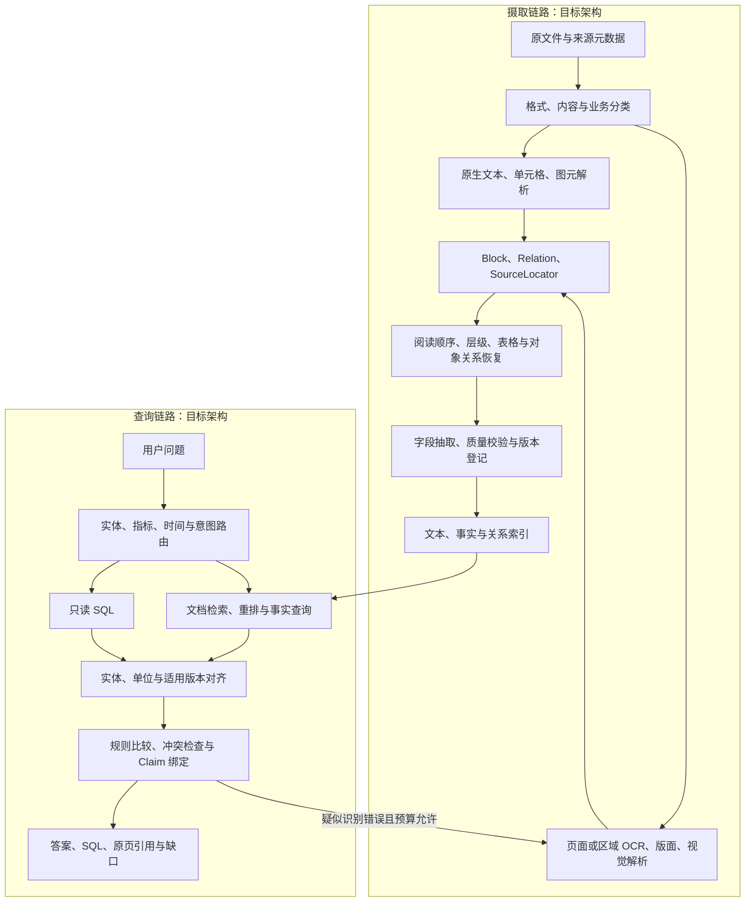

# DataMind Agent 技术设计说明书

## 面向赛题八：多模态数据驱动的可解释精准问数/问答智能体

版本：**V1.3（复杂文件解析与工业问答整合版，0.33.0 基线）**  
文档修订日期：2026 年 10 月 7 日  
实施证据截止：2026 年 10 月 7 日（代码 API **0.33.0**）；本次对照仓库代码与已有报告整理，未重新运行模型、OCR 或应用验收。  
用途：方案设计、增量研发、实验验收、竞赛交付与答辩。

> **方案摘要**：以“生产数据库＋工艺文件＋质检报告＋限定二维图纸”为工业主场景，建立从文件分类、原生/OCR 解析、结构恢复、业务事实提取，到 SQL 查询、跨源核验和来源定位的证据链。当前（API 0.18.0）已实现结构化单源问数、文档问答、真实扫描 OCR、限定工业温度规则核验、工业模型问数、紧凑格式 v2 与字段复核，以及本机身份/审批/来源权威、受控 CAD 契约与原生 DXF、图纸资产/关联复核/尺寸服务、受控多文件登记队列、原生 PDF 离线准备与私有知识发布/多文件检索，受控私有模型回答（只用本次选定的私有片段，生成后重查身份与证据），统一任务预算与进程时限（跨进程资源槽、挂钟 deadline、进程组终止），扫描页 OCR 与公式会话接入同一预算，以及已发布私有 PDF 向量点的受控修复与孤立点回收。下一阶段补齐紧凑格式之外的真实授权样本、统一 CPU/内存配额与跨主机租约，再推进通用 Adapter、V-CAR 与正式交付包。

### 阅读与状态约定

本版依据[复杂非结构化文件分类与解析技术文档](复杂非结构化文件分类与解析技术文档.md)，整合并精简 [V1.2 说明书](DataMind_Agent_技术设计说明书_V1.2.md)。参考材料用于提炼技术设计，其中的建议和工具清单不构成本项目的实现承诺。

**已实现**表示仓库存在对应代码；**限定实现**表示只覆盖明示的格式、模板或业务范围；**规划**表示尚待编码或验收；**历史实测**表示已有报告，本次没有重跑。目标架构、示例契约和研发指标均不自动转化为实际成绩。当前 API 版本为 **0.33.0**。

本版作为设计主入口。§18 汇总能力与历史成绩；V1.2 §18.2–§18.19 保留完整阶段记录、初始失败和修订过程，其旧“待实现”描述按后续记录与本版状态理解。代码入口和真实接口分别见 §14、§10；下一步完成条件见 §15。

### 目录

1. [项目定位与需求映射](#1-项目定位与需求映射)
2. [目标、范围与设计原则](#2-目标范围与设计原则)
3. [总体架构与运行链路](#3-总体架构与运行链路)
4. [结构化数据与精准问数](#4-结构化数据与精准问数)
5. [复杂文件解析与多模态知识库](#5-复杂文件解析与多模态知识库)
6. [跨源推理、冲突核验与修复](#6-跨源推理冲突核验与修复)
7. [可解释性与交互](#7-可解释性与交互)
8. [元数据、存储与版本治理](#8-元数据存储与版本治理)
9. [评测体系与验收口径](#9-评测体系与验收口径)
10. [API 与数据契约](#10-api-与数据契约)
11. [演示数据与验收脚本](#11-演示数据与验收脚本)
12. [技术选型与模型登记](#12-技术选型与模型登记)
13. [部署与运行保障](#13-部署与运行保障)
14. [代码落点与增量实现](#14-代码落点与增量实现)
15. [研发顺序与交付门禁](#15-研发顺序与交付门禁)
16. [风险与答辩证据](#16-风险与答辩证据)
17. [参考依据与整合映射](#17-参考依据与整合映射)
18. [实施状态、历史成绩与修订记录](#18-实施状态历史成绩与修订记录)

## 1. 项目定位与需求映射

### 1.1 项目定义

DataMind Agent 面向结构化业务数据与复杂文档的混合问答。系统识别指标、实体、工序、批次、时间和版本，选择只读 SQL、文档检索或工业规则工具，返回可追溯的答案。工业数据以规范编码关联；零售与 Chinook 保留为 SQL 回归基线。

工程价值在于恢复并利用原始数据中的结构、关系和适用条件：表格数值需要表头与单位，工艺要求需要适用版本，图纸尺寸需要标注对象，来源冲突需要双方证据和裁决依据。单纯提取文字不足以支撑这些任务。

### 1.2 赛题目标与内部专项

赛题依据沿用 V1.2 记录的用户需求：基础为单表查询与单文档检索；中级初赛至少攻克官方九项中的一项、决赛三项以上；高级提交创新自述；采用国产模型。正式交付前核对官方完整要求，本文不新增官方分值、编号或比赛日期。

| 层次/内部专项 | 设计目标 | 提交证据与当前边界 |
|---|---|---|
| 基础 Demo | 国产模型驱动单表问数、单文档检索、引用与拒答 | 两条单源链路已有代码和报告；已补本机身份/审批；国产来源登记仍需完善 |
| T1：复杂多表问数 | 审核关系、粒度、JOIN、聚合与有界修复 | 零售基线可复用；工业目前仅限定单层查询，不代表复杂工业 SQL 已通过 |
| T2：非标准文档解析 | 工艺/质检字段、结构、图纸尺寸与对象关联 | PDF/OCR 与限定字段已实现；紧凑格式 v2 通过；受控 CAD 契约/原生 DXF/资产/关联复核/尺寸服务已实现，真实图纸泛化未验证 |
| T3：混合数据冲突 | 实体/单位/时间/版本对齐、冲突检测与有依据的消解 | 限定温度检测与来源权威规则机制已实现；通用多指标与真实工厂授权裁决待实现 |
| 高级：V-CAR | 可验证跨源智能体推理，重点为冲突驱动局部重识别 | 尚待视觉接入、机制消融与模型效率实验 |

T1/T2/T3 是内部追踪代号，须映射官方九项后才能计入专项数量。OCR、澄清、公式识别和质量路由是配套能力。

## 2. 目标、范围与设计原则

### 2.1 分期范围

| 优先级 | 输入与业务范围 | 交付策略 |
|---|---|---|
| A：核心 | 工艺/质检原生与扫描 PDF、生产库、相关表单/老旧档案、限定二维机械图纸 | 先完成字段与跨源闭环；图纸须另建数据和评测，当前尚未实现 |
| B：扩展 | DOCX、PPTX、复杂 XLSX、流程图/P&ID/电气图 | 核心闭环后按样本需求接原生适配；逐格式验证定位与关系 |
| C：研究 | HTML、邮件、音视频、BIM/三维 CAD、GIS、点云、通用日志与仿真数据 | 专业对象/空间/时间契约后置，不列本期核心验收 |

参考文档中的六类通用重点文件转化为长期兼容路线。本期不同时建设全部解析器；优先形成有数据、有实现、有证据、有评测的工业路径。

### 2.2 设计原则

1. **原生结构优先**：有文本、单元格、图元或构件属性时保留原生结构，扫描与疑难区域使用 OCR/视觉补充。
2. **证据绑定**：原文、提取值、标准化值和生成摘要分开保存；关键结论可回到 SQL 行、原页区域或原生对象。
3. **确定性核验**：单位换算、区间比较、版本选择、聚合粒度与权限由代码校验；模型产出语义候选。
4. **有界恢复**：按失败根因局部修复，记录旧结果与新结果；目标统一预算为最多两次修复，预算耗尽返回缺口。
5. **分层状态**：摄取就绪、解析完成、字段忠实、原文审批和来源权威分别建模。
6. **可复现评测**：固定代码、数据、模型、提示词与标签版本，保留初始失败、未消解冲突和原始分母。

当前结果用于可复核的问答与辅助核验，不直接执行生产控制。自动写回、模型训练、前端框架迁移与 Agent 微服务化后置。

## 3. 总体架构与运行链路

### 3.1 摄取链路与查询链路

摄取负责把原始资产转换为版本化证据；查询消费已就绪的资产与索引。只有质量诊断或疑似识别错误触发受控重解析，不在每次问答时重新解析所有文件。



图中统一 Adapter、完整关系恢复、独立重排和局部视觉重识别属于规划。当前已有 PDF 摄取（含原生 PDF 离线准备与私有快照登记）、Hybrid/RRF 检索、SQL/RAG 路由、限定温度核验、受控 CAD 尺寸链路与受控多文件登记队列。

### 3.2 工业核验路径

问题：“2026 年 9 月 A102 工序 30 哪些批次温度超限？生产记录和质检报告是否一致？”

1. 明确零件、工序与生产期间，缺失或歧义范围先澄清。
2. 从实际工艺 PDF 提取范围、单位、原文审批声明与有效期；按批次发生时间选唯一适用版本。
3. 参数化 SQL 读取批次及逐次测量；按测量/报告标识关联报告事实。
4. 代码换算单位，分别计算工艺超限与同口径来源冲突。
5. 返回逐测量结果、批次汇总、原文位置、规则与双方原值；缺证据或重叠版本不生成确定结论。

当前采用固定查询和规则模板，不调用大模型；工业模型问数是另一条链路。受控 CAD 尺寸契约/原生 DXF/资产/关联复核/尺寸服务已实现，且原生 DXF 已接入统一解析契约（实体/尺寸/XDATA 引用 → `cad_entity` 定位与 `references` 关系）；DWG 需外部转换器，通用动态计划与任意多源推理仍待实现。

## 4. 结构化数据与精准问数

### 4.1 SQL 主链路

`问题帧 → Catalog/Schema Linking → 审核 Join Path → 模型 SQL → AST/语义门禁 → 常量绑定 → 只读执行 → 结果/错误核验 → 有界修复 → 证据与 Trace`

Catalog 保存字段中文名/别名、枚举、指标定义、单位、粒度、权限和审核关系。连接路径必须来自已登记关系；查询需保持事实粒度和连接基数，避免一对多 JOIN 放大汇总。结构检查和可执行性不能代替问题语义正确性。

SQL Guard 拒绝写操作、未授权对象、未审核 JOIN 与危险表达式；执行端使用只读账号/事务、超时和行数上限。修复后的 SQL 重新通过门禁，保存每次错误与结果。

### 4.2 当前工业问数契约

| 项目 | 限定实现 |
|---|---|
| Catalog | `demo_industrial.parts`、`measurement_observations`；2 对象、14 列、1 条 n:1 维度关联、3 个指标 |
| 视图粒度 | 每行一个 `measurement_id`；只覆盖已有测量，不包含未测量批次 |
| 批次数/测量数 | 批次去重计数；测量按测量行计数 |
| 温度聚合 | 使用归一化 `temperature_c`；K 减 273.15；未知单位为 NULL，不进入均值 |
| 时间口径 | `produced_at`，Asia/Shanghai，年月/年份半开区间；单批次可不指定月份 |
| 查询范围 | 单层 SELECT；目录、计数、按零件分组、均值/最大/最小、明细与未知单位 |
| 门禁 | 检查实体、工序、时间、指标、AND 条件、聚合粒度；阻止 OR 放宽、额外筛选、重复 JOIN 和混单位聚合 |
| 资源 | 工业模型问数 5 秒 SQL 超时、100 行上限、最多两次修复 |

超限、合格、工艺适用与报告一致性需调用原文规则工具。不能通过 SQL 登记的报告 ID 推断 PDF 已存在、已批准或是真值。复杂工业 SQL、多实体、多工序、相对时间、阈值过滤和按批次均值另行扩展。

业务契约以 [QUERY_CONTRACT.md](../data/industrial_demo/QUERY_CONTRACT.md) 为准；历史工业开发集 8/8 不代表这些后续能力已验收。

## 5. 复杂文件解析与多模态知识库

### 5.1 分类体系：格式、内容载体、业务语义

文件分类采用三层组合。**物理格式**决定读取器；**内容载体**决定原生/OCR/视觉路径；**业务语义**决定字段与核验规则。例如 PDF 可以是原生工艺卡、扫描报告、矢量图纸或混合页面，同一文件甚至同一页需要多条解析路径。

类型识别目标为文件签名/容器结构检查，再抽样页与对象画像；扩展名仅作声明。记录 `declared_extension`、`detected_media_type`、`content_profiles`、`semantic_candidates`、分类依据、Adapter 版本与路由理由。假后缀、加密、损坏、未知格式和转换失败单列状态，不返回“空解析成功”。统一分类器尚未实现。

#### 5.1.1 办公与多媒体分类矩阵

| 类别 | 核心难点与保留内容 | 解析策略与定位 | 范围/状态 |
|---|---|---|---|
| 原生/复杂 PDF | 多栏顺序、标题、表格、图注、公式、脚注与跨页关系 | 文本/坐标优先，区域布局补充；页序号＋bbox | A；基础文本/表格/公式已有，完整结构待扩展 |
| 扫描 PDF、图片与表单 | 倾斜、模糊、印章、手写、行格/字段绑定 | 原像素 OCR，保留变换链与低置信候选；原页/图区域 | A；扫描 OCR 与限定字段已有，通用图片摄取待扩展 |
| Word | 标题、表格、文本框、脚注、批注和修订 | 原生对象解析；段落/表格/单元格＋渲染引用 | B；**已实现段落/标题/表格**（API 0.29.0），文本框/脚注/批注/修订未实现 |
| PPT | 形状位置、箭头、图表、章节与备注 | slide/shape/连接端点；保留备注来源 | B；**已实现文本框文本**（API 0.29.0），形状位置/图表/备注未实现 |
| 复杂 Excel | 多表区、合并、多级表头、公式/缓存、跨 Sheet、隐藏项 | Sheet/单元格/表区及依赖；公式与缓存分开 | B；**已实现按行取值与表区 locator**（API 0.29.0），合并语义/公式/隐藏项未实现 |
| 图片流程图/架构图 | 节点、方向、连线和关系语义 | OCR＋符号/连线候选＋上下文核验；节点/边区域 | B；未实现，节点名单不能替代流程 |
| HTML/网页 | 正文与导航/广告/评论、动态内容 | 保存来源快照、正文区域与链接 | C；未实现 |
| 邮件 | 线程、引用去重、签名与附件关系 | 消息 ID/线程/附件来源树 | C；未实现 |
| 音频 | ASR、说话人分离、专业术语与时间连续性 | 时间戳/说话人/音频段 | C；未实现 |
| 视频 | 分镜、关键帧、字幕/声音/画面同步 | 时间段/帧/转写关联 | C；未实现 |

#### 5.1.2 工程数据分类矩阵

工程数据常包含原生结构或数值结构，不能全部按“图片→OCR”处理。

| 类别与代表格式 | 应恢复的工程信息 | 适配与关系边界 | 范围 |
|---|---|---|---|
| 二维 CAD：DXF、DWG、DGN、图纸 PDF | 图层、图元、块属性、尺寸/公差、单位、视图与版次 | DXF 原生（LINE/CIRCLE/TEXT 及限定 XDATA）、受控尺寸/资产/关联复核，**并已接入统一解析契约**（API 0.30.0）；DWG 转换器缺失时明确拒绝，DGN 与图纸 PDF 区域路径另验收 | A，限定实现 |
| BIM：IFC、RVT、NWD/NWC | 构件、属性、层级、系统和空间关系 | 专业读取/导出适配，保留原生对象 ID | C |
| 三维 CAD：STEP/IGES、SLDPRT/SLDASM、CATPart | 装配树、几何拓扑、参数、材料与约束 | 以专业对象与几何解析为主；导出是否保留属性需验证 | C |
| P&ID、电气图、工程流程图 | 设备/端口/管线、物料流和控制关系 | 符号＋连线＋方向核验；相交不必连通 | B |
| 现场照片、红外图、巡检视频 | 设备、区域、缺陷候选和时序 | 视觉结果绑定现场/时间与原图；不承诺缺陷诊断 | 核心文档区域 A，诊断 C |
| 点云：LAS/LAZ、PCD/PLY、E57 | 点/分割对象、配准、构件与模型映射 | 保留坐标系、单位与变换；专业三维处理 | C |
| GIS/遥感：SHP、GeoJSON、GeoTIFF、KML、DEM | 地理实体、栅格/矢量、空间关系 | 坐标参考、空间索引与源数据集关联 | C |
| 仿真结果 | 网格、场值、时序、边界/载荷、单位与报告 | 原生数值＋参数＋云图关联，保留运行条件 | C |
| 日志、告警、运维记录 | 时间事件、设备、故障、措施和因果候选 | 事件/数值结构与文档关联；时间相邻不自动推定因果 | C |
| 老旧工程档案 | 蓝图、污损/盖章扫描、手绘与历史版次 | 图像增强＋OCR/符号候选；引用原图，标记不可辨 | A 中的限定档案，待扩样 |

### 5.2 Parser Adapter 与解析状态（目标契约）

Adapter 输入为源资产、不可变文件哈希、解析配置和允许的页/区域。输出为统一 `ParseResult`，至少包含：

| 对象/字段 | 约束 |
|---|---|
| `classification` / `adapter_capabilities` | 类型依据、能力范围、转换要求与限制 |
| `blocks` / `relations` | 原文/原生属性、位置及结构/对象关系；候选与确认状态分开 |
| `parsed_scope` / `failed_scope` | 逐页/区域/对象记录成功、失败与缺口 |
| `quality_findings` / `unsupported_features` | 质量风险、缺失结构与影响；不得静默删页 |
| `artifact_refs` / `manifest` | 原始/转换/增强/渲染产物、参数和解析器/模型哈希 |
| `parse_status` | `parsed`、`partial`、`needs_review`、`failed`、`unsupported` |

`parsed` 仅表示声明范围已解析，不等于事实已验证。摄取阶段另用 `queued → classifying → parsing → validating → indexing → ready`，失败进入 `failed`。API 0.25.0 已实现该契约的**校验与登记**（`datamind/parse_contract.py`）；API 0.26.0 起 `parse_pdf` 在返回前**实际产出并校验**契约并写入质量明细，违反不会中断摄取而是带错误码记录。API 0.27.0 已接入**按 media type 的 Adapter 路由**（签名探测 + 带 handler 的登记 + `dispatch` 分发并校验，`parse_pdf` 经该路由执行并在明细中回报 `adapter: pdf-native`）；API 0.28.0 已接入契约结果的**存储**：新增应用所有的 `document_block_locators(block_id, document_id, contract_version, locator)`，`ingest` 在重建文档块时同步写入，只有校验过的块才有行（不编造历史定位）。基表 `document_blocks` 属主为 postgres 且既有迁移从不 ALTER 基表，故遵循既有模式另建表而非变更属主。见 [解析契约](../docs/PARSE_CONTRACT.md)。

转换产物记录工具/版本、输入输出哈希、字体/布局与缺失警告。转换成功后仍需检查内容与证据映射；源文件与转换文件均可追溯。Office 不默认截图 OCR，CAD 不默认丢弃图元。

### 5.3 PDF/OCR 当前实现与改进重点

当前 `parse_pdf` 按页统计原生字符；低于 30 字符走 240 DPI 原像素 OCR，其余走原生文本/表格。OCR 保留纠偏矩阵、原页坐标及低置信候选。预览使用 110 DPI，与识别输入分开。公式 worker 接收裁剪图片，结构检查通过后生成 LaTeX 候选，数学语义尚未独立验证。

这套路径存在明确边界：页内排序仍按 y/x，多栏可能串序；“文字够多”的混合页仍可能遗漏扫描区域；标题识别基于字号启发式；扫描行聚合不等于单元格/表头/续表完整恢复。近期优化应针对这些缺口，不以更换工具名称代替验收。

目标路由先评估文本层覆盖和区域内容，再选择原生/扫描混合解析；布局区域内恢复阅读顺序；表格恢复行列、合并、表头、单位和脚注。增强与裁剪只改变解析输入，引用始终能访问原始页，并通过缩放/旋转/裁剪逆变换还原位置。

### 5.4 Block、Relation、Chunk 与来源定位

| 对象 | 必需信息与约束 |
|---|---|
| `DocumentBlock` | 文档/源/解析版本、类型、原文、原生属性、顺序、位置、质量与内容哈希 |
| `BlockRelation` | 源/目标对象、关系类型、原文依据、恢复方法与 `candidate/verified/needs_review` 状态 |
| `Chunk` | 标题路径、原文、块/关系引用、索引文本、单位/条件、访问域与版本 |
| `DocumentFact` | 实体/工序/批次/测量、事实类型、原值/标准化值、版本/有效期、逐字段证据 |
| `DrawingFeature` | 图号/版次、尺寸/公差、单位、图层/句柄/视图、标注对象和关联状态 |

关系包括 `precedes`、`contains`、`caption_of`、`header_of`、`continuation_of`、`annotates`、`connected_to`、`flows_to` 与 `references`。文件内部关系与跨文件实体对齐分开存储。关系需有依据，名称接近、对象相邻或线条相交均不足以确认。

目标 `SourceLocator` 统一文档与源版本，再按类型定位：

| `locator_kind` | 位置字段 | 关键边界 |
|---|---|---|
| `pdf_region` / `image_region` | 页序号/图 ID、bbox、页面大小、坐标系与变换链 | 实际页序号与印刷页码分开；像素与 PDF 点坐标分开 |
| `office_object` | part/object、paragraph/table/cell 或 slide/shape | 原生对象为锚；渲染页码依赖环境 |
| `sheet_range` | Sheet、单元格/区域、公式/缓存来源 | 合并与隐藏属性保留 |
| `cad_entity` | layout/view、句柄、图层、模型坐标/单位、渲染引用 | 句柄绑定源版本；模型坐标不混用页面像素 |
| `temporal_segment` | 起止时间、说话人/帧引用 | 时间单位和时间基准必须明确 |
| `model_spatial_object` | 原生对象 ID、坐标参考、变换/视图 | 空间数据使用原生坐标契约 |

PDF 的目标统一约定为页序号从 1 开始、bbox 为 `[x0,y0,x1,y1]`、原页可视坐标原点在左上、单位为 point，并明确页面旋转。不同读取器的坐标需转换后入契约，验证 bbox 在原页范围内。当前已有 PDF 块位置；API 0.25.0 已把统一 Locator/Relation 落地为**可校验契约**（七类定位器、关系类型/状态/依据约束），Office/CAD 等格式仍无产出该契约的解析器。

### 5.5 结构恢复与语义切片规则

| 结构 | 恢复与切片规则 | 必测反例 |
|---|---|---|
| 多栏/标题/页眉脚注 | 先分区与栏内顺序；标题路径随块；重复区域标记后处理 | 双栏串序；脚注例外/版本被误删 |
| 段落/跨页内容 | 顺序、章节、源版本与语义连续性确认后合并 | 页末截断；跨版本误拼 |
| 表格/续表 | 表区或行组切分，携带完整表头路径、单位/脚注；续接保存依据和各页出处 | 相似表头但单位不同；合并格错误填充 |
| 图/公式 | 图注与原生关联/区域候选核验；公式连同变量定义、单位与适用条件召回 | 最近文字非图注；缺符号仍作确定计算 |
| Office | 批注/修订/备注/隐藏项与正文分开；公式与缓存值分开 | 删除文字当正文；过期公式缓存当实时值 |
| 图纸/关系图 | 标注对象/视图与关系片段关联；未确认关系保留候选 | 多对象标注；线交叉误连通 |

当前切片配置为目标 500、上限 800、重叠 80 **字符**，结合标题树和独立表格块；这不是 token 配置，也不代表全部结构感知切片已完成。结构增强后先比较召回、引用和错误率，再调长度。不同源版本与访问域不能拼成一个切片。

### 5.6 业务事实抽取与质量门禁

工艺事实存要求范围、条件、实体/工序、审批声明与有效期；报告事实存批次/测量、时点/方法、实测及报告结论。规范要求、实测和结论分别标识为 `requirement/measurement/conclusion`，不相互替代。

目标字段为 `fact_id`、`entity_id`、`operation_no`、`batch_id`、`measurement_id`、`metric`、`fact_kind`、`raw_value/raw_unit`、`normalized_value/range/unit`、`conditions`、源/业务/解析版本、`valid_from/to`、审批声明、`evidence_refs`、抽取方法与核验状态。缺失/未知保留原样，不从文件名、上传时间或数据库值补造。

采用五层门禁：格式可读 → 原文覆盖 → 结构/关系完整 → 字段/单位/绑定合法 → 引用可解析。接受字段必须同时满足原文忠实、正确区域和业务键绑定；结构合法或 OCR 高置信不能代替字段正确。当前新模板评分还要求区域 IoU≥0.5，具体标签以冻结评测契约为准。

现有工业原生解析器能处理限定模板；后续模板字段首轮为 28/56。原文块读到但未形成合法事实的字段不能计入接受分子。无法辨认、缺单位、缺绑定或有多个候选时进入待核验。

### 5.7 检索与证据构建

当前文档链路为：已索引/公开/集合/文档版本过滤 → 词法与 Dense 各 Top-30 → RRF（`k=60`）→ Top-5 → 模型生成 → 引用原文连续片段及数字支持检查。Dense 不可用时保留降级警告并用词法路径。当前没有独立神经重排器，也没有完整关系邻接补全。

目标在融合后增加文档重排、图注/表头/相邻结构补全、去重与上下文预算；权限与源版本过滤贯穿补全。精确实体/批次/工序走事实过滤，聚合与规则走确定性工具，不能依赖文本相似度确认唯一实体或关系。

工业 PDF 当前为 `typed_facts_only`，仅进入事实链路，没有新增工业 RAG 切片/向量；运行数据中 169 切片/向量属于原知识库。未来工业文本检索需单独建设与验收。

### 5.8 二维 CAD 与局部视觉增强

受控 CAD 链路已实现：`cad-contract-v1` 冻结源/图号/版次/句柄/模型坐标/单位与 LINE/CIRCLE/TEXT 及直径/公差，含对象关联与错版/矛盾门禁；`ingestion/cad_dxf.py` 读取原生 DXF，`cad_render.py` 生成句柄 SVG；图纸按认证资产登记（固定源副本/快照/版本历史），由 reviewer/admin 做关联复核，再由 admin 登记尺寸并在独立 approver 批准后使用（`/#cad`、`/#dimensions`）。冻结后新合成图 6/6 场景符合预期（2 可用、3 保留/排除、1 不支持拒绝），属自定义交换 profile，不代表任意 CAD 泛化。

尺寸文字识别与对象关联分别评测。标注覆盖文本与实体测量值不一致时保留差异；扫描/PDF 不根据像素长度推断制造尺寸。P&ID 的拓扑与控制语义另建标签，不用机械尺寸实验代替。DWG 转换与图纸 PDF/扫描区域路径仍待实现。

复杂表格/图纸局部才进入国产视觉候选；先记录质量根因，再选择裁剪或重识别。保留区域、模型/权重版本、视觉输入、耗时、资源与修复前后。当前 providers 为文本载荷，视觉输入与模型分工配置尚未接入；本版不宣称已具备小视觉模型级联。

## 6. 跨源推理、冲突核验与修复

### 6.1 编排角色与执行边界

Query Understanding 提取语义与歧义；Planner 产出受约束任务；SQL/RAG 执行工具；Fusion 对齐事实；Verifier 检查数值、出处、实体、时间、粒度与冲突。首版保持单体内显式状态机，Agent 代表职责节点。

目标 DAG 每个节点保存任务 ID、依赖、结构化输入引用、预期输出、权限、预算、状态与事件。独立任务可并发，带依赖的任务消费前序结果；失败只重跑受影响子图，原始失败保留。当前持久化运行/事件已有，工业仅限定规则 DAG。API 0.22.0 已按本契约实现通用依赖计划与断点恢复（`datamind/vcar.py`）；API 0.23.0 补齐受控节点执行与 HTTP 入口：节点可在独立进程组内按统一预算执行、占用跨进程资源槽、取消可传播，`POST /v1/plans/execute` 的目标由服务端白名单决定。见 [V-CAR 说明](../docs/VCAR.md)。

### 6.2 对齐与跨源冲突

比较键至少覆盖零件、工序、批次、测量/报告 ID、指标、时点与方法；精确编码优先，其次经审核别名，多候选不自动合并。先换算可靠单位，再按发生时间选择唯一适用版本。有效期为 `[start,end)`；结束时间缺失仅在原文明确开放时可当开放区间。

| 类型 | 核验与处置 | 当前范围 |
|---|---|---|
| 单位等价 | Decimal 标准化并保留双方原值 | 限定摄氏/K 已实现，未知单位转缺口 |
| 错实体/测量方法 | 检查业务键/时点/方法，拒绝错误对齐 | 限定规则已实现，通用实体映射待扩展 |
| 版本差异 | 按发生时间匹配批准源声明及唯一有效版次 | 限定选择已实现；重叠/未知转复核 |
| 工艺超限 | 实测与适用要求区间比较 | 限定温度已实现；属于业务不合规 |
| 同口径来源矛盾 | 保存 SQL/PDF 原值、证据与原因 | 检测/持久化已实现；无权威规则保持 `unresolved` |
| 疑似 OCR 错误 | 重识别原文局部并重算依赖结论 | 规划，不能以“更接近 SQL”判定新识别正确 |
| 权威裁决 | 按明确范围/审批/有效期/版本的权威规则处理 | 规划；无默认 SQL 优先或新上传优先 |

工艺要求 840–860℃、SQL 实测 870℃、同测量报告 850℃时，应分别报告“SQL 记录超限”与“来源冲突”。报告写合格不能消除温度矛盾，也不能生成单一确定的批次合格判断。

### 6.3 字段复核、审批与来源权威

字段复核支持 `confirmed/rejected/needs_review` 追加历史，绑定文件/文档/解析器/字段载荷哈希与前一记录；请求幂等，版本或并发旧状态返回 409。已补本机身份认证（`auth.py`＋migration 005）、角色权限与 CSRF：复核仅 reviewer/admin，独立字段审批仅 approver/admin 且不能审批自己，模型接入仅 admin。

确认表示提取忠于原文，不改变原文审批、不把候选变为权威。最新存疑/退回字段从后续工业规则核验排除，保留字段与历史；证据排除导致缺口，不能据此认定来源一致。载荷/版本变化后旧决定不自动继承；生产 SQL、文档 RAG 和旧运行快照保持各自语义。字段审批（`approvals.py`）与来源权威（`authority.py`＋migration 006）分层：权威规则由 admin 登记、另一审批账户启用/不批准/撤销，精确绑定范围/版本/生产记录/依据页，未登记则保持 `unresolved`。

仍为**本机演示范围**：服务只绑定 `127.0.0.1`，来自本机的请求默认自动以已登记的 `local-admin`（admin）身份进入（`DATAMIND_LOCAL_NO_LOGIN=0` 可恢复强制登录，`=1` 可对非本机客户端也启用），真实账户仍需本地管理员交互创建、无默认密码；身份与依据内容的业务授权含义由人核对，未做真实工厂授权验收。接口追加语义不等于底层数据库具有防篡改保证；缺失字段补录与正式多租户权限尚待实现。

### 6.4 V-CAR 与恢复预算（0.22.0 已实现编排原语）

`Plan → Execute → Verify → Repair → Reverify`：将结论映射到任务和证据，按错误类别选择重新取 Schema、检索改写、单位/映射修正或局部重识别；任何修复都重新验证依赖结论。真实来源矛盾无规则时终止自动消解，返回双方证据。

目标共享 `deadline/max_steps/max_rows/max_tokens/max_repair`，最多两次修复。API 0.22.0 已实现该统一预算与局部修复：`max_repair` 上限 2，预算在派发边界检查，失败只重跑受影响子图且保留原始失败，修复后后继重新执行；`unresolved` 冲突终止自动消解并返回双方证据。API 0.23.0 已把节点执行接入 `task_budget`（独立进程组、跨进程资源槽、取消传播、节点时限取自全局剩余预算）并提供 `POST /v1/plans/execute`；API 0.24.0 已补机制消融与修复/冲突指标（四条机制臂、冻结合成集、误修复率与未消解保留，见 [V-CAR 说明](../docs/VCAR.md)）；**真实视觉载荷、模型规模对比与参数效率对照仍待实现**。

API 0.24.0 已在冻结合成集上验证该假设的机制层：结构化事实与规则臂 0 误修复，盲目局部重识别臂把 2 个原正确值改错（误修复率 14.29%），有据重识别 + 权威规则臂 0 误修复并正确保留 2 例未消解。零分母按 §9.2 报告 N/A，全部失败保留。

创新假设为：结构化事实与根因规则减少无效重识别，仅疑难区域调用小视觉模型能降低成本并改善错误定位。实验比较普通 OCR＋文本检索、结构化事实/规则、再加局部重识别、完整证据闭环；固定测试集和模型做机制消融，再比较模型规模。必须报告误修复、错误消解与未消解，验证后才能主张效果。

## 7. 可解释性与交互

展示实际执行的信息：路由、任务/工具事件、SQL/参数、结果粒度、命中原文、字段/版次、规则、冲突与耗时/重试。无需展示模型私有逐字思维链。

前端已有模型配置、SQL/RAG/工业范围、SSE、运行列表/回放、引用卡片、原页字段定位及复核历史，并新增 `/#cad`（图纸资产/关联复核）、`/#dimensions`（尺寸登记/独立批准/历史）、`/#files`（多文件登记队列）、`/#authority`（来源权威登记/启用）与多文档问答选择。目标继续补统一结构高亮与待核验关系；页面明确区分实时执行和历史回放。

回答 Evidence Graph 表示 Claim 的支持/反驳/核验来源；工程对象图表示原文件中的连接与空间结构，两者以事实/对象 ID 关联。通用图结构尚待实现。当前 RAG 验证引用连续片段与数字支持，**未独立验证完整语义蕴含**；数字出现在证据中不等于对象、时间、条件和结论均正确。

验收要求：每个关键 Claim 可追到相应 SQL 行/聚合或文档位置；无支持时标明不足；冲突展示双方证据；回放保持当时版本，源文件变化时提示版本不一致，不定位到新内容。API 0.32.0 起文档引用的 `locators` 携带**契约校验过**的定位（`block_id` + `locator` + `contract_version`），只在存储中确有时附上，缺失即不附。

## 8. 元数据、存储与版本治理

### 8.1 核心对象与存储

| 存储 | 当前用途 | 目标扩展 |
|---|---|---|
| PostgreSQL | Catalog/Schema、资产/块/切片、候选事实、运行/事件/证据、工业冲突、复核历史与评测 | 分类/Adapter、统一关系/Locator、图纸特征、正式权限/审批/权威规则 |
| Qdrant | 原知识库 Dense 向量与 payload | 工业文本索引；与当前事实链路分开验收 |
| 本地文件卷 | 原文件、页图与产物 | 版本化裁剪、转换、CAD 渲染；S3 按需 |
| PostgreSQL/JSONB＋遍历 | 现有结构化记录；通用关系存储规划 | 结构图/工程对象图/证据图分开，无规模依据先不加独立图数据库 |

Redis、专用图数据库、监控集群和额外对象存储不是当前核心依赖。

### 8.2 版本必须分层

| 版本 | 含义 | 不可混用的情况 |
|---|---|---|
| `source_sha256/source_version` | 原文件内容指纹 | 同名新文件不能复用旧定位 |
| 资产 `document_version` | 当前 API/数据库中的整数版本 | 不是工艺 V1/V2 的业务版次 |
| 业务 `revision` | 原文工艺/图纸/报告版次及适用有效期 | 不从上传顺序推定生效 |
| `parser_version/parse_version` | 解析器代码及一次解析产物版本；独立解析版本为目标扩展 | 同文件重识别不等于业务升级 |
| `index_version` | 切片/Embedding/检索索引快照 | 新解析不能继续引用旧片段内容 |
| `review_binding` | 字段载荷哈希、文件/资产/解析器版本及前一决定 | 旧复核不自动确认新载荷 |

每次实验 manifest 保存代码 commit/哈希、源集合、Catalog、标签、解析/转换配置、模型权重/来源/规模、提示词、硬件与缓存状态。源/证据哈希验证已有；完整不可变解析产物、shadow index 和原子切换仍为目标。

重解析规划创建新产物版本，验证通过后发布并使相关切片/事实缓存失效，保留旧运行依赖。失败保持上一可用版本；不得覆盖历史输入后继续把旧 run 当同一次结果。

## 9. 评测体系与验收口径

### 9.1 数据划分与标签

分开维护开发、调参与未参与修复的验收样本。按源文件、模板家族、零件系列/来源分组；同文件的原生/扫描、旋转/模糊变体必须在同一划分。真实授权材料与合成材料单列，标签冻结在测试前；标签、seed 和原生对照不传入 OCR/字段识别器。

标签包含原文值/单位/条件、区域/对象、表头与关系、业务键、适用版本、期望路由/状态、SQL 结果、支持证据、冲突/拒答/澄清原因。无法辨认字段标为不可确定；失败、缺失和不支持单列统计，不静默删除。

### 9.2 指标定义

| 层次 | 指标与分母 | 解释边界 |
|---|---|---|
| 分类/转换 | 路由正确数/有标签输入；成功、partial、failed、unsupported 分布 | 成功转换不能代替内容/定位正确 |
| OCR/结构 | CER=`(替换+删除+插入)/参考字符数`；标题/单元格/续表/关系 Precision、Recall、F1 | 按原生/扫描、模板和质量分层，不替代业务字段成绩 |
| 字段/完整事实 | 字段值＋定位＋绑定全部通过数/冻结字段数；完整事实数/事实总数 | 原文诊断匹配与接受字段分开；全部缺失项留在分母 |
| Locator | 成功解析且命中正确页/区域/对象数/被评定位数 | 页码正确不等于 bbox/对象正确 |
| Schema Linking | 表/语义锚点列/指标 Top-K 召回；审核 Join Path 正确数/路径标签数 | 连接键与公式操作数按对应门禁另评；召回不等于端到端 SQL 正确 |
| 检索 | Recall@K、MRR@10，必需多证据覆盖 | gold 命中与端到端问答分开；多证据问题报告覆盖缺口 |
| SQL | 语义/执行结果正确数/模型执行题；模型前澄清单列 | 行列、NULL、类型、单位、重复数与排序要求均保留 |
| 回答 | 关键 Claim 正确、引用支持/覆盖、忠实度、正确拒答 | 规则/人工标签为主；辅助 Judge 不充当唯一真值 |
| 冲突 | Precision=`TP/(TP+FP)`，Recall=`TP/(TP+FN)`；正确/错误消解、未消解 | 与业务超限分开；显式报告真实矛盾的误裁决 |
| 修复 | 修复成功数/尝试修复数；正确字段被改错数/参与重识别的原正确字段数 | 同时报告触发比例、预算耗尽与新增耗时 |
| 性能/模型 | p50/p95、失败率、调用/token/视觉输入、内存/显存、参数/激活参数 | 固定数据复杂度/硬件/并发，冷/热缓存分开 |

检索 Recall@K 在多 gold 证据问题中按“召回 gold 数/gold 总数”报告，同时可另报问题级至少一条命中率，禁止用一个分子混称两种指标。零分母报告 N/A。SQL 排序无关比较使用保留重复次数的多重集；排名/Top-k 保留顺序，不用集合去重掩盖错误 JOIN。数值容差与单位按题声明，类型归一化不能改变标签与行列形状。

### 9.3 研发目标与发布门禁

沿用研发目标：Recall@5≥0.85、MRR@10≥0.80、回答忠实度≥0.90、PDF 正确页码率≥0.95、质量风险召回≥0.90、多文档/多模态正确率≥0.90。均为计划目标，不是官方门槛或已有实测；新增结构/关系指标先建基线和人工标签再定阈值。

发布先验证组件，再做相应端到端套件和人工抽查，输出全部失败。新增格式需同时有读取器、Locator、困难/异常样本与报告才能列为已验证支持。安全违规目标为 0；核心路径不退化；缺证据/冲突不被静默改成确定答案；预算、版本和回放可复核。

组件回归、固定规则、真实模型、单题重试与同输出复算分别报告。扩样计划可沿用约 40 份核心文件（15 工艺、15 报告、10 图纸）和约 60 条问题的建设目标，当前尚未达成；数据数量不能代替模板/结构多样性。

## 10. API 与数据契约

### 10.1 当前接口（依据 `datamind/api.py`）

| 方法与路径 | 实现内容与边界 |
|---|---|
| `POST /v1/chat`、`POST /v1/chat/stream` | `auto/sql/rag/industrial`；SQL、文档与限定工业路径；SSE |
| `GET /v1/runs`、`GET /v1/runs/{id}` | 运行列表、结果与回放 |
| `GET /v1/runs/{id}/events`、`/evidence`、`/conflicts` | 事件、证据与持久化工业冲突 |
| `GET /v1/documents`、`GET /v1/documents/{id}` | 可访问集合内的资产与状态 |
| `GET /v1/documents/{id}/file`、`/pages/{page_no}` | 原文件、原页预览；验证源版本与位置 |
| `GET /v1/documents/{id}/facts` | 当前候选字段与定位 |
| `GET/POST /v1/documents/{id}/facts/{fact_id}/reviews` | 复核历史/追加决定；需 reviewer/admin（本机默认自动满足） |
| `/v1/model/profiles` 及配置启用/测试等既有接口 | 多配置文本协议接入；不等于已接视觉模型；仅 admin 可改 |
| 身份/会话与角色接口（`auth.py`、`scripts/manage_users.py`） | 本机默认免登录（回环自动以 `local-admin` 进入）、账户登录、CSRF 与角色门禁；无默认密码 |
| 受控队列接口（`file_jobs.py`） | DXF/单测量 JSON 上传、逐文件状态、限额/租约/幂等/重试/取消 |
| CAD 资产与关联复核接口（`cad_store.py`、`cad_reviews.py`） | 认证登记、版本历史、实体/预览、复核决定 |
| 尺寸服务接口（`cad_dimensions.py`） | 测量登记/版本、显式绑定、独立批准/撤销、当前核验与历史 |
| 来源权威接口（`authority.py`） | admin 登记、另一审批账户启用/撤销、规则状态查询 |
| PDF 私有链路接口（`pdf_publications.py`、`pdf_search.py`、`pdf_answer.py`） | 快照登记/知识发布/私有多文件检索；检索只返回证据，回答仅用本次选定片段 |

以下为**规划接口**：通用文件上传 `POST /v1/documents`、统一 `features`/`relations`、统一 locator 预览、区域 `reparse` 和评测作业 API。当前通用摄取/评测仍由脚本完成，不能据接口规划表认定已上线。

### 10.2 当前有效请求示例

工业规则核验提交至 `POST /v1/chat` 或 `/v1/chat/stream`：

```json
{
  "question": "2026年9月A102工序30哪些批次温度超限？生产记录和质检报告是否一致？",
  "mode": "industrial",
  "scope": {
    "database_sources": ["demo_industrial"],
    "document_collections": ["industrial_demo"]
  }
}
```

工业模型问数提交同一接口，使用 SQL 模式：

```json
{
  "question": "2026年9月A102工序30有多少个已有测量的生产批次？",
  "mode": "sql",
  "scope": {"database_sources": ["demo_industrial"]}
}
```

当前 `ChatRequest` 只有 `question/mode/scope`；集合字段为 `document_collections`。不把旧设计的 `knowledge_collections/conversation_id/options` 当已实现请求契约。流式通过选择 `/stream` 端点启用。

### 10.3 契约演进与错误

当前返回 `run_id`、状态、相应 SQL/RAG/工业结果及持久化 Trace；以实际模式和代码为准。统一目标答案将包含 Claim、证据 ID、版本快照、冲突/缺口与校验状态，不能将示意响应直接作为当前 OpenAPI。

| 情况 | 当前/目标处置 |
|---|---|
| 源文件变化 | 当前 `SOURCE_VERSION_MISMATCH`；拒绝把旧字段定位到新源 |
| 复核载荷过期或并发旧状态 | 当前 HTTP 409；读取最新字段/历史后再提交 |
| 范围、单位、版本或证据不足 | 当前分支返回澄清/拒答/缺口，不能静默补值 |
| 无权威规则的来源冲突 | 当前保存 `NO_REGISTERED_AUTHORITY_RULE`，不选真值 |
| 统一分类/关联/修复错误 | 规划稳定的 unsupported、关联不确定、预算耗尽等错误，须随实现登记 |

新接口参数用类型/allowlist 校验；文件定位只能解析已登记且授权的 locator，不接受任意路径作为来源权限。

## 11. 演示数据与验收脚本

### 11.1 当前数据与关联

工业合成底座包含 3 零件、12 批次、13 测量、13 质检登记与 5 工艺版本；工艺/报告 PDF 共 17 页。批次 1:N 测量，每个测量至多一条质检登记；按独立测量 ID 比较，避免多采样 JOIN 扇出。材料和“已批准”均为模拟声明。

历史运行资产为 27 文档、23 候选事实（6 门店＋17 工业）、169 切片/向量。四页后续原生/扫描模板测试未混入运行知识库。数据口径以 [CONTRACT.md](../data/industrial_demo/CONTRACT.md) 与相应报告为准，不代表本次实时数据库盘点。

### 11.2 演示路径与验收

| 路径 | 演示要点 | 状态 |
|---|---|---|
| 基础 SQL | 问订单/业务统计，展示模型 SQL、绑定、执行结果和只读轨迹 | 可运行，配置上游模型后执行 |
| 文档 RAG | 原文问题与无答案问题，展示引用/页码和拒答 | 可运行；完整结构与语义核验仍有限 |
| 工业模型 SQL | A102 生产期间/工序批次数、温度均值和明细 | 限定实现，明确已有测量/测量粒度口径 |
| 工业规则 | 工艺→SQL→报告，展示适用版本、超限、冲突与缺口 | 限定温度实现；不调用模型 |
| 字段复核与审批 | 定位原页、确认/存疑/退回、历史与过期校验；独立字段审批 | 限定实现；演示提交使用隔离副本 |
| CAD 资产/关联/尺寸 | 认证登记图纸、关联复核、尺寸绑定与独立批准、历史回放 | 受控合成链路可运行；`/#cad`、`/#dimensions` |
| 多文件队列 | 上传受控 DXF/JSON、逐文件状态、重试/取消 | 需另启 `--watch` worker；`/#files` |
| 私有 PDF 检索 | 固定发布版本的多文件证据检索 | 只返回证据，不含模型回答 |
| V-CAR | 疑难局部重识别、依赖重验 | 规划，不列现有可运行路径 |

### 11.3 复现入口

以下沿用已有脚本；真实模型评测会调用上游，具体环境与初始化依赖见 [README](../README.md)。本次文档修订未执行这些命令。

```bash
# 一键启动并保留现有数据
bash scripts/start_local.sh --background

# 组件/集成回归，结果另存报告
.venv/bin/python -m unittest discover -s tests -v

# 工业固定规则评测
.venv/bin/python scripts/eval_industrial.py

# 真实模型工业 SQL 评测，默认写入新的时间报告
.venv/bin/python scripts/eval_industrial_sql.py

# 字段复测必须使用未占用的新输出路径，保留初始报告
.venv/bin/python scripts/eval_industrial_forms.py --output reports/industrial_forms_followup_v13.json
```

字段页入口为 `http://127.0.0.1:8000/#fields`。复核正式字段须由有依据的人执行；模型评测、种子重建和文档刷新不作为编辑文档的附带步骤。

## 12. 技术选型与模型登记

### 12.1 当前组件与候选分开

| 层 | 当前使用 | 后续候选/限制 |
|---|---|---|
| API/编排 | FastAPI/Pydantic、Python 显式流程 | 通用任务 DAG/全局预算；首版不拆 Agent 微服务 |
| SQL/元数据 | PostgreSQL、psycopg2、SQLGlot、Catalog | 复杂工业口径与正式权限/审批 |
| PDF/OCR | PyMuPDF；RapidOCR 3.9.2/ONNX，本地 OCR manifest | 完整版面/结构流水线需另接另评 |
| 公式 | 隔离 worker，PP-FormulaNet_plus-M/ONNX，权重哈希校验 | 已有 LaTeX 候选不等于数学语义已验证 |
| 检索 | BAAI/bge-small-zh-v1.5、FastEmbed、Qdrant、词法＋RRF | 神经重排、结构补全与工业文本索引待实现 |
| Office | 尚未接入 | 原生对象/单元格/连接线优先 |
| CAD | 受控 `cad-contract-v1`＋原生 DXF 读取/渲染、图纸资产、关联复核、尺寸服务（`requirements-cad.txt`） | DWG 转换、通用图纸 PDF/扫描与任意 CAD 泛化分别验收 |
| 视觉/替代解析 | 尚未接入通用 VLM | 沿用 V1.2 的国产小视觉模型、MinerU/Docling/Unstructured 等候选，按同集效果决定 |
| 前端/存储 | HTML/JS/CSS、本地文件卷 | 先补核心证据交互；S3/框架迁移按需 |

参考文档中的 PyMuPDF/pdfplumber、MinerU、Docling、Unstructured、PaddleOCR、Tesseract/RapidOCR 等是候选技术目录，不表示已安装全部组件，亦不保证所有工具均覆盖版面、公式或工程关系。

### 12.2 国产来源与参数效率

沿用竞赛国产模型要求，分别登记语言、视觉、OCR、Embedding 和重排的研发来源、模型卡/许可、版本、权重哈希及用途。协议类型、云地址和网关品牌不能证明底层模型来源。

历史 `deepseek-flash` 为配置别名，精确权重/参数尚未核验，不主张小模型优势。小视觉模型候选尚未集成；完整来源强制校验/视觉配置分工仍待补。辅助模型参数分别统计；MoE 总参数与激活参数分开，量化位宽变化不等于参数量下降。

效率实验固定数据复杂度与硬件，比较全页/局部视觉、轻量 OCR 级联及不同规模，报告效果、失败、调用比例、视觉输入、p95 与内存/显存。API 只能核验别名时明确规模未知。

## 13. 部署与运行保障

当前为本机 FastAPI＋web、PostgreSQL/Qdrant Compose 与本地文件卷；启动脚本支持后台 API。OCR/Embedding 权重缓存后可本地使用，公式 worker 使用独立 Python 环境；问答依赖已配置上游，未独立验收本地语言模型时不承诺全系统离线。

SQL 源查询使用只读角色；工业 schema 位于元数据库，逻辑上仍区分业务读取和元数据写入。迁移/seed 使用相应应用/初始化权限，不能把管理权限授予问数工具。

已补本机身份认证、角色权限与 CSRF/会话门禁；正式部署仍需租户 ACL 与真实账户治理。`scope` 是数据范围选择，不能替代身份授权。缓存/关系补全/预览必须遵守原资产权限。

目标运行保障包括文件类型/大小/页数/时长限制、解析隔离、deadline/取消传播与并发预算、密钥引用和脱敏。文档内容视为不可信数据，其中的指令不能改变路由、权限、系统提示或工具参数。服务不可用展示降级/失败；历史回放明确标记。

## 14. 代码落点与增量实现

| 位置 | 已有职责 | 后续增量 |
|---|---|---|
| `datamind/agent.py`、`api.py` | SQL/RAG/工业路由、HTTP/SSE、持久化与文档/复核接口 | 通用 DAG、分类状态、上传与受控重解析 |
| `catalog.py`、`sql_engine.py`、`sql_guard.py`、`industrial_query.py` | Catalog、模型 SQL、只读与语义门禁、限定工业口径 | 复杂工业查询与独立 Schema Linking 评测 |
| `knowledge.py`、`rag_engine.py` | Hybrid/RRF、模型回答、原文/数字引用检查 | 重排、结构补全、工业检索与语义核验 |
| `industrial.py`、`industrial_rules.py` | 工艺/报告事实核验、逐测量比较与冲突 | 多指标/多工序、明确权威规则与局部重识别 |
| `field_store.py`、`fact_reviews.py`、`auth.py`、`approvals.py`、`authority.py` | 字段读取/定位、追加复核与版本隔离、本机身份/角色、独立字段审批、来源权威规则 | 真实账户治理、缺失字段补录与正式多租户权限 |
| `cad_dimensions.py`、`cad_store.py`、`cad_reviews.py`、`ingestion/cad_dxf.py`、`cad_contract.py`、`cad_dimension_contract.py`、`cad_render.py` | 受控 CAD 契约、原生 DXF 读取/渲染、图纸资产/版本、关联复核、尺寸绑定与独立批准 | DWG/图纸 PDF 路径、通用 CAD API 与真实图纸验收 |
| `file_jobs.py`、`file_uploads.py`、`scripts/file_job_worker.py` | 受控多文件登记队列（DXF/单测量 JSON），限额/租约/幂等/重试/取消 | PDF/OCR/Office 并发化与硬资源隔离 |
| `ingestion/pdf_prepare.py`、`pdf_index.py`、`pdf_publications.py`、`pdf_vectors.py`、`pdf_search.py` | 原生 PDF 离线准备、私有快照登记、私有知识发布、私有多文件检索 | 私有模型回答、统一预算/deadline、点损失修复与孤立回收 |
| `ingestion/ingest.py`、`ocr.py`、`tables.py`、`formula.py`、`industrial_facts.py` | PDF/OCR/公式、表格候选、限定字段与切片（串行离线工具，并发不安全） | 区域路由、跨页表格与关系、并发安全 |
| 规划 `ingestion/router.py`、`parsers/`、统一结构/Locator 模块 | 当前未创建为通用能力 | 分类/能力登记、PDF/Office/CAD Adapter、稳定产物契约 |
| `db/migrations/001–012`、seed/Catalog 脚本 | 事实、工业数据、问数视图、复核表、身份/审批、权威、CAD 资产/关联/尺寸、队列、PDF 快照/知识 | 统一 Adapter/解析版本/关系与正式审批增量迁移 |
| `scripts/eval_*.py`、`tests/`、`data/evaluation/` | 现有组件与冻结阶段评测 | 新样本、关系/CAD/修复消融；保留旧集与初始报告 |
| `web/`、`reports/` | 配置/问答/定位/复核/回放及历史证据 | 通用对象高亮、裁决交互、独立实验与交付材料 |

新对象和字段走增量迁移；启动保留既有数据，不依赖重置掩盖兼容性问题。旧稿中的拟议文件名不再当现有路径。

## 15. 研发顺序与交付门禁

采用依赖与完成条件安排工作，不把旧六周估算当比赛日期。优先级如下：

| 顺序/关联里程碑 | 工作 | 具体完成条件 |
|---|---|---|
| P1a：M6 字段泛化 | 用单独开发材料支持紧凑格式和可靠字段边界 | 原文/区域/实体/工序/测量/单位完整绑定；冻结 v1 与首轮失败报告保留 |
| P1b：M6/M8 新样本验收 | 未参与修复的新页、模板和字段标签先冻结，再解析 | 分列原生/扫描、字段/完整事实/定位与全部失败；合成/授权真实材料单列 |
| P1c：M10/M12 治理（本地合成已完成） | 身份认证、提取复核权限、原文审批与权威规则 | 本机身份可验证；复核/审批独立；无规则的真实冲突保持未消解；真实账户与授权依据待征集 |
| P2：M6/M10 二维 CAD（受控链路已完成） | 冻结字段/对象/视图/单位与版本标签，实施 DXF/PDF 路径 | 受控 DXF 契约/资产/关联/尺寸已实现并有独立分母；DWG/图纸 PDF 与任意 CAD 泛化待做 |
| P3：M9/M11 V-CAR（编排、受控执行与机制消融已完成） | 通用依赖计划、视觉载荷、局部修复和全局预算 | 依赖计划/局部修复/统一预算/进程组执行/HTTP 入口/机制消融与误修复率已实现并有 44 项测试；真实视觉载荷、模型规模对比与跨主机租约待做 |
| P4：M13/M14 交付 | 国产 manifest、独立模型/效率测试、官方专项映射和交付包 | 新机初始化/启动与演示可复现；版本/数据/模型/报告一致；失败/回放明示 |

通用 Adapter/关系契约随字段泛化逐步建设；B/C 格式不能抢占核心验收。P1c 的本机认证/审批/权威机制与 P2 的受控 CAD 链路已在合成材料完成，但**真实授权模板与依据、DWG/图纸 PDF、完整 P1/M6、V-CAR 与正式竞赛包仍未完成**。历史 M1–M14 的详尽计划保留在 V1.2 §15，仅作任务追踪。

初赛交付设计报告、技术实验说明书与可运行软件包；决赛准备实时演示、专项证据和高级创新自述。大权重/外部数据不随包时列明合法获取、缓存和网络依赖；未经验证不宣称离线。

## 16. 风险与答辩证据

| 关键风险 | 应对与可展示证据 |
|---|---|
| 文档设计被误读为全功能已上线 | 主状态表＋代码/API 对照；明确目标契约和限定范围 |
| 页面 OCR 阈值漏混合区域、多栏/表格错序 | 区域路由与结构标签；保留原页、漏识别、表头/行格失败 |
| 规范、实测和报告结论混淆 | 分事实类型与粒度；超限和来源冲突分别计算 |
| 复核确认被当审批/真值裁决 | 展示版本绑定与原值保持；三种治理状态分别说明 |
| 无依据强行消解或为一致改识别值 | 原值/候选/规则/修复轨迹；未消解与误修复有分母 |
| 合成/近重复变体造成高估 | 按源/模板分组；真实与合成、开发与验收分开 |
| 模型别名/参数无法核验 | 明示未知；模型来源与资源报告，不宣称最小模型优势 |
| 外部模型不可用或演示伪装实时 | 保留上游失败；降级/历史回放明示；按现场网络演练 |

答辩按“问题→设计→对照→结果→限制”组织。每个完成项展示输入、run ID、SQL/原文/规则、版本和完整报告；创新展示消融与资源，失败样例解释停止原因。性能报告固定硬件、数据量、并发和缓存，目标数字不代替实测。

## 17. 参考依据与整合映射

### 17.1 输入与项目依据

- [复杂非结构化文件分类与解析技术文档](复杂非结构化文件分类与解析技术文档.md)：用户指定参考，保留原文。
- [V1.2 技术设计说明书](DataMind_Agent_技术设计说明书_V1.2.md)：原设计与全部历史实施记录，保留原文。
- [进度总览](../PROGRESS.md)、[README](../README.md)：实现范围、启动方式与当前边界。
- [工业规则数据契约](../data/industrial_demo/CONTRACT.md)、[工业模型问数契约](../data/industrial_demo/QUERY_CONTRACT.md)：业务键、粒度、时间、单位与支持范围。
- [赛题原始资料](<../赛题/8 赛题八：网信产业应用赛道-多模态数据驱动的可解释精准问数问答智能体（中电云计算技术有限公司）.pdf>)：正式提交前核对。本次沿用旧稿需求记录，未重新核定评分或官方九项编号。

### 17.2 参考内容如何转化为项目设计

| 参考文档章节 | 整合结果 | 本版位置 |
|---|---|---|
| §1–§4 文件类型、难点与六类重点 | 三层分类；办公/多媒体矩阵；A/B/C 交付范围 | §2、§5.1 |
| §5、§9 统一解析架构与模块 | 摄取/查询分离；Adapter/状态/缺口；Block/Relation/Locator | §3、§5.2–§5.5、§14 |
| §6 解析技术栈 | 现有依赖与候选分开，按数据/定位/评测验收 | §12 |
| §7 问数/文档/多模态路由 | SQL/RAG/事实工具职责；检索排序先于答案证据核验 | §4、§5.7、§6 |
| §8 完整性与可追溯性 | 原文/结构/业务/定位/回答分层评测与引用要求 | §5.6、§7、§9 |
| §10 工程类型与统一理解 | 完整工程矩阵；保留图元/属性/空间/时间结构；二维 CAD 优先 | §5.1.2、§5.8 |
| §10.12 工程 RAG/知识图谱 | 文本＋事实＋关系索引；工程对象图与回答证据图分开 | §5.7、§7、§8 |

工具列表和格式列表作为适配路线，不作为全部已接入证明。工程关系、数值结构和原生对象独立保留，不统一压成文本摘要。

## 18. 实施状态、历史成绩与修订记录

### 18.1 当前能力状态总表

状态来自现有仓库与截至 2026 年 10 月 7 日的实施证据（代码 API **0.33.0**）。整理时 Docker 中的 PostgreSQL/Qdrant/网关容器仍在运行，但 8000 应用服务未启动，未做实时数据盘点或模型调用。

| 能力 | 当前状态 | 尚缺完成条件 |
|---|---|---|
| 单源 SQL/Catalog/Guard/修复 | 已实现；工业 SQL 为限定单层实现 | 复杂工业 SQL、独立语义/Schema Linking 基准 |
| 文档 Hybrid/RRF/模型引用/拒答 | 已实现；没有独立神经重排 | 语义蕴含、完整结构与工业文本检索 |
| PDF/OCR/公式 | 原生文本/表格、原像素 OCR、公式 worker 已实现；块可映射进统一解析契约 | 混合区域/多栏、表头/续表、数学语义；Office/CAD 适配器未实现 |
| 工业字段 | 限定模板与紧凑格式 v2 已实现；v1 后续模板首轮仅部分通过 | 真实授权模板与独立工厂样本 |
| 温度跨源规则/冲突 | 限定单位/版本/逐测量核验与冲突持久化已实现 | 多指标/多工序、真实工厂授权裁决与通用计划 |
| 字段复核与独立审批 | 认证复核、独立字段审批、追加历史、原页定位、版本绑定与幂等/并发已实现 | 真实账户治理、缺失字段补录 |
| 来源权威规则 | admin 登记、另一审批账户启用/撤销、精确绑定与历史回放已实现（合成） | 真实授权依据与工厂级验收 |
| CAD 契约与原生 DXF | `cad-contract-v1`、LINE/CIRCLE/TEXT 读取、句柄 SVG 与门禁已实现；冻结后新合成图 6/6 场景符合预期 | DWG 转换、图纸 PDF/扫描与任意 CAD 泛化 |
| 图纸资产/关联复核/尺寸服务 | 认证登记与版本历史、reviewer/admin 关联复核、尺寸绑定与独立批准/撤销、历史回放已实现 | 真实 ERP/计量校准/制造授权 |
| 受控多文件队列 | DXF/单测量 JSON 上传、逐文件状态、限额/租约/幂等/重试/取消已实现 | PDF/OCR/Office 并发化与硬资源隔离 |
| 原生 PDF 准备/私有发布/检索/回答/维护 | 按 SHA 固定源准备、私有快照登记、私有知识发布、1–4 文件证据检索、仅用本次选定片段的受控模型回答，以及按冻结计划修复丢失点与孤立点回收已实现 | 真实认证私有 Qdrant 烟测、自动调度与告警 |
| 统一任务预算与进程时限 | 跨进程资源槽、挂钟 deadline、进程组终止（含孙进程）、取消传播、输出上限与稳定超时码已实现；登记 worker、PDF 准备 CLI、扫描页 OCR 与公式会话可选接入 | CPU/内存硬隔离与跨主机租约 |
| API/前端/Trace | SQL/RAG/限定工业、SSE/回放/引用，新增 `/#cad`、`/#dimensions`、`/#files`、`/#authority` 与多文档问答 | 上传/统一 Adapter/通用 Locator 接口与交互 |
| Office/工程通用适配 | 未实现 | 各自原生契约、定位、样本与评测 |
| V-CAR/国产小视觉级联 | 通用依赖计划、统一预算、局部修复、断点恢复、进程组节点执行与 HTTP 入口已实现（`datamind/vcar.py`、`POST /v1/plans/execute`）；视觉级联未接入 | 视觉载荷、局部重识别、机制消融与跨主机租约 |
| 正式交付与多用户部署 | 未完成 | 官方专项核对、模型 manifest、新机复现与认证部署 |

### 18.2 历史实验分母与证据

| 实验 | 历史结果 | 报告与解释 |
|---|---|---|
| 零售模型 SQL | 14/14；鲁棒性 4/4 | `reports/nl2sql.json`、`robustness.json`；旧基线，非本次重跑 |
| Schema Linking/Join Graph | 表 31/31、语义锚点列 28/28、指标 4/4；路径 6/6 | `reports/schema_linking.json`；18 条小规模自建题、Top-5 微平均召回 |
| 最近完整 RAG 套件 | 10/12；可回答题 Recall@5 11/11，MRR@10 0.955 | `reports/rag_fields.json`；含 1 上游错误、1 缺表头拒答，不与单题复测拼接 |
| RAG 上游错误题单独复测 | 1/1 | `reports/rag_fields_retry.json`，独立报告 |
| 历史扫描表头/字段 | 表头 5/9，字段 3/15 | `reports/header_initial.json`、`document_fields.json`；完整表格恢复未通过 |
| 工业固定规则开发集 | 13/13 | `reports/industrial_rules.json`；不调用模型，非泛化成绩 |
| 工业真实模型问数开发集 | 模型执行 8/8，模型前澄清 2/2 | `reports/industrial_nl2sql.json`；分母分开，限定查询范围 |
| 工业 v1 后续模板首轮 | 字段 28/56；完整事实 2/4；原生/扫描各 14/28 | `reports/industrial_forms_initial.json`；四页合成材料，全部缺失保留 |
| 紧凑格式 v2 开发/新样本 | 开发 52/52、4/4；新样本首轮 104/104、8/8（原生/扫描各 52/52、4/4） | `reports/industrial_forms_development_v2.json`、`industrial_forms_acceptance_v2_initial.json`；合成材料 |
| 身份/审批 | 112/112 | `reports/identity_regression.txt`；非模型准确率 |
| 来源权威 | 126/126 | `reports/source_authority_regression.txt`；仅本地合成温度冲突 |
| CAD 契约 | 138/138 | `reports/cad_contract_regression.txt`；手工快照，无 DXF 读取 |
| 原生 DXF | 153/153；冻结后 6 图：标题 15/15、尺寸字段 16/16、实体/句柄/坐标 35/35 | `reports/cad_dxf_regression.txt`、`cad_dxf_acceptance_initial.json`；非任意 CAD 泛化 |
| 图纸资产与版本 | 167/167 | `reports/cad_assets_regression.txt`；v2 后 v1 字节不变 |
| CAD 关联复核 | 179/179 | `reports/cad_reviews_regression.txt` |
| 尺寸契约与独立批准 | 195/195（含专项 16/16） | `reports/cad_dimension_regression.txt`；身份为作者声明 |
| 认证尺寸服务 | 212/212 | `reports/cad_dimension_service_regression.txt` |
| 队列/多文档问答 | 261/261；受控竞态 5/5 | `reports/next_stage_regression.txt`、`next_stage_browser_verification.json` |
| 原生 PDF 准备 | 292/292（专项 31/31、CLI 8/8） | `reports/pdf_prepare_regression.txt` |
| PDF 私有快照登记 | 338/338（服务 27/27、HTTP 19/19） | `reports/pdf_publication_regression.txt` |
| PDF 私有知识发布 | 411/411 | `reports/pdf_index_regression.txt` |
| PDF 私有多文件检索 | 465/465（profile/并发 14、联合向量 8、HTTP 32） | `reports/pdf_search_regression.txt`；专项使用合成向量 |
| PDF 私有模型回答 | 新增 15 项组件/契约测试通过（总 480/480） | `reports/pdf_answer_verification.json`；检索与回复均为合成注入，未调用上游模型 |
| 统一任务预算与进程时限 | 新增 22 项（task_budget 17、file_jobs +5），总 502/502 | `reports/task_budget_verification.json`；真实子进程 deadline 终止、孙进程清理与取消传播 |
| OCR/公式接入统一预算 | 新增 11 项（命令运行器 6、公式契约 2、受控 OCR 3），总 513/513 | `reports/ocr_formula_budget_verification.json`；真实扫描页子进程与进程内结果一致，1s 时限返回 OCR_TIMEOUT |
| 统一解析契约 | 新增 25 项，总 603/603（含 T5 11 项） | `reports/parse_contract_verification.json`；契约与映射，未接入生产路由 |
| V-CAR 通用依赖计划 | 新增 16 项，总 539/539 | `reports/vcar_verification.json`；真实并发、受影响子图局部修复、四类预算与断点恢复 |
| V-CAR 受控节点执行与 HTTP | 新增 10 项，总 549/549 | `reports/vcar_bounded_verification.json`；子进程隔离、取消杀进程组、资源槽 busy、HTTP fail closed |
| V-CAR 机制消融与修复指标 | 新增 18 项，总 567/567 | `reports/vcar_ablation.json`、`reports/vcar_ablation_verification.json`；local 臂 2 例误修复、full 臂 0 误修复 |
| 私有向量修复与孤立回收 | 新增 10 项，总 523/523 | `reports/pdf_maintenance_verification.json`；内存 Qdrant，未重跑真实认证私有 Qdrant |
| 最新组件/集成回归 | 603/603 | `reports/parse_contract_verification.json`；非模型问答准确率 |

表中的 Recall@5 11/11 是既有套件的可回答题 gold 命中口径；扩展多证据集须按 §9.2 明确证据覆盖定义，不直接外推。历史报告保留各自模型/提示词/代码版本。四页 v1 材料为解析器完成后编写的合成模板；紧凑格式 v2 由同一实现者编写，均非独立工厂盲测，全部缺失与初始失败保留。

### 18.3 本次 V1.3 修订记录（2026 年 10 月 7 日）

1. 以合并后的 `main`（API 0.17.0）为基线重做：原整合稿基于 0.7.0，本次按其合并结果更新版本、摘要、状态与代码落点。
2. 将参考文件的办公、多媒体与工程分类纳入三层分类与分期范围，补全类型、结构和关系处理矩阵。
3. 将目标设计与限定实现分开，修正旧 API/模块表中落后的 RAG、事实、工业冲突、复核、身份/审批、权威、CAD 与 PDF 私有链路状态，示例请求对齐实际 `ChatRequest`。
4. 统一摄取/查询、Block/Relation/Locator、字段/版本/审批/复核概念，明确混合页面、阅读顺序、续表和原生工程对象边界。
5. 将重复实施日志保留在 V1.2 历史入口；本版集中状态、成绩与近期依赖，保留所有原分母和失败解释。
6. 补充字段接受、定位、冲突/误修复、重复行/排序与数据划分口径，使后续验收可执行。

本次交付为文档整合与入口更新；没有修改解析器、业务代码、数据库、模型配置或历史报告，也没有新增模型/OCR/性能成绩。V1.2 与参考 MD 保留原文。

### 18.4 私有模型回答阶段（API 0.18.0，2026 年 10 月 7 日）

新增 `POST /v1/pdf-knowledge/answer`（`datamind/pdf_answer.py`）：在已发布、显式选择的私有 PDF 检索证据上生成答案，复用文档 RAG 的原文连续片段与数字支持校验，最多一次修复；未知 chunk、片段不匹配、数字无支持均被拒绝；任一所选文件没有过阈值命中时整体拒答，不用其余文件拼凑。仅 admin 且需 CSRF/同源，响应 no-store；生成结束后重查身份，并复核选定 publication 的源/计划/结果摘要与全部 Qdrant 实际点（`evidence_integrity_rechecked=true`）。不调用公开 RAG、不读公开知识、不做当前头替换、不写向量。

新增 15 项测试（12 项生成/校验单元测试 + 3 项 HTTP 契约测试），完整隔离回归 **480/480**、失败/错误 0；检索结果与模型回复均为明确合成注入，未调用上游模型或下载。该校验是组件与契约证据，不是生成问答准确率或检索相关性成绩。见 `docs/PDF_PRIVATE_SEARCH.md` 与 `reports/pdf_answer_verification.json`。
### 18.5 统一任务预算与进程时限（API 0.19.0，2026 年 10 月 7 日）

新增 `datamind/task_budget.py`，为解析、OCR 与登记类任务提供统一预算：`run_bounded` 在独立进程组中执行目标并在挂钟超时后 `SIGTERM`→`SIGKILL` 终止整组（含孙进程），`resource_slot` 用 PostgreSQL 会话 advisory lock 限制跨进程并发，`effective_dsn` 保证子进程连接的是当前实际数据库，输出按上限截断并计数，错误以稳定错误码返回且不外传堆栈。参数可用 `DATAMIND_TASK_DEADLINE_SECONDS`、`DATAMIND_TASK_GRACE_SECONDS`、`DATAMIND_TASK_OUTPUT_BYTES`、`DATAMIND_TASK_SLOTS` 配置。

接入位置：`datamind/file_jobs.py` 的 `work_once`/`drain` 新增可选 `deadline_s`（超时记为 `FILE_JOB_DEADLINE_EXCEEDED`，默认保持原进程内路径）；`scripts/file_job_worker.py` 新增 `--deadline`/`--grace`；`scripts/prepare_pdf.py` 新增 `--deadline`/`--grace`，`ingestion/pdf_prepare.py` 新增 JSON 入口 `prepare_json`/`verify_json`。

新增 17 项 task_budget 测试与 5 项登记接线/映射/取消测试，完整隔离回归 **502/502**、失败/错误 0。真实子进程在 1 秒时限内被终止且孙进程一并消失；`cancel_event` 置位后运行中的子进程被立即终止；洪水输出被截断且无法伪造结果；资源槽占满返回 `503/TASK_BUDGET_BUSY`。真实原生 PDF 在 60 秒时限下经 CLI 准备成功、`verified=true`。边界：这是挂钟 deadline 与进程组终止，不是 CPU/内存 cgroup 级硬隔离；子进程不继承父进程的 monkeypatch 状态；OCR/公式阶段与跨主机租约待接入。见 `docs/TASK_BUDGET.md` 与 `reports/task_budget_verification.json`。

### 18.6 OCR/公式接入统一预算（API 0.20.0，2026 年 10 月 7 日）

`datamind/task_budget.py` 新增 `run_bounded_command(argv, stdin_text, …)`：在独立进程组内执行**任意命令**（可为独立解释器或入口脚本），与 `run_bounded` 共用 deadline、输出上限、取消与进程组终止策略；成功仅表示退出码为 0，stdout 由调用方解释。

接入：`ingestion/formula.py` 的 `recognize(images, *, dsn, deadline_s, slots)` 经该入口在 `.venv-formula` 独立解释器中运行公式会话，可选占用跨进程槽，保留 `FORMULA_TIMEOUT`/`FORMULA_INFERENCE_FAILED`/`FORMULA_BACKEND_UNAVAILABLE` 等错误码并新增 `FORMULA_CANCELLED`；`ingestion/ocr_worker.py` 与 `ocr.page_blocks_bounded` 在独立进程组内渲染并识别单页，映射 `OCR_TIMEOUT`/`OCR_CANCELLED`/`OCR_FAILED`/`OCR_PAGE_NUMBER_INVALID`；`ingestion/ingest.py` 新增 `--ocr-deadline`/`--ocr-slots`/`--formula-deadline`/`--formula-slots`，**默认仍在解析进程内执行**。

新增 11 项测试（命令运行器 6、公式契约 2、受控 OCR 3），完整隔离回归 **513/513**、失败/错误 0。真实扫描页验证：子进程 OCR 与进程内路径的块与 detail 关键字段完全一致（16 块、27 行、1.79 秒）；同一页给 1 秒时限时进程组被终止并返回 `OCR_TIMEOUT`。边界：受控路径不改变识别结果，只改变执行位置与时限；仍非 CPU/内存 cgroup 级硬隔离；槽依赖健康数据库会话，无空槽即返回 `TASK_BUDGET_BUSY` 并记为解析缺口；表头/完整表格关系缺口未被本阶段改善。见 `docs/TASK_BUDGET.md` 与 `reports/ocr_formula_budget_verification.json`。

### 18.7 私有向量修复与孤立点回收（API 0.21.0，2026 年 10 月 7 日）

`pdf_vectors.repair_plan(plan)` 只按冻结计划补齐缺失点（create-if-absent、upsert、`require_all` 复核），返回 `expected/missing_before/repaired`；发布路径的 `write_and_verify` 改为复用它，行为不变。新增 `datamind/pdf_maintenance.py`：

- `repair_publication(publication_id, …)`：仅接受已发布且持有冻结计划的版本；写字节前用固定 snapshot/bundle 重新 `validate_plan`；**不修改**计划、登记行、结果摘要或当前头，返回 `head_unchanged=true`。
- `orphan_scan(…)`：列出 `pdf_private_*` 集合的点数、被引用数与孤立点数（有界样本）。
- `reclaim_orphans(collection, …, confirm=…)`：默认 dry-run；集合名必须以 `pdf_private_` 开头；引用集来自所有 `vector_plan` 非空行并对每份计划做 `_checked_plan`；删除前重读引用集并再次相减，删除后重扫，仍有孤立点则 `PDF_MAINTENANCE_ORPHANS_REMAIN`。

接口：`POST /v1/pdf-knowledge/publications/{id}/repair`、`GET /v1/pdf-knowledge/orphans`、`POST /v1/pdf-knowledge/orphans/reclaim`（均 admin + CSRF + no-store，完成后重查身份）。

新增 10 项测试，完整隔离回归 **523/523**、失败/错误 0。边界：跨存储读取不是事务，读取引用集之后冻结的新登记不在保证内；修复不做猜测性重建；回收只判断“是否有冻结计划引用”，被删点不可恢复；未实现自动调度与告警；测试使用内存 Qdrant，未重跑真实认证私有 Qdrant 烟测。见 `docs/PDF_VECTOR_MAINTENANCE.md` 与 `reports/pdf_maintenance_verification.json`。

### 18.8 V-CAR 通用依赖计划（API 0.22.0，2026 年 10 月 7 日）

新增 `datamind/vcar.py`：`plan()` 校验节点契约（id/依赖/无环/工具/权限/输入可序列化）并返回拓扑排序计划，`subgraph()` 计算受影响子图，`budget()` 合并校验 `deadline_s/max_steps/max_rows/max_tokens/max_repair/max_parallel`（`max_repair` 上限 2），`execute()` 按依赖并发执行、失败只跳过传递依赖、修复仅重跑受影响子图并保留原始失败、修复后后继重新执行，`unresolved` 冲突终止自动消解并返回双方证据，`validate_state()` 支持断点恢复。

新增 16 项测试，完整隔离回归 **539/539**、失败/错误 0。边界：尚未接入 HTTP 路由，节点仍在执行进程内运行（未接 `task_budget` 进程组/资源槽），视觉载荷与局部重识别、机制消融、误修复率与错误消解率仍待做。见 `docs/VCAR.md` 与 `reports/vcar_verification.json`。

### 18.9 V-CAR 受控节点执行与 HTTP 入口（API 0.23.0，2026 年 10 月 7 日）

`bounded_runners` 把「工具 → 可执行文件」的映射交给服务端，并在独立进程组内执行每个节点：节点时限取自「调用方给定值」与「全局剩余挂钟时间」的较小者，有 DSN 时按工具占跨进程资源槽，取消事件置位后终止在飞进程组并把未派发节点记为 `skipped/PLAN_CANCELLED`，节点返回的 `rows`/`tokens` 累加进全局预算。`execute` 自动绑定执行器自带的 `ExecutionContext`，避免调用方漏传 context 时节点时限静默退回默认值。新增 `POST /v1/plans/execute`（admin + CSRF + no-store，完成后重查身份）：请求体只含 `nodes` 与可选 `budget`，工具到模块函数的映射来自服务端 `DATAMIND_VCAR_TARGETS`，未配置即 `503/VCAR_TARGETS_NOT_CONFIGURED`，调用方无法指定可执行文件。

新增 10 项测试，完整隔离回归 **549/549**、失败/错误 0。边界：HTTP 入口需运维显式配置注册表，仓库不附带；节点仍在同一主机执行，CPU/内存非 cgroup 硬隔离；V-CAR 尚未替换既有固定工业规则链路；视觉载荷与机制消融仍待做。见 `docs/VCAR.md` 与 `reports/vcar_bounded_verification.json`。

### 18.10 V-CAR 机制消融与修复指标（API 0.24.0，2026 年 10 月 7 日）

新增 `datamind/ablation.py`、`scripts/eval_vcar_ablation.py` 与冻结集 `data/evaluation/vcar_ablation_v1.json`（16 例）。四条机制臂在同一固定集上对照：`ocr_text`（纯文本读数）、`structured`（结构化事实/规则，察觉冲突但一味偏向一侧）、`local`（只要提供局部重识别就采用）、`full`（仅在有据时重识别；冲突只在有已登记权威规则时消解，否则保留双方证据并标未消解）。

冲突检测**只由来源数值比对得出**（仅做项目真实实现的 K→C 归一化），不读标签；单位/实体差异按完整性/绑定缺陷处理。指标按 §9.2：修复成功率、误修复率（另给占原正确输入份额）、冲突 Precision/Recall、正确/错误/未消解、触发比例，零分母报告 N/A。

实测：`ocr_text` 准确率 0.1875、冲突 Recall 0；`structured` 0.6875、P/R 1.0、修复成功率 0.5455、误修复 0；`local` 0.6875、修复成功率 0.5714、**误修复 2（14.29%）**；`full` **准确率 1.0**、修复成功率 0.8333、误修复 0，并把 2 例无规则冲突正确保留为未消解。开发中修正两处度量缺陷：机制臂原依据 defect 标签判定冲突（标签泄漏使 Precision 恒为 1），改为纯来源比对；「未察觉冲突」原被记为正确消解，现要求先检出才计分。

新增 18 项测试，完整隔离回归 **567/567**、失败/错误 0。边界：这是机制消融而非模型精度，局部重识别为替身、未实现真实视觉载荷；数据集为 16 例合成材料，不能外推；未做模型规模对比与资源曲线。见 `docs/VCAR.md`、`reports/vcar_ablation.json` 与 `reports/vcar_ablation_verification.json`。

### 18.11 统一解析契约、资源限额与跨主机租约（API 0.25.0，2026 年 10 月 7 日）

并行推进两条线。**(A) 统一解析契约**（§5.2/§5.4，`datamind/parse_contract.py`）：`parse_status` 五态与摄取状态机（跳步拒绝）、七类 `SourceLocator` 的必需字段与取值校验（页号≥1、bbox 在页内且不倒置、unit/coordinate_system、CAD 句柄、A1 单元格、时间区间）、Block 必需字段与 content_hash、Relation 端点/类型/状态/证据与「不足以确认关系」的恢复方法黑名单、Adapter 能力登记（未登记类型明确拒绝，不返回空解析成功）、以及把真实 ingest/OCR 块形状映射进契约（只搬运解析器实际产出的键，页尺寸缺失即拒绝）。**(B) 资源限额与跨主机租约**（§13，`datamind/task_budget.py` + migration 013）：`cpu_seconds` 经 `RLIMIT_CPU` 生效并以 `TASK_CPU_LIMIT_EXCEEDED` 上报；`memory_bytes` 经 `RLIMIT_AS`，平台不支持时（本机 macOS）**失败关闭**返回 `TASK_BUDGET_RLIMIT_UNSUPPORTED`，绝不静默忽略；`task_leases` 提供 acquire/renew/release/holder/sweep 与**接管递增的 fence**，过期接管后旧 token 无法续期或释放。

新增 25 项解析契约测试与 11 项资源/租约测试，完整隔离回归 **603/603**、失败/错误 0。边界：契约仅校验与映射，未接入统一 Adapter 路由与生产摄取；Office/CAD 无产出契约的解析器；Chunk/DocumentFact/DrawingFeature 未纳入；内存上限在 macOS 不可执行，CPU 上限与租约为挂钟/协作式机制而非 cgroup 硬隔离或分布式共识，且租约尚未接入执行路径。过程中并行子代理对仓库做了越界自动改写，已全部回退并只保留受控改动。见 `docs/PARSE_CONTRACT.md`、`docs/TASK_BUDGET.md` 与 `reports/parse_contract_verification.json`。

### 18.12 解析契约接入生产摄取（API 0.26.0，2026 年 10 月 7 日）

`ingestion/ingest.py` 新增 `_contract_summary`，并在 `parse_pdf` 返回前调用：把真实解析块经 `from_pdf_blocks` 映射进契约、用 `validate_parse_result` 校验，结果写入质量明细 `detail['parse_contract']`，形如 `{'contract_version','validation','parse_status','blocks','locator_kinds'}`。三种结局：`parsed`（校验通过）、`failed`（附带稳定错误码，如 `PARSE_LOCATOR_INVALID`）、`skipped`（无块可校验）。

**契约违反不会中断摄取**：错误带码写入质量明细保持可见，既有块输出与 `parse_status` 不受影响；这避免了「为了满足契约而隐藏真实解析缺口」。真实原生 PDF、真实扫描页 OCR 与公式说明三类材料均验证为 `validation: parsed`、locator 全为 `pdf_region`。

新增 4 项摄取集成测试，完整隔离回归 **607/607**、失败/错误 0。边界：Adapter 登记仍是进程内契约，**按 media type 的 Adapter 路由**与**契约结果写入 `document_blocks`** 均未实现；Office/CAD 仍无产出契约的解析器；`Chunk`/`DocumentFact`/`DrawingFeature` 未纳入契约。见 `docs/PARSE_CONTRACT.md` 与 `reports/parse_contract_verification.json`。

### 18.13 媒体类型探测与 Adapter 路由（API 0.27.0，2026 年 10 月 7 日）

`datamind/parse_contract.py` 新增 `detect_media_type(path)`（按文件签名判断 PDF/PNG/JPEG/ZIP，未知返回 `application/octet-stream`，不可读报 `PARSE_MEDIA_UNREADABLE`；扩展名只作声明）与 `dispatch(media_type, **kwargs)`（按类型找到适配器、调用其 handler、对返回值执行 `validate_parse_result`）。`register_adapter` 新增可选 `handler`；无 handler 的适配器仍可声明能力，但分发被拒（`PARSE_ADAPTER_UNSUPPORTED`）。

`ingestion/ingest.py` 注册 `pdf-native` 适配器并把 `parse_pdf` 的契约校验改走该路由，质量明细因此带有 `adapter: pdf-native`——这是路由确实被执行、而非仅登记一行代码的证据。

新增 7 项测试，完整隔离回归 **614/614**、失败/错误 0。边界：只注册了 PDF 一个适配器，ZIP 类无法区分 DOCX/XLSX/PPTX；契约结果仍未写入 `document_blocks` 存储列。见 `docs/PARSE_CONTRACT.md`。

### 18.14 契约定位写入存储（API 0.28.0，2026 年 10 月 7 日）

新增迁移 `014_block_contract.sql` 与应用所有的 `document_block_locators(block_id PRIMARY KEY, document_id, contract_version, locator JSONB, created_at)`，并对只读角色授予 SELECT。选择另建表而非给 `document_blocks` 加列，是因为基表属主为 `postgres` 而迁移以应用角色运行，**项目既有迁移从不 ALTER 基表**——遵循既有模式比变更表属主更安全。

`ingestion/ingest.py`：`parse_pdf` 在排序后统一为块赋 `block_id`，使契约映射与数据库行**共用同一身份**；校验通过后把 locator 与契约版本挂回块。写库时先删除该文档的块与定位行，再以历史 13 列写入 `document_blocks`，随后仅对**有校验定位**的块写入 `document_block_locators`。契约出现之前解析的块不写任何行，**不编造 locator**。

新增 6 项测试（含真实库事务内按实际列插入再回滚），完整隔离回归 **620/620**、失败/错误 0。边界：仅 PDF 适配器；关系（`BlockRelation`）尚未持久化；检索侧尚未消费 locator；历史块保持无定位行。见 `docs/PARSE_CONTRACT.md`。

### 18.15 Office 适配器（API 0.29.0，2026 年 10 月 7 日）

新增 `ingestion/office.py` 与 `scripts/parse_office.py`，可选依赖见 `requirements-office.txt`（python-docx / python-pptx / openpyxl）；未安装时以 `PARSE_ADAPTER_UNSUPPORTED(library_missing)` 明确拒绝，不返回空解析。OOXML 子类型由**包内索引**判定（`word/document.xml`、`ppt/presentation.xml`、`xl/workbook.xml`），不含已知部件的 ZIP 仍报 `application/zip` 并被路由拒绝。

映射：DOCX 产出标题（含 `heading_level`）、段落与整表（保留 `table_cells` 二维结构），locator 为 `office_object`（`part` + `paragraph=N`/`table=N`）；PPTX 每个文本框一块，标题占位符标为 `title`，locator 含 `slide`/`shape`；XLSX **按行**一块，locator 为 `sheet_range(sheet, range)` 并保留**真实电子表格行号**（空行跳过但不重编号，引用指向操作员看到的同一行）。三者均注册为带 handler 的适配器，`parse()` 探测后经 `dispatch` 路由并由契约校验。

**有界而非静默截断**：超 `MAX_BLOCKS`（2000）或单表 `max_rows_per_sheet`（500）时 `parse_status=partial`，并在 `unsupported_features` 记录 `block_limit_reached`/`sheet_row_limit_reached`。

新增 10 项测试（可选库缺失时跳过），完整隔离回归 **630/630**、失败/错误 0。边界：不解析样式、批注/修订、文本框、脚注、图表、SmartArt、备注、公式（只取缓存值）、合并单元格语义与隐藏项；Office 块尚未接入事实抽取与检索侧消费。见 `docs/PARSE_CONTRACT.md`。

### 18.16 原生 DXF 接入统一解析契约（API 0.30.0，2026 年 10 月 7 日）

新增 `ingestion/cad_adapter.py` 与 `scripts/parse_drawing.py`，把 `ingestion/cad_dxf.py`（冻结 profile `datamind-2d-labelled-dxf-v1`）的结果映射进统一契约并注册 `dxf-native`（`image/vnd.dxf`，探测支持 ASCII 与二进制 DXF）。映射规则：身份层（`DM_DRAWING_ID`/`DM_REVISION`/`DM_PART_ID`）为 `title` 且 `heading_level=1`；`LINE`/`CIRCLE` 为无文本 `figure`；其余 `TEXT` 为 `paragraph`；每个尺寸特征为 `dimension` 块，`native_attributes` 携带 `nominal_value`/公差上下限/单位/关联状态；locator 为 `cad_entity`（`layout`/`handle`/`layer`/`model_xy`/`unit`，附 `view_id` 与坐标系）。

关系来自源 DXF 的**显式 XDATA**：`relation_type=references`、`recovery_method=native_reference`、`confirmed → state=verified`，`evidence` 为源依据文本。**引用目标不在本次有界读取内时记录 `dimension_target_not_included` 并把 `parse_status` 置 `partial`，不编造关系**；超 `MAX_BLOCKS` 记 `block_limit_reached`；CAD 告警进入 `quality_findings`。

**DWG 不注册假适配器**：它是专有二进制格式、需要外部转换器，`parse` 直接返回 `CAD_DWG_CONVERTER_UNAVAILABLE`，直接 `dispatch` 返回 `PARSE_ADAPTER_UNKNOWN`。

新增 12 项测试，完整隔离回归 **643/643**、失败/错误 0。边界：DWG/DGN 需外部转换器；图纸 PDF/扫描区域路径仍走通用 PDF/OCR 链路，未做 CAD 专项关联；图纸块尚未接入事实抽取与检索侧消费。见 `docs/PARSE_CONTRACT.md`。

### 18.17 契约存储与读接口（API 0.31.0，2026 年 10 月 7 日）

新增迁移 `015_contract_store.sql`：`document_contract_blocks`（非页面形状的契约块：`block_id`、`contract_version`、`block_type`、`text`、`reading_order`、`native_attributes`、`locator`、`content_hash`）与 `document_block_relations`（`relation_type`、`relation_state`、`recovery_method`、`evidence`，`evidence` 非空与禁止自引用由 CHECK 兜底），均授予只读角色 SELECT。

Office/DXF 的块按 `part`/`paragraph`/`slide`/`sheet`/`handle` 定位，**没有页概念**，写入页面形状的 `document_blocks` 需要编造页码，因此另存一表；PDF 路径继续用 `document_blocks` + `document_block_locators`。**两套存储尚未合并**，这一点明确保留为边界。

`ingestion/contract_store.py` 的 `persist_result` 在写库前**再次** `validate_parse_result`，随后按文档整体替换块与关系（重复导入不产生重复行，半成品不残留）；`relation_id` 由 `(document_id, 源, 目标, 类型)` 决定。入口为 `scripts/import_contract.py`（`--dry-run` 只校验）与 `GET /v1/documents/{id}/contract`。

新增 7 项测试，完整隔离回归 **650/650**、失败/错误 0。边界：问答/引用链路尚未改用 locator 定位证据；两套契约存储未合并；DWG/DGN 仍需外部转换器。见 `docs/PARSE_CONTRACT.md`。

### 18.18 引用消费已验证定位（API 0.32.0，2026 年 10 月 7 日）

`datamind/rag_engine.py`：`citation_from_hit(hit, *, quote='', locators=None)` 为引用附加 `locators: [{block_id, locator, contract_version}]`，**只附上存储中确实存在的定位**——缺失即不附，不从 `page_start`/bbox 推导区域；`ask_documents(..., locator_lookup=...)` 在检索后**一次性**查询全部命中块的定位（去重排序，只传真实 id），查询失败**不阻断回答**，错误码写入 `locator_lookup_error`。`datamind/agent.py` 注入基于只读 DSN 的实现；未注入时行为与之前完全一致。`ingestion/contract_store.read_locators` 只返回契约校验过的行，上限 512 个 id。

新增 9 项测试，完整隔离回归 **659/659**、失败/错误 0（一次 30 错误的回归确认为并发 agent 干扰所致，非本次改动）。边界：前端高亮尚未改用 `locators`；历史 27 份文档在契约前解析、没有定位行，其引用自然不带区域且不回填。见 `docs/PARSE_CONTRACT.md`。

### 18.19 前端消费已验证定位（API 0.33.0，2026 年 10 月 7 日）

`web/app.js` 新增 `citationLocators`/`locatorLabel`/`citationRegionFrame`：引用卡片在存在定位时显示「已验证定位」徽标（`pdf_region · 第 N 页`、`cad_entity · Model · 句柄 X`、`sheet_range · 工作表 A1:B1`），并对可映射的 `pdf_region` 提供区域高亮——复用既有 `field-page` + SVG 叠加，按 `page_width`/`page_height` 设 viewBox、按 `bbox` 画框。**只画能画对的**：仅当 `rotation_degrees == 0` 且带 bbox 与页尺寸时绘制，旋转页与非页面定位只显示标签，**绝不按猜测角度绘制**。页面图仍走受版本/摘要约束的 `/pages/{n}`。

同时修正一处交付隐患：`web/index.html` 的前端缓存版本仍是 `0.14.0`，回访浏览器可能继续使用旧脚本而看不到新功能，已更新为 `0.33.0`。

新增 5 项前端接缝守护测试（`tests/test_frontend_locators.py`）：前端读取的字段必须与后端实际产出的定位字段一致、必须存在旋转页拒绝绘制的判断、非页面定位走标签分支、`node --check` 语法校验。完整隔离回归 **664/664**、失败/错误 0。边界：界面为静态资源，需浏览器刷新；`BlockRelation` 尚未进入检索排序或冲突消解。

### 18.20 独立审计缺陷修复（API 0.34.0，2026 年 10 月 8 日）

依据独立审计与复审（`reports/project_audit_20261008_2d9ab18_review.md`）按其 §7 排期修复 F01–F09 与 F11：**F01** 列权限改按 sqlglot AST scope 逐作用域解析（堵住 `SELECT c AS c FROM customers c` 与内层 CTE 别名覆盖外层表别名两条越权路径，同时不误伤 ORDER/GROUP 别名与 CTE 引用）；**F02** 指标口径改为与 `business_metrics.expression_sql` 注册表做结构比对，`verification_passed()` 使"非空结果"不再等于已验证，并把"已校验为错"（阻塞）与"无法独立校验"（记录、不阻断，避免误伤净销售额等复合指标）分开；**F03** 存储端口默认仅回环（需重建容器生效）；**F04** deadline 覆盖 stdin 写入（子进程不读 stdin 不再能绕过）；**F05** 无密钥导出经 `redact_profile()` 彻底脱敏；**F06** `api.py` 内 profile 解析统一为 `resolve_profile()`（问答链路仍待统一）；**F07** 恢复状态绑定 `Plan.digest`（裸映射失败关闭、摘要不符拒绝）；**F08** 前端引入请求代次防串屏；**F09** Office 保真（block id 摘要化、DOCX 真实正文顺序、XLSX 无缓存公式显式声明 `formula_without_cached_value`）；**F11** 验证脚本不再污染真实库且去掉硬编码规模。

**F10（摄取跨存储一致性）明确延后**：需要 outbox/状态机式多存储协议并改动依赖 Qdrant 与嵌入模型的摄取主链路，本轮无法充分验证，故不改动，方案已记录。

执行方式：F01/F04/F07 由主代理实现，F02、F03+F11、F05+F06、F08+F09 由四个子代理并行实现，每个子代理限定写入文件集合并禁止仓库级格式化与 git 写操作，改动全部由主代理独立复核。新增 70 项测试，完整隔离回归 **734/734**、失败/错误 0。诚实边界见 `docs/AUDIT_FIXES.md`「未完成与后续建议」。

### 18.21 F06 剩余部分与自查发现的 F12（API 0.35.0，2026 年 10 月 8 日）

**F06 补齐**：`sql_engine.settings()` 把存储配置的 `proxy` 映射为 `NEW_API_PROXY`，`model_profile()` 输出 `proxy` 键；传输层 `providers.make_client()` 本就支持 `profile['proxy']`，缺的只是这条传递链。修复前"探活走代理、问答不走代理"，配了中继的部署会出现探活通过但问答不通。注意 `sql_engine.settings()` 与 `api.resolve_profile()` 仍是**两套解析实现**（行为已一致，实现未合并），这一点如实保留。

**F12（自查发现）**：补 F06 时写传输层测试才发现 `providers.make_client()` 先判断显式 `proxy`、再判断 `is_local`，因此 profile 里一旦配置 proxy，连 `http://localhost` 网关也会被塞进代理——正是该函数注释要避免的挂起或 502；而 F06 把 proxy 带进问答链路后该**暴露面反而变大**。现改为 `is_local(url)` 优先：本机地址一律直连且不使用任何来源的代理（含显式 profile proxy），远端 URL 才使用显式 proxy，无 proxy 时维持尊重系统/环境代理的原行为。

新增 11 项测试，完整隔离回归见 `reports/audit_fix_verification.json`。见 `docs/AUDIT_FIXES.md`。

### 18.22 F10 摄取顺序、读取侧脱敏与契约关系消费（API 0.36.0，2026 年 10 月 8 日）

**F10 摄取跨存储一致性**：`ingestion/ingest.py` 抽出 `publish_document(...)` 顺序协议——先置 `status='parsing'` 并立即提交（该文档在解析/嵌入/向量写入全程不可检索）→ Qdrant delete+upsert → 写 PG（blocks/locators/facts/chunks）→ 置 `'indexed'`/`'failed'` 并提交；第 2/3 步不捕获异常，异常上抛前绝不执行 indexed 提交。**这不是分布式事务**：Qdrant 写成功而 PG 最终失败会留下孤儿向量，它们因 `status='indexed'` 的检索门而不影响回答内容，代价是向量存储多于元数据；重试入口是重跑摄取（失败文档不会被跳过分支跳过）。并发摄取同一文档无锁，属已知边界。

**profile 读取侧脱敏**：`public_profile()` 不再回传敏感头原值，敏感头**只出键名**（`header_keys`）、`proxy` 去掉 userinfo 并给出 `has_proxy`/`proxy_has_credentials`；保存路径新增键级合并（敏感头缺失/空白=保持原值，删除需显式哨兵），前端为每个敏感头键名生成空输入框（占位「留空表示保持不变」），避免"脱敏值被写回、真实凭据丢失"。`include_keys=True` 的带密钥搬迁路径**刻意保持原样**。

**契约关系消费**：`contract_store.read_relations` 按 source/target 两向命中并归组；`citation_from_hit(..., relations=…)` 与 `ask_documents(..., relation_lookup=…)` 沿用 locator 的纪律（只附存储中确有的、一次查询、失败记录 `relation_lookup_error` 而不阻断）。对端字段命名 `peer_block_id`，刻意区别于 locator 载荷中表示**被引块**的 `block_id`。迁移 016 为 `target_block_id` 补索引。关系目前**只是可追溯元数据**，不参与排序、打分、重排或冲突消解，前端亦未渲染。

**F03 生效**：已重建 Postgres/Qdrant 容器（复用既有卷），端口现仅 `127.0.0.1`，数据完好（27 文档 / 169 切片）。

**诚实记录——我自己引入的回归 R1（已修复并加守护）**：提交 `3a2ab33` 把 `block_id` 赋值从 `main()` 移进 `parse_pdf`，使不走该函数的生产者（OHR-Bench JSON 分支）失去 id，`build_chunks` 会 `KeyError`、完整摄取在该段中断。发现该问题的子代理把它归因为"预先存在"，**该归因不成立**——重构前的 `main()` 确实给每个块赋了 id。修复为 `ingest.ensure_block_ids`（按位置派生、已有 id 不改）；修复中新写的测试又当场抓出第二处缺陷（按 `reading_order` 派生会让共享该序号的两个块撞主键），改为位置派生 + 冲突后缀。守护见 `tests/test_ingest_block_identity.py`。

新增 44 项测试，完整隔离回归 **804/804**、失败/错误 0。边界：关系未进入排序/消解、前端未渲染；`include_keys=True` 仍明文外带凭据；本机无视觉模型，V-CAR 真实视觉载荷与模型规模对比不可执行。

### 18.23 前端呈现契约关系与 profile 解析收敛（API 0.37.0，2026 年 10 月 8 日）

**前端呈现**：引用卡片渲染已存关系（`relations`），**后端词汇原样显示不翻译**，避免把未验证的关系呈现为已验证；**无关系则完全不渲染**（不留空占位，否则会被读成"存在关系"）。文档状态语义经查证：`web/app.js` 只有一处文档列表，而 `/v1/documents` 硬编码 `WHERE status='indexed'` 且响应不返回 `status` 列，故该视图**不可能**出现 `parsing/pending/failed` 原始英文状态——因此只把"空列表"这一会被误读为"没有数据"的呈现改为明确中文说明，**不为不存在的状态臆造状态列**。主代理补充：关系块最小样式、把运行状态中文映射抽成 `runStatusLabel()` 供回答区与运行记录共用（原先运行记录裸显示英文状态），并提升前端缓存版本 `0.34.0 → 0.37.0`（`app.js` 与 `style.css` 均变更）。

**profile 解析收敛**：新增唯一解析入口 `settings_store.resolve_profile_values()`（优先级：请求显式字段 > 指定/启用配置 > 环境变量 > 默认值），`api.resolve_profile()` 与 `sql_engine.settings()` 都只是它的投影——此前两套实现曾导致 proxy 只在探活侧生效。同时修正一处**优先级的凭据方向差异**：存储配置不带 `api_key` 时，探活侧原本会把 stored 的端点与 env 的真实密钥组合（可能把密钥发往 stored 里写着的第三方端点），现选保守侧（stored 需自带 `api_key` 才参与解析）。

**敏感头补回（无条件）**：请求只提交非敏感头时会从已存配置补回 `Authorization`/`api-key`/`Cookie` 等，避免"编辑非敏感头后测试连接"401；请求显式值优先，已存没有的不凭空造，删除仅 `__clear__` 一条通道。子代理一度把该行为限定为"注入 `stored=` 时保持整体替换"以兼容一条**记录缺陷行为**的冻结断言；协调者判定让参数翻转合并语义正是本缺陷成因之一，改为**无条件补回**并改写该断言，另加"两种调用方式等价"断言防止折中回归。请求侧 `proxy` 仍为替换语义（保存路径已正确合并，探活路径无实际缺口）。

新增 31 项测试，完整隔离回归见 `reports/audit_fix_verification.json`。边界：需浏览器人工验收；关系未进入排序/消解。
